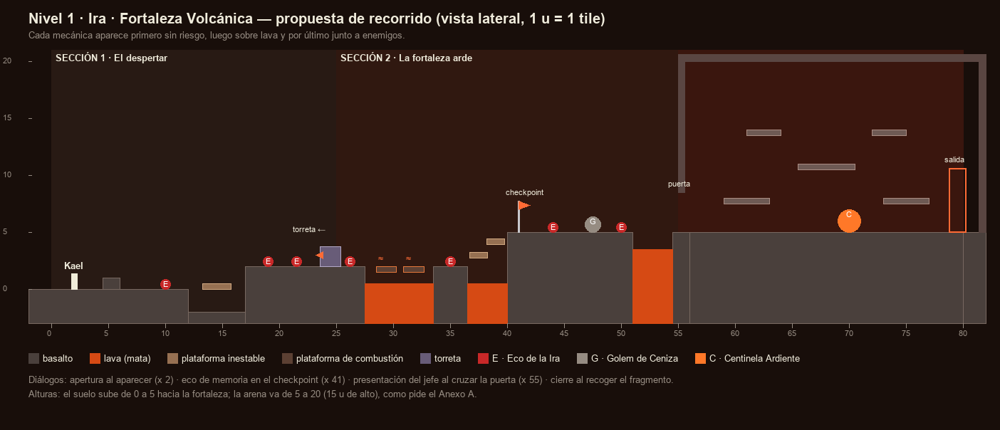

# Nivel 1 · Ira · Fortaleza Volcánica — propuesta de recorrido

> **Estado:** propuesta para PENDIENTES N10. Todavía no está montada en la escena. Si te parece
> bien, la monto con `PreparadorNivel`. Conservo lo que pusiste a mano: los Ecos a la escala que
> dejaste (1,8 × 1,5).

*El esquema se regenera con `python Herramientas/esquema_nivel1.py`. Es un dibujo de diseño, a
escala (1 u = 1 tile), no una captura del juego.*

---

## 1. La idea: la Ira empuja, el nivel enseña a contenerla

El Anexo A resume el mundo así: «La ira no controlada destruye el entorno y al que la porta». El
nivel lo convierte en una regla de juego:

- **Todo invita a correr:**
  - las plataformas inestables se rompen si te quedas;
  - la lava mata;
  - los Ecos atacan rápido.
- **Correr sin mirar castiga:**
  - la plataforma de combustión quema justo cuando llegas con prisa;
  - la bola de la torreta te alcanza si saltas a destiempo;
  - el Golem no se interrumpe con golpes (hiperarmadura): cambiarle golpe por golpe es perder;
  - la Centinela solo se puede castigar cuando su espada queda clavada.
- **Ganar es esperar el momento y soltar el golpe entonces.** La recompensa del mundo dice lo mismo
  con una mecánica: el **Ataque Cargado** se mantiene y se suelta cuando uno decide. La ira no
  desaparece: se canaliza.

Esto responde a la primera observación de los evaluadores («profundizar en el diseño conceptual de
los niveles»): cada decisión del recorrido sale de la emoción, no del gusto.

## 2. Cómo enseña: tres tiempos por mecánica

Cada peligro aparece tres veces, y cada vez cuesta más:

1. **Primero, sin riesgo.** Si fallas, solo pierdes tiempo.
2. **Después, sobre lava.** Si fallas, mueres y vuelves al checkpoint.
3. **Por último, junto a enemigos.** Hay que pensar dos cosas a la vez.

No hay carteles de tutorial. El nivel enseña con su forma, como pide el Anexo A («tutorial
implícito»).

## 3. El recorrido, tramo a tramo

Medidas en unidades de Unity (1 u = 1 tile). El suelo sube de y 0 a y 5 hacia la fortaleza. La
arena va de y 5 a y 20: 15 u de alto y nada por encima de 20, como pide el Anexo A.

| Tramo | x | Suelo | Qué hay | Qué aprende o siente el jugador |
|---|---|---|---|---|
| **Inicio** | 0–6 | y 0 | Kael aparece en x 2. Hay un escalón de 1 u en x 4,5. | **Apertura:** Kael habla al aparecer. Primer salto, sin peligro. |
| **Primer Eco** | 6–12 | y 0 | Un Eco de la Ira en x 10, en llano. | A atacar: el Eco va a por ti y no hay nada más en pantalla. |
| **El foso** | 12–17 | y −2 | Un foso de 5 u, de solo 2 u de hondo, con una plataforma inestable en medio (x 14,5). | Que la plataforma se rompe. Si caes, sales con doble salto o por la izquierda. Asusta, pero no mata. |
| **La terraza** | 17–27,5 | y 2 | Ecos en x 19 y x 21,5. La torreta en x 24, en el suelo y mirando a la izquierda. | Saltar la bola mientras peleas. La torreta dispara a la altura de Kael. Al final se salta por encima de su bloque. |
| **Guardia del lago** | 26–27,5 | y 2 | Un Eco en x 26,2, en el borde del primer lago de lava. | Lo cerca que estás de la lava al pelear. |
| **Lago de combustión** | 27,5–33,5 | lava | Dos plataformas de combustión (x 29,4 y x 31,8) sobre lava. | **Esperar:** cruzar con prisa quema. Hay que mirar las brasas y saltar cuando se apagan. |
| **La isla** | 33,5–36,5 | y 2 | Un Eco en x 35. | Pelear en poco sitio. |
| **La subida** | 36,5–40 | lava | Plataformas inestables escalonadas (x 37,5, y 3,2; x 39, y 4,4). | Lo del foso, ahora sobre lava. No pararse. |
| **Checkpoint** | 41 | y 5 | Bandera, sin enemigos cerca. | **Eco de memoria** (cuando haya memorias, Fase 10). Respiro. |
| **El patio del Golem** | 40–51 | y 5 | Un Eco en x 44, el Golem de Ceniza en x 47,5 y otro Eco en x 50. | El Golem no se frena a golpes. Hay que leer su A1 (medio segundo), saltar su onda y castigar después. |
| **El salto a la puerta** | 51–54,5 | lava | Un hueco de 3,5 u de lava. | El último salto antes del jefe. Se cruza con un salto normal; con el dash sobra. |
| **La arena** | 55–80 | y 5 | Sala cerrada de 25 × 15 u. Plataformas a tres alturas: y 8 (x 61 y x 75), y 11 (x 68), y 14 (x 62,5 y x 73,5). La Centinela en x 70. Salida en x 79,5. | La **presentación** al cruzar la puerta. Las plataformas sirven para esquivar el salto aplastante y las ondas. Sus erupciones obligan a bajar. |

**Recuento frente al Anexo A:**

| | Anexo A | Propuesta |
|---|---|---|
| Sección 1 | 3 soldados de lava y 1 torreta | 3 Ecos de la Ira y 1 torreta |
| Sección 2 | 4 soldados, el Golem y checkpoint en x 40 | 4 Ecos, el Golem y checkpoint en x 41 |
| Arena | 3 alturas de plataformas | 3 alturas de plataformas |

## 4. Medidas de Kael, para que todo se pueda cruzar

Estos valores salen de `ParametrosJugador`:

- **Salto:** sube unas 2,45 u.
- **Doble salto:** suma 1,7 u, unas 4,2 en total.
- **Distancia de un salto corriendo:** unas 4,4 u.
- **Dash:** unas 3 u más.

El hueco más largo del nivel mide 3,5 u (el salto a la puerta) y se cruza sin dash. Ninguna
plataforma pide más de 3 u de subida de una vez, ni siquiera las de la arena (de y 5 a y 8 y de
y 11 a y 14).

## 5. Dónde suena cada diálogo

| Momento | Dónde | Estado |
|---|---|---|
| Apertura | al aparecer (x 2) | ✔ ya funciona; falta el texto (N11) |
| Eco de memoria | en el checkpoint (x 41) | Llega con las memorias (Fase 10) |
| Antes del jefe | al cruzar la puerta (x 55) | ✔ la presentación «El que ya estaba aquí» |
| Derrota del jefe | cuando la Centinela termina de caer | ✔ los planos `CinematicaFinalLvl1` y `Lvl2` |
| Cierre | al recoger el fragmento, antes del fin de nivel | ✔ ya funciona; falta el texto (N11) |

## 6. Lo que no cuadra en el Anexo A (decide tú)

1. **El tamaño de la arena.** El Anexo A la describe como «sala cerrada de 60 u × 15 u», pero también dice
   que va de x 55 a x 80, es decir, 25 u. Propongo **25 × 15**: es lo que da el tramo y lo que ya
   usa la arena de hoy (27 u).
2. **«Lava en el suelo» de la arena.** La Centinela pelea en el suelo (espadazo, onda y salto). Con
   lava en el suelo, la Centinela caería en ella o sus ondas se cortarían. Propongo **suelo firme**
   y dejar la lava en las **erupciones de las plataformas**, que ya existen. Si quieres lava en la
   sala, iría solo detrás de la puerta y de la salida, donde no se pelea.
3. **El checkpoint en x 41 y no en x 40.** Lo corro una unidad para que la bandera no quede sobre la
   última plataforma inestable. Sigue antes del Golem, como pide el Anexo A.

## 7. Cómo lo montaría

Al decirme que sí, lo haría en este orden:

1. **Un paso nuevo en `PreparadorNivel`** con la tabla de tramos de arriba. Borra el «Provisional»
   y coloca el suelo, la lava, las plataformas, los enemigos, el checkpoint, la arena y la salida.
   Los Ecos van a la escala que dejaste a mano.
2. **`PintorEscenario`** viste los bloques con el tileset del Mundo 1, como ahora.
3. **Una prueba** que lee la tabla y comprueba que ningún hueco ni ninguna subida pasa de lo que
   Kael alcanza. Otra que recorre el nivel con los sistemas reales hasta la arena.
4. **Capturas** del nivel montado, para que lo revises antes de jugarlo.
