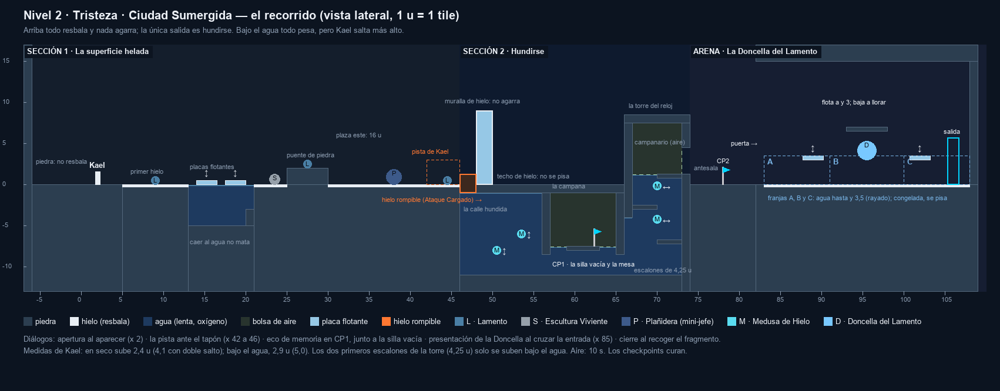
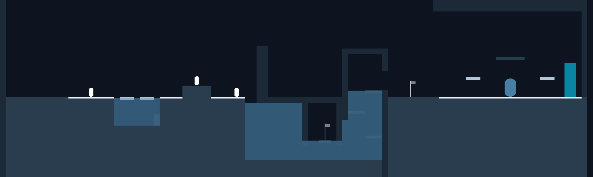
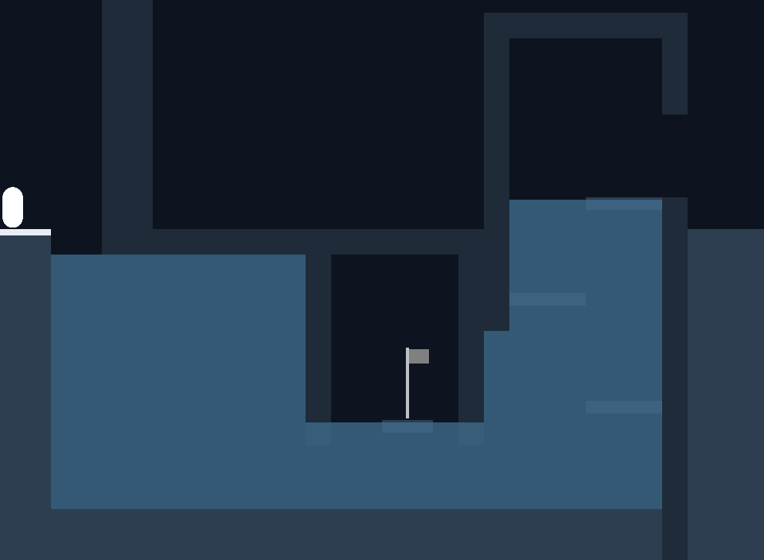
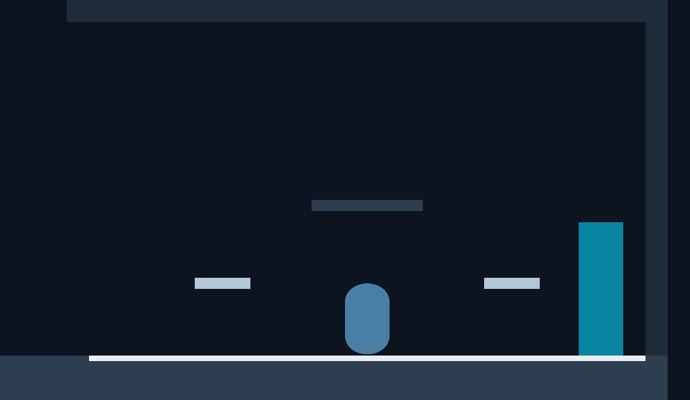

# Nivel 2 · Tristeza · Ciudad Sumergida: el recorrido

> **Estado:** aprobado el 2026-10-08, con todas las decisiones de la sección 9. **Fases A a F
> montadas** en `Assets/Scenes/Nivel2.unity`: el recorrido con sus bloques, el
> agua y el hielo, los Lamentos, los dos checkpoints, la salida y la arena (A); el tapón de hielo
> rompible, las placas que flotan, el oxígeno, los ecos de intentos, el eco de memoria y el velo
> submarino (B); el pesar del Lamento, la Escultura dormida, las Medusas y la Plañidera, el
> mini-jefe, en el sitio de la segunda Escultura (C); y la Doncella del Lamento con sus olas, su
> inundación, su hielo y su llanto (D); todo su arte, con el fondo y el tileset (E); y las
> cinemáticas de la Doncella (F). **El autor lo jugó el 2026-10-12** y pidió los cambios de «Lo
> que cambió tras la prueba del autor» (sección 3): el recorrido es 13 u más largo. Falta el
> sonido. Los números de
> abajo son los de `Assets/Scripts/Editor/DisenoNivel2.cs`, que monta `PreparadorNivel` y
> comprueban las pruebas (`DisenoNivel2Tests`, `EscenaNivel2Tests`, `Nivel2PlayModeTests`). Si
> cambias el recorrido, cámbialo allí y sube su `Version`: la escena se vuelve a montar entera.
> Los prompts de todas las imágenes están en `Prompts_Mundo2.md`.

*El esquema se regenera con `python Herramientas/esquema_nivel2.py`. Es un dibujo de diseño, a
escala (1 u = 1 tile), no una captura del juego. Dibuja también lo que solo aparece durante el
combate: las tres franjas que inunda la Doncella.*

---

## 1. La idea: la Tristeza congela, el nivel enseña a sentirla

El Anexo A resume el mundo así: «La tristeza requiere ser sentida, no suprimida». El guion lo
dice con un gesto: **dejarse hundir y seguir avanzando**. Y Kael lo cierra con «La Tristeza pesa,
pero también sostiene». El nivel convierte esas tres frases en reglas de juego, en tres tiempos:

1. **Suprimir: la superficie helada.** El hielo es la tristeza congelada, el «estoy bien». En él
   todo resbala y nada agarra. Si corres, acabas en el agua; si caminas (Alt), tienes el control.
   Los Lamentos se pegan y te vuelven pesado. Y la superficie no lleva a ningún sitio: termina en
   una muralla de hielo liso que no se puede subir, ni con el salto de pared.
2. **Sentir: hundirse.** La única salida es romper el hielo y dejarse caer. El hielo solo cede al
   **Ataque Cargado**, la ira que Kael aprendió a contener en el mundo anterior. La grieta brilla
   en naranja, el único color cálido del mundo. Abajo todo es lento y oscuro, y falta el aire.
   Pero **el agua sostiene**: bajo el agua Kael salta más alto, y la torre que lleva a la salida
   solo se puede subir así.
3. **Atravesar: la arena.** La Doncella del Lamento inunda la arena. Solo se la puede herir
   cuando llora, y en la segunda fase llora sobre el agua: el agua que te frena es la que te deja
   saltar hasta ella.

Dos piezas más refuerzan el tema:

- **Respirar.** Las bolsas de aire son pausas. El oxígeno da prisa, pero el nivel pone aire a
  menudo: no castiga ir despacio, castiga quedarse pataleando sin rumbo. Y cuando se acaba, Kael
  no muere de golpe: se va apagando, como la tristeza que no se atiende.
- **Los ecos de intentos** (Anexo A). Al reaparecer tras una muerte, una sombra de Kael repite
  durante 8 s el intento que salió mal. No daña ni ayuda: es la rumiación, verse repetir lo que
  dolió.

Esto responde a dos observaciones de los evaluadores. La primera pedía profundizar en el diseño
conceptual de los niveles: cada pieza sale de la emoción. La quinta preguntaba qué estrategias de
juego sirven al autoconocimiento: aquí la estrategia que funciona es aceptar y atravesar, y la
que falla es suprimir y correr.

## 2. Las mecánicas del mundo

Medidas con los parámetros reales de Kael (`ParametrosJugador`).

| Mecánica | Qué hace | En el código |
|---|---|---|
| **Hielo** | Kael tarda 0,57 s en arrancar y 0,5 s en frenar. A toda velocidad resbala 1,5 u; caminando (Alt), solo 0,2 u. | ✔ Una franja de 0,5 u con `ZonaModificadorMovimiento` (hielo: aceleración ×0,15) sobre cada suelo de hielo y sobre cada placa. |
| **Agua** | Velocidad ×0,6, gravedad ×0,3 y salto ×0,6, como dice el Anexo. Resultado: va más lento (3,6 u/s) y cae despacio (máx. 5,4 u/s), pero salta **más alto**: 2,9 u (en seco, 2,4) y 5,0 con doble salto (en seco, 4,1). Se ve menos: los bordes de la pantalla se oscurecen en azul. | ✔ Zonas de `ZonaModificadorMovimiento` (agua), con un velo translúcido por delante de Kael; el dash ya se bloqueaba bajo el agua sin el Dash Acuático. La visibilidad reducida es un velo del HUD (`IndicadorAgua`), la viñeta de la interfaz en azul, en lugar de un volumen de post-procesado de URP: hace lo mismo sin un perfil más que mantener. |
| **Oxígeno** | **10 s** bajo el agua (eran 15 hasta el 2026-10-12: al probarlo sobraba). Se recarga en las bolsas de aire y al salir del agua (lleno en 1 s). **Si se acaba, Kael pierde un corazón cada 2 s**, sin empujón, hasta que respira o muere (con 5 corazones, 10 s más). Mientras tanto, la barra de aire del HUD parpadea en rojo. *Decidido el 2026-10-08.* | ✔ `OxigenoJugador` en el prefab de Kael, con su cuenta en `ReservaOxigeno`. Quita vida con `Health.PerderVida`, que no es un golpe: sin retroceso, sin i-frames y sin escudo. La barra de aire está en `IndicadorAgua`, bajo la de vida, y aparece al meterse en el agua. |
| **Bolsas de aire** | Huecos sin agua bajo un techo: la campana hundida y el campanario. | ✔ Son la ausencia de agua. Falta la columna de burbujas que las señale (arte, A6). |
| **Placas flotantes** | Placas de hielo de 2,5 u que suben y bajan 0,5 u en un seno de 3 s, a la contra dos a dos. Resbalan como el hielo. | ✔ `PlataformaFlotante`, un cuerpo cinemático: al subir empuja a Kael y al bajar (como mucho a 1 u/s) Kael la sigue por su peso. Su franja de hielo es un hijo y se mueve con ella. |
| **Hielo rompible** | Un tapón que llena el agujero y asoma 1,25 u sobre la plaza. Un golpe normal solo lo agrieta. El Ataque Cargado lo rompe y deja el hueco abierto. **Al llegar ante él, Kael lo dice** («Este hielo no cede a un golpe cualquiera. Hace falta el Ataque Cargado: contener el golpe… y soltarlo.»), y otra vez si lo agrieta sin haberlo oído. *No está en el Anexo A; aprobado el 2026-10-08. La pista, pedida el 2026-10-12.* | ✔ `HieloRompible`. La espada solo golpea la capa Enemy, así que el tapón lleva una zona de golpe en esa capa, que no choca con Kael. La pista es una `ZonaDeDialogo` delante de él, con el momento «pista» de los diálogos del nivel. |
| **Ecos de intentos** | Graba los últimos 8 s de Kael (posición, fotograma y hacia dónde mira). Al morir guarda ese intento, y al reaparecer lo repite con una sombra translúcida que después se desvanece. | ✔ `EcoDeIntentos` (el `EchoRecorder` del Anexo), con un búfer circular (`GrabacionIntento`). No necesita arte: usa los fotogramas de Kael. |
| **Eco de memoria** | Kael dice su línea de memoria la primera vez que toca el checkpoint («Alguien deja una silla vacía en la mesa…»). | ✔ `Checkpoint.ecoDeMemoria`, en el primer checkpoint de cada nivel; lo dice el `LevelManager`. Suena también en el Nivel 1 («Una voz grita órdenes…»). |
| **Checkpoints que curan** | Cada vez que Kael toca un checkpoint recupera toda la vida, también si ya estaba activo. En este mundo importa: el aire que falta se paga en corazones, y la bandera de la campana los devuelve. *Pedido el 2026-10-12, para todos los niveles.* | ✔ `Checkpoint.cura`, activado por defecto: vale también para el Nivel 1. |
| **Hielo liso** | La muralla que cierra la plaza es de hielo: se choca con ella, pero Kael ni se desliza por ella ni salta desde ella. *Pedido el 2026-10-12: con el salto de pared se subía y se saltaba medio nivel.* | ✔ `SinAgarre`, una marca en la pared que `PlayerSensors` se salta al buscar dónde agarrarse. |

**El Dash Acuático se gana aquí, no se usa aquí.** En este mundo el dash no funciona bajo el
agua, y así ya está programado. El agua se aprende sin atajos; la habilidad se estrena en el
Jardín (mundo 5), en su zona acuática.

## 3. El recorrido, tramo a tramo

Medidas en unidades de Unity (1 u = 1 tile). La superficie está a y 0; el fondo del agua, a
y −11; el techo de la arena, a y 15. **Cada agua llega casi a la altura de lo que se pisa al
salir de ella**, 0,1 u por debajo: al cruzar la superficie la gravedad vuelve a ser la de fuera y
el salto se queda corto, así que ninguna subida acaba muy por encima del agua de la que sale. Y
esa décima hace que, de pie en el borde, Kael ya esté en seco.

| Tramo | x | Suelo | Qué hay | Qué aprende o siente el jugador |
|---|---|---|---|---|
| **Inicio** | −6 a 5 | piedra, y 0 | Kael aparece en x 2. | **Apertura:** Kael habla al aparecer. La piedra seca es el único suelo que agarra hasta el puente. |
| **El primer hielo** | 5 a 13 | hielo, y 0 | Un Lamento en x 9 (patrulla de 7 a 11). | A resbalar: pelear sin poder frenar. Si el Lamento te alcanza, te vuelve pesado 2 s. |
| **Las placas** | 13 a 21 | agua hasta y −0,1 | Dos placas (x 15,25 y x 18,75) que suben de y 0 a y 1, a la contra. Debajo, 5 u de agua y un escalón (x 20 a 21, y −3) para salir. | Si llegas corriendo, resbalas al agua; si caminas, te quedas encima. **Caer no mata:** es el primer contacto con el agua, sin riesgo. |
| **La plaza helada** | 21 a 46 | hielo, y 0; puente de piedra (x 25 a 30, y 2) | Una Escultura en x 23,5. Lamentos en x 27,5 (en el puente) y x 44,5. **La Plañidera**, el mini-jefe, en x 38 (flota de x 36 a x 40), en mitad de la plaza este, que mide 16 u. | Lo que parecía decorado despierta. En el puente se pelea bien; en el hielo, no. Y la plaza este tiene guardiana: hay que esperar a que baje la guardia. |
| **La muralla** | 46 a 50 | — | Al final de la plaza, el agujero (x 46 a 48) tapado por el hielo rompible, que asoma 1,25 u, y justo detrás una muralla de 9 u, **de hielo liso: no agarra**. En las 4 u de delante (x 42 a 46), Kael dice cómo se rompe el tapón. El techo de hielo sigue más allá, pero no se pisa. | Por arriba no hay salida, ni con el salto de pared. El golpe contenido de la Ira abre el camino. |
| **Hundirse** | 46 a 56 | agua; fondo en y −11 | Se cae 11 u, despacio. La calle hundida, con dos Medusas que suben y bajan (x 50,5 y x 53,5). | Todo pesa y se ve poco. Aparece la burbuja del oxígeno. Esperar el hueco entre las medusas. |
| **La campana** | 56 a 66 | campana colgada del techo | Sus paredes bajan hasta y −8,5: se pasa por debajo, de pie. Dentro (8 u), el agua llega a y −7,5 y por encima queda el aire. Se sube a la repisa seca (x 59 a 63) con un doble salto bajo el agua de 3,5 u, por el hueco del oeste o por el del este, que miden 2 u. | **CP1** (x 62,4), pasadas la silla vacía y la mesa, y **eco de memoria.** Respirar, y curarse. |
| **La torre del reloj** | 66 a 74 | agua hasta y 1,25 | Se entra por debajo de su pared (abierta hasta y −4). Tres rellanos: y −6,75, y −2,5 e y 1,25, a ras del agua. Dos Medusas cruzan de lado a lado cada 5 s, a la contra (y −4 e y 0,1). | **El agua sostiene:** los dos primeros escalones (4,25 u) no se suben en seco (4,1) y bajo el agua sí (5,0). El último (3,75 u) sale del agua. |
| **El campanario** | 67 a 73, y 1,25 a 7,5 | aire | Las campanas y una ventana a la derecha (y 1,25 a 4,5). | Salir del agua andando. |
| **La antesala** | 74 a 82 | piedra, y 0 | **CP2** en x 78. | Respiro antes del jefe: la bandera cura. |
| **La arena** | 82 a 109 | hielo, y 0 | Sala de 25 × 15 u (interior de x 83 a 108), como la del Nivel 1. Placas en x 89 y x 102 (y 3,5) y balcón fijo (x 93 a 98, y 7), que nunca se inunda. La Doncella en x 95,5. Entrada en x 85; salida en x 106. El suelo se parte en tres franjas que ella inunda: A (x 83 a 91), B (91 a 100) y C (100 a 108). | La **presentación** al cruzar la entrada. El suelo resbala. Su agua frena, y su hielo es adonde hay que subirse para herirla. |

**Recuento frente al Anexo A:**

| | Anexo A | Montado |
|---|---|---|
| Sección 1 | 0–30 u: sobre el hielo, resbalamiento y plataformas flotantes; 3 Lamentos y 2 Esculturas Vivientes | −6 a 46 u: lo mismo, salvo que la segunda Escultura es ahora la Plañidera, el mini-jefe, con una plaza de 16 u para ella |
| Sección 2 | 30–60 u: bajo el agua, visibilidad reducida, 4 Medusas de Hielo, el melee es poco efectivo | 46 a 74 u: lo mismo |
| Arena | 60–90 u: superficie helada sobre agua, suelo resbaladizo | 82 a 109 u: 25 × 15 u con suelo de hielo |
| Longitud | ~90 u | ~115 u: la antesala del CP2 añade 8; la plaza de la Plañidera, 10; y la campana, 3 |
| Checkpoints | no dice | dos: CP1 en la campana y CP2 en la antesala |

### Lo que cambió al montarlo

- **La casa es una campana.** La casa sobre pilotes del esquema mezclaba agua y aire sin pared
  entre ellos. Ahora es una campana colgada del techo de hielo, que guarda el aire debajo como una
  campana de buzo. No tiene suelo: se entra por debajo.
- **Las subidas que salen del agua son más bajas.** Al cruzar la superficie, la gravedad vuelve a
  ser la de fuera y lo que queda del salto sube poco: a una subida de 4 u que sale del agua, Kael
  llegaba con 0,3 u de sobra. La repisa de la campana (3,5 u) y el último rellano de la torre
  (3,75 u) dejan al menos 0,29 u por encima del borde, y las pruebas exigen 0,25.
- **Los escalones de la torre miden 4,25 u**, no 4,5: con el margen de las pruebas (el 90 % de lo
  que salta Kael), 4,5 no llegaba bajo el agua. Siguen sin poder subirse en seco.
- **El agua de las placas llega casi al hielo** (y −0,1). Las placas flotan a ras de ella, y salir
  del agua es subir hasta su superficie.
- **Ninguna superficie está a ras de lo que se pisa**, sino 0,1 u por debajo. A ras, la física
  cuenta como solapados dos cuerpos que solo se tocan, y Kael andaría frenado en la repisa o en el
  último rellano, como si siguiera en el agua.
- **Todo lo de la sección 2 se corrió media unidad** para que los bordes caigan en unidades
  enteras, como en el Nivel 1.
- **La cámara baja hasta y −13** (en el Nivel 1, −6) y tiene su mismo encuadre (4,85).

### Cómo se ve hoy

Fotos de la escena montada (fase A, bloques de color, sin Kael, **antes de alargar el nivel**: la
plaza este medía 6 u y la campana, 5):

### Lo que cambió en la fase B

- **El hielo rompible es un tapón que asoma.** Una losa a ras del suelo no se podía golpear: la
  espada de Kael golpea de frente, entre 0,25 y 1,55 u sobre sus pies. El tapón llena el hueco y
  asoma 1,25 u, lo bastante para darle y lo justo para subirse encima: no es otra muralla.
- **Las placas del agua suben de y 0 a y 1** (amplitud 0,5, no 0,6). En lo más bajo siguen fuera
  del agua, así que encima de ellas nunca se está mojado; y se cruzan sin esperar el momento,
  con un salto normal. Las de la arena, sí: desde el suelo se alcanzan cuando bajan.
- **La visibilidad reducida es un velo del HUD**, no un volumen de post-procesado.
- **El eco de memoria suena en el primer checkpoint de cada nivel**, también en el de la Ira.

### Lo que cambió en la fase C

- **Las Medusas de la torre se movieron medio metro.** A la altura de la fase A (y −4,75 e
  y −0,4) rozaban la cabeza de Kael, que mide 1,8 u, mientras esperaba en los rellanos: esperar el
  hueco no era seguro. Ahora pasan a y −4 y a y 0,1, con 0,2 u de margen sobre su cabeza y sin
  atravesar las losas. Lo comprueba `DisenoNivel2Tests`.
- **El ritmo de las Medusas:** las de la calle suben y bajan cada 4 s, y las de la torre cruzan
  cada 5 s. Van a la contra dos a dos: cuando una está en un extremo, la otra está en el otro.
- **La Escultura duerme con el controlador apagado.** Así no ve, no se gira ni ataca hasta que
  Kael pasa a 3,5 u. Tarda 1 s en despertar y entonces se enciende el `EnemyController`, que no
  hubo que tocar. Si la golpean dormida, despierta en el acto, y el golpe cuenta.
- **El pesar del Lamento** frena a Kael con su zarpazo y con su cuerpo, como dice el Anexo A
  («reducen velocidad al contacto»). Lo lleva Kael (`Pesadumbre`), así que se le pasa aunque el
  Lamento muera.
- **La Plañidera ocupa el sitio de la segunda Escultura** (x 32), en la plaza este: 6 u de hielo
  entre el puente y el tapón, que es la única salida de la superficie. El nivel se queda con una
  Escultura, no con las dos del Anexo A.
- **La Plañidera ve con línea de visión.** El puente mide 2 u de alto y tapa a Kael mientras
  esté al otro lado: así no lanza esquirlas a quien todavía pelea con la
  Escultura, y el puente sirve de parapeto.
- **Mientras maneja las esquirlas, su `EnemyController` está apagado**, como el de la Escultura
  dormida. Solo las alza cuando lleva 2,5 s persiguiendo a Kael, nunca en mitad de un barrido.
  Si muere así, el controlador se enciende a tiempo de oír la muerte y muere por su camino.

### Lo que cambió en la fase D

- **El agua de la inundación sube hasta y 3,4, no hasta y 4,** y la capa de hielo que deja al
  congelarse se pisa a y 3,5. Con el agua a 4, la capa quedaba a 0,15 u del límite del doble
  salto de Kael (4,15 u): desde el hielo seco no se podía subir de forma fiable, y desde el agua
  de al lado tampoco, porque una inundación de 4 u de fondo solo deja saltar unas 0,08 u más que
  en seco. A 3,5 se sube con el doble salto y con margen (con un salto solo, no), y saliendo del
  agua de la franja vecina. Lo comprueba `DisenoNivel2Tests`.
- **Las franjas miden 8, 9 y 8 u,** no un tercio exacto de la arena: sus bordes caen en unidades
  enteras, como los de los bloques. La A y la C llevan dentro una placa, y la B queda bajo el
  balcón.
- **La Doncella flota con los pies a y 3.** Más arriba no se la vería: con Kael en el suelo, la
  cámara enseña hasta y 6,35, y ella mide 3,2 u. A esa altura pasa entera por debajo del balcón.
- **Las olas nacen en la pared que ella tiene a la espalda** y cruzan la arena entera, pasando
  bajo ella. Si salieran de debajo de ella, como la onda de la Centinela, podrían aparecer
  encima de Kael.
- **Tocarla no hace daño.** Flota a la altura de las placas, que son el refugio contra las olas;
  si su cuerpo hiriera, dejarían de serlo. Hieren sus olas y sus púas.
- **En la fase 2 la ronda es: ola doble, inundación, congelar y llanto.** El llanto va justo
  después de congelar para que la capa de hielo (6 s) siga ahí mientras llora.

### Lo que cambió tras la prueba del autor (2026-10-12)

El autor jugó el nivel entero (PENDIENTES N31). Dio por buenos el hielo, el agua, las placas, la
Escultura, la torre y la Doncella con sus dos fases, y pidió esto:

- **El aire dura 10 s, no 15.** Cada tramo sin aire se hace en unos 8 s sin esperar: con 15
  sobraban 7 y la barra no importaba. Con 10 quedan 2 para esperar a una Medusa; lo que falte se
  paga en corazones, que devuelve el checkpoint de la campana.
- **Kael dice cómo se rompe el tapón.** La grieta naranja lo sugería, pero solo lo entendía
  quien lo había programado. La línea suena al llegar a 4 u del tapón y, si no la ha oído, cuando
  lo agrieta con un golpe normal. No se repite seguida y calla con el tapón roto.
- **La plaza este mide 16 u, no 6.** Era el hueco de la segunda Escultura, que no anda; a la
  Plañidera, que flota, barre y lanza esquirlas, se le quedaba corto. Ahora flota en el centro
  (x 38), con 6 u libres a cada lado. El tercer Lamento sigue junto al tapón.
- **Las esquirlas de la Plañidera son vez y media más grandes** (0,4 × 0,2 u), y su zona de golpe
  crece con ellas (radio 0,18 u).
- **La muralla es de hielo liso y no agarra.** El diseño contaba con que no se salta (9 u), pero
  Kael trepa una pared sola encadenando saltos de pared: subía, andaba por el techo helado y por
  el tejado de la torre y caía en la antesala sin haber bajado al agua. Las demás paredes siguen
  agarrando; la regla se ve: lo que es de hielo no agarra.
- **Los checkpoints curan** toda la vida cada vez que Kael los toca, en todos los niveles.
- **El atrezo** (el autor lo dejó a mi criterio, N36). La estatua de piedra sale en el inicio,
  antes que la Escultura Viviente, y otra vez en la plaza este: la primera enseña que las
  estatuas son decorado y la Escultura lo desmiente. Los faroles marcan los tres sitios donde se
  puede parar (el inicio, el puente y la antesala). La plaza de la Plañidera es una plaza en
  ruinas (rocas y una columna rota). La mesa va junto a la silla vacía del eco de memoria
  («Alguien deja una silla vacía en la mesa»), y para que quepan la silla, la mesa y la bandera
  **la campana es 3 u más ancha** y su repisa mide 4 u, con un hueco de 2 u a cada lado. En la
  calle hundida hay algas, la campana caída, otra columna y rocas; a los lados de la campana del
  campanario, dos cadenas; y los estandartes cuelgan sobre el frente del puente y bajo el balcón
  de la arena. Todo está en `DisenoNivel2.Decorados`: quitar una pieza es borrar su línea.
- **Todo lo que hay del tapón en adelante se corrió 10 u, y de la campana en adelante, 13.** Las
  secciones del `LevelData` (de las que sale lo que enseña la cámara) y la torre del fondo siguen
  al diseño.

### Lo que falta

- **El sonido:** no hay ningún audio en el proyecto.
- **Las puertas:** la salida, la verja de la arena y la bandera del checkpoint son rectángulos
  de color, y el cierre del mundo, tres frases sobre negro. Los prompts de sus imágenes están en
  `Prompts_Puertas.md`.

## 4. Medidas de Kael, para que todo se pueda cruzar

| | En seco | Bajo el agua |
|---|---|---|
| Salto | 2,4 u | 2,9 u |
| Doble salto | 4,1 u | 5,0 u |
| Distancia de un salto corriendo | 4,4 u | 5,6 u (1,6 s en el aire) |
| Velocidad | 6 u/s | 3,6 u/s |

- **Lo más alto del nivel** son los dos primeros escalones de la torre (4,25 u). Están bajo el
  agua a propósito: con el salto en seco no se pueden subir.
- **Al salir del agua**, lo que sobra del salto sube 0,3 veces lo que subiría dentro: por eso las
  subidas que acaban en la superficie son más bajas (sección 3).
- **Oxígeno:** los dos tramos sin aire (del agujero a la campana y de la campana al campanario)
  se hacen en unos 8 s sin esperar. Los 10 s dejan 2 para esperar a una medusa; después quedan
  los corazones, que devuelve el checkpoint.
- `DisenoNivel2Tests` comprueba cada salto en su medio, con los mismos márgenes que el Nivel 1.

## 5. Los enemigos

| Enemigo | Cuántos | Cómo se comporta | Qué enseña | En el código |
|---|---|---|---|---|
| **Lamento** ✔ | 3 | Es el **Eco de la Tristeza**: el mismo cuerpo que el Eco de la Ira, empapado y chorreando agua (el azul de `Referencias/Arte/EnemigosNiveles.jpeg`). Lento y pesado: los datos ya existen (patrulla a 0,8 u/s, persigue a 1,4 u/s y espera 2,5 s en cada punto). Desde la fase E va a la escala de los Ecos del Nivel 1 (1,8 × 1,5) y golpea como ellos: el clip a 1,6× y 0,45 s de descanso. Su zarpazo quita 1 de vida y **pesa**, porque Kael va a la mitad de velocidad durante 2 s. Así se cumple el «reducen velocidad al contacto» del Anexo. | La tristeza se pega si te dejas alcanzar. | `Pesar` en su arma y en su cuerpo, que aplica la `Pesadumbre` de Kael (un modificador de movimiento con tiempo). No toca `EnemyController`. Usará el controlador de animación del Eco. |
| **Escultura Viviente** ✔ | 2 | Parece una estatua más del decorado. Despierta cuando Kael pasa cerca, se gira despacio y descarga un golpe lento y telegrafiado. Tiene hiperarmadura, como el Golem: los golpes no la interrumpen. **No anda** (aprobado el 2026-10-08), y tras golpear tarda en recuperarse: ahí se la castiga. *El Anexo solo la nombra.* | Leer antes de actuar: no todo lo quieto está muerto. | `EnemyController` y `EnemyData` con la hiperarmadura que ya existe; `EsculturaDormida` lo enciende al despertar. El despertar será su clip. Golpe: 1 s de aviso, 2 de daño, y 2,25 s clavada después. |
| **Medusa de Hielo** ✔ | 4 | Flota sobre una línea con un seno: vertical en la calle y horizontal en la torre. Quema al contacto. **No muere** (aprobado): la espada solo la aparta y la encoge 1 s. Es la forma de cumplir «el melee es poco efectivo aquí». | Hay cosas que no se vencen: se atraviesan eligiendo el momento. | Componente propio, `MedusaHielo`, porque no anda ni persigue: un cuerpo cinemático en la capa Enemy (la espada la nota y Kael la atraviesa) con un contacto que quema. Un golpe la aparta 1,5 u y la encoge 1 s. |
| **La Plañidera** (mini-jefe) ✔ | 1 | Es el Golem del Mundo 2: un espectro encapuchado, con los ojos vendados y un arco de esquirlas a la espalda. 10 de vida. Flota hacia Kael a 1,6 u/s. Cuando lleva 2,5 s persiguiéndolo, alza las esquirlas (0,5 s), las apunta (0,8 s: el aviso) y lanza tres, una cada 0,35 s, hacia donde esté Kael; cada una mide 0,4 × 0,2 u (vez y media lo que medía, para verla venir), quita 1 y se deshace contra el suelo o las paredes. Sin ellas llora 2 s, sin atacar ni moverse: ahí se la castiga. Si Kael se le pega, echa el brazo atrás 0,55 s y barre (quita 2). Hiperarmadura, como el Golem; tocarla no hace daño. | Esperar a que baje la guardia: lo mismo que pedirá la Doncella. | `EnemyController` y `EnemyData` con hiperarmadura, como el Golem, para acechar y barrer. `Planidera` lleva las esquirlas: apaga el controlador mientras las maneja y las lanza con el `Proyectil` de la torreta. |

## 6. El jefe: la Doncella del Lamento

**Concepto:** `Referencias/Arte/Jefes/jefe2.jpeg` (y su copia `Jefe2 (2).png` en la v1), la figura
encapuchada azul con esquirlas. Confirmaste que es ella, aunque quizá se rediseñe con un aspecto
más llamativo: el prompt para Google AI Studio está en `Prompts_Mundo2.md`, apartado D.

**Sus datos** (`Assets/Data/Jefes/DoncellaLamento.asset`): 26 de vida y dos fases, la segunda al
50 %. Tocarla no hace daño.

**Cómo pelea** (montado el 2026-10-10, sin arte: una cápsula azul): espera en el hielo y, al
empezar el combate, sube y va de lado a lado con los pies a y 3. **Solo es vulnerable mientras
llora** (aprobado): fuera de esa ventana, los golpes no le hacen nada y destella en blanco
(`inmuneFueraDeVulnerable`). Llorando late en cian y cada golpe vale el doble. Dónde llora cambia
con la fase:

1. **Fase 1:** baja al hielo seco, a 2 u de Kael, por el lado en el que ella estaba. Se la
   alcanza a pie. No baja a una franja con agua.
2. **Fase 2:** llora flotando bajo sobre la franja que acaba de congelar, con los pies 0,2 u por
   encima de la capa de hielo: hay que subirse a la capa, y de pie en ella la espada llega. Si no
   hay nada congelado, llora metida en la franja inundada, con los pies 1 u bajo la superficie:
   de pie en el fondo no se llega, y con un salto bajo el agua, sí. Si tampoco hay agua, baja al
   hielo como en la fase 1.

Cada ronda repite los patrones de su fase en orden y acaba llorando:

| Fase | Patrón | Qué pasa | Cómo se responde |
|---|---|---|---|
| 1 · Olas e inundación: ola, inundación, ola y llanto | **Ola** | Avisa 0,7 s y una ola a ras del hielo (1,2 × 1 u, a 8 u/s) cruza la arena entera desde la pared que ella tiene a la espalda. Quita 1. | Saltarla, o esperarla sobre una placa, el balcón o la capa de hielo. |
| | **Inundación** | Avisa 1 s en la franja donde está Kael (el volumen que va a ocupar el agua late, translúcido). Después el agua sube en 0,5 s hasta y 3,4 y se queda 5 s. No hace daño: es agua (lenta, con salto alto y gasto de oxígeno). | Salir de la franja o quedarse: el agua frena, pero no hiere. |
| | **Llanto** | Baja al hielo (la bajada es el aviso: tarda 1,6 s como mucho) y llora 1,5 s. | Es la ventana, y la única: daño doble, como la espada clavada de la Centinela. |
| 2 · Congelamiento (50 %): ola doble, inundación, congelar y llanto | **Grito** | Al empezar la fase se queda quieta 0,9 s, avisando. | La señal de que el combate cambia, como el rugido de la Centinela. |
| | **Ola doble** | Dos olas seguidas, con 0,8 s entre una y otra. | Dos saltos con ritmo. |
| | **Congelar** | El agua de la inundación se pone blanca 0,8 s y se congela: brotan púas de hielo en todo lo que estaba inundado (quitan 1 durante 0,6 s) y arriba queda 6 s una capa de hielo de 0,5 u, que se pisa a y 3,5 y resbala. | Salir del agua antes de que se congele, y luego subirse a la capa con el doble salto. |
| | **Llanto sobre el agua** | Llora 1,2 s sobre la capa de hielo (o metida en el agua, si no llegó a congelarse). | Subirse a su hielo, o meterse en su agua y saltar. |
| Muerte | — | El agua se va y el hielo se deshace. La cinemática de la derrota (la ciudad emerge un instante) y el fragmento que se recoge llegan con el arte y la narrativa. | **Cierre.** |

**En el código:** `DoncellaLamento` lleva lo que es suyo (volar, saber dónde llorar y las franjas
de su arena). Los ataques son datos, en `Assets/Data/Jefes/Patrones`: `PatronOla`,
`PatronInundacion`, `PatronCongelar` y `PatronLlanto`. Cada franja es una `FranjaInundable`, que
vive por su cuenta: el agua sigue ahí cuando la Doncella corta su ataque para llorar.
`VerificadorDoncella` comprueba, al regenerar, que cada fase tiene su llanto: sin él no habría
ventana y no se la podría vencer.

**Por qué así:** su línea dice «Él cerró los ojos para no llorar, y la ciudad se hundió». Por eso
solo se la vence cuando llora: la tristeza se resuelve sintiéndola. Y en la segunda fase, su
ataque principal, el agua, es lo que permite alcanzarla. Es el «pesa, pero también sostiene» del
cierre, hecho combate.

## 7. Qué hay que implementar, por fases

Como con el Nivel 1: una rama por fase, pruebas en verde, el CHANGELOG y PENDIENTES al día, y
parar si algo no cuadra. **Las fases A a D no necesitan arte:** se hacen con los bloques de color
del recorrido provisional, como el Nivel 1 antes de vestirlo, sin sprites inventados.

| Fase | Qué | Piezas |
|---|---|---|
| **A · Recorrido** | La escena `Nivel2`, montada desde una tabla de medidas | `DisenoNivel2` y `PreparadorNivel` para la Tristeza; `LevelData` con escena y checkpoints; pruebas de alcance con la física del agua y del hielo |
| **B · Mecánicas** | Hielo, agua, oxígeno, placas, hielo rompible, ecos y memoria | `SueloHielo`, `ZonaAgua`, `OxigenoJugador` + HUD + daño por asfixia, `PlataformaFlotante` (y que Kael vaya encima), `HieloRompible`, `EcoDeIntentos`, eco de memoria en el checkpoint, volumen submarino |
| **C · Enemigos** | Lamento, Escultura, Medusa y la Plañidera | `Pesar`, los datos de la Escultura, `MedusaHielo` y la Plañidera con sus esquirlas |
| **D · Jefe** | La Doncella completa, sin arte | Flotar y bajar en `DoncellaLamento`; `PatronOla`, `PatronInundacion`, `PatronLlanto` y `PatronCongelar`; la arena; un verificador |
| **E · Arte** | Vestir lo anterior a medida que llegue | Una sub-fase por paquete (tileset, enemigos, jefe, efectos, fondo), como el Golem y la Centinela |
| **F · Narrativa y sonido** | Presentación, derrota y cierre con planos; música | El sistema de cinemáticas del Nivel 1, sin cambios |

## 8. Las imágenes que necesitamos

### Reglas para todas (lo que funcionó con el Nivel 1)

- **Un PNG por fotograma**, con transparencia o con **fondo magenta plano (#FF00FF)**. Nunca el
  damero gris que imita la transparencia.
- **El mismo lienzo para todos los fotogramas de un personaje**, con la línea de suelo en la misma
  fila. Así el pivote es común, como en el Eco, el Golem y la Centinela.
- **Yo no reescalo ni recorto** (tu regla): dibújalo al tamaño indicado, o dime a qué densidad va.
- **Pixel art de bordes duros** con la paleta del Anexo A: azul profundo `#1E3A5F`, azul hielo
  `#4A7FA5`, gris azulado `#2C3E50` y blanco nieve `#E8EEF4`, más el acento cian del nivel
  (`#00D4FF`). El único naranja del mundo es la grieta del hielo rompible.
- **Los tamaños van en unidades del juego:** 1 u es un tile de 32 px, y Kael mide 1,8 u de pie.

### P1 · El escenario

| # | Imagen | Fotogramas | Tamaño en el juego | Notas |
|---|---|---|---|---|
| 1 | **Tileset de la ciudad sumergida** | una hoja de celdas de 32 px | 1 celda = 1 u | Como `tileset_32.png` del Nivel 1. **Mínimo:** bloque de piedra de 3×3 que encaje sin costuras; remate de hielo (izquierda, centro y derecha) para el borde de arriba de lo que resbala; cornisa fina con sus dos extremos; pared lisa para la muralla y la torre. **Decoración:** farola hundida, columna rota, ventana o arco, estatua de piedra **con la misma silueta que la Escultura dormida**, mesa con una silla vacía, campanas y algas. Los tiles de hielo de la v1 (`IceSet`, `rock_ice`) son de 16 px y de otro estilo: sirven de referencia, no de arte final. |
| 2 | **Superficie del agua** | 3–4 en bucle | franja de 1 u de alto, repetible a lo ancho | El cuerpo del agua puede ser un color plano translúcido (`#1E3A5F`), sin dibujo. |
| 3 | **Placa de hielo flotante** | 1 | 2,5 × 0,8 u | La superficie, plana y en una fila fija; por debajo puede gotear. |
| 4 | **Hielo rompible** | 3, más 2 de esquirlas | 2 × 2,25 u (asoma 1,25) | Un tapón: intacto (con la grieta que brilla en naranja), agrietado y roto. |
| 5 | **Burbujas de una bolsa de aire** | 3–4 en bucle | 0,5 × 1,5 u | La columna que marca dónde se respira. |
| 6 | **Oxígeno en el HUD** | 5 | unos 32 px | Burbuja llena, ¾, ½, ¼ y a punto de romperse. |

### P1 · Los enemigos

| # | Imagen | Fotogramas | Alto en el juego | Notas |
|---|---|---|---|---|
| 7 | **Lamento** | los 12 del Eco de la Ira: Idle 2, Correr 4, Ataque 4, Muerte 2 | como el Eco | Se hace **editando cada fotograma del Eco** hacia su versión de la Tristeza (`EnemigosNiveles.jpeg`). Conserva pose, lienzo y pivote. Al morir se deshace en agua. |
| 8 | **Escultura Viviente** | Estatua 1, Despertar 3, Golpe 5 (alza 2, golpe 1, recuperación 2), Daño 1, Muerte 4 (14; no anda) | ~2,4 u | Un ciudadano de piedra cubierto de hielo. El fotograma «Estatua» tiene que parecerse a la estatua del tileset. |
| 9 | **Medusa de Hielo** | Flotar 4 en bucle, Apartada 2 (6) | ~1 u | Translúcida; la campana se contrae y se expande. No muere: no lleva muerte. |
| 9b | **La Plañidera** (mini-jefe) | Flotar 4, Esquirlas 5, Abrazo 3, Muerte 4 (16), y la esquirla: vuelo 2 y rotura 1 | ~3,5 u, como el Golem | Sale de la imagen de AI Studio del 2026-10-09 (`Mundo2/Planidera/Concepto.png`). No anda ni lleva daño (hiperarmadura). **Recibidos los 16** (2026-10-10); faltan las 3 esquirlas. |

### P1 · El jefe

| # | Imagen | Fotogramas | Tamaño en el juego | Notas |
|---|---|---|---|---|
| 10 | **Doncella del Lamento** | Flotar 4, Ola 4, Inundación 4, Llanto 4 (baja, se arrodilla, llora en bucle con 2, se alza), Congelar 4, Rugido 3, Muerte 5: 28, como los 29 de la Centinela | ~3,2 u de alto | Por Google AI Studio: un diseño nuevo, más llamativo, con los ojos velados (`Prompts_Mundo2.md`, D). |
| 11 | **Ola** | 3: sube, cresta, rompe | ~2,4 × 1,2 u, como la onda de la Centinela | Agua y espuma, con la base en la misma fila. |
| 12 | **Inundación** | aviso 2 (burbujas por las grietas) y superficie 3 en bucle | franja de 8 × 4 u | La superficie puede ser la del agua (#2). |
| 13 | **Púas de hielo** | 5, como la erupción: aviso (escarcha), brota, quieta ×2, se rompe | ~2,5 × 2 u por grupo | Se repiten a lo ancho de la franja. |
| 14 | **Capa congelada** | 3: se forma, se mantiene, se derrite | repetible a lo ancho, 0,5 u de alto | |
| 15 | **Fragmento de la Tristeza** | 1–2 | ~0,6 u | O dentro de la muerte de la Doncella, como el de la Centinela. |

### P2 · El fondo (parallax, como el del Mundo 1)

| # | Imagen | Notas |
|---|---|---|
| 16 | **Cielo helado** (repetible) | Gris azulado, con nieve fina. |
| 17 | **Ciudad lejana congelada** (repetible) | Tejados y torres que asoman del hielo. |
| 18 | **La torre del reloj medio hundida** (una pieza) | Como la fortaleza del Mundo 1: un hito que se ve desde el inicio y al que se llega. |
| 19 | **Fondo submarino** (repetible) | Rayos de luz que bajan desde la superficie. Se funde con el de arriba cuando la cámara baja. |
| 20 | **Ciudad hundida** (repetible) | Fachadas con ventanas oscuras y farolas. |
| 21 | **Primer plano** (repetible, opcional) | Arriba, carámbanos; abajo, algas y burbujas. |

### P2 · Las cinemáticas (se pidieron a 240 × 135 px; salieron a 480 × 268 y así se quedan)

| # | Imagen | Planos | Qué muestran |
|---|---|---|---|
| 22 | **Presentación de la Doncella** | 2 | La ciudad congelada vista desde la arena; la Doncella con las manos en la cara, abriendo los ojos. |
| 23 | **Derrota** | 2 | El hielo se derrite; la ciudad emerge un instante. |
| 24 | **Cierre del mundo** | 0–3 | Opcional: hoy son tres textos. |

### P2 · Kael

| # | Imagen | Fotogramas | Notas |
|---|---|---|---|
| 25 | **Nadar** | 4–6 en bucle, en el lienzo de Kael | Sin él, bajo el agua usaría el clip de correr, más lento. |
| 26 | **Resbalar** | 1–2 | Opcional: al frenar sobre el hielo. |

Siguen pendientes de antes (N3): el daño y el wall slide.

### Lo que no necesita imagen

- **Los ecos de intentos:** los sprites de Kael, semitransparentes.
- **La visibilidad bajo el agua:** post-procesado de URP.
- **El daño por asfixia:** usa los corazones del HUD que ya existen.

### El sonido (no es imagen, pero hace falta)

La música del nivel (~70 BPM: caja de música lenta y distorsionada, piano con mucha
reverberación), el tema de la Doncella y efectos de agua, burbujas y hielo que cruje y se rompe.

### Orden recomendado

1. **El tileset y la superficie del agua (1 y 2):** son la cara del nivel.
2. **La Doncella y sus efectos (10 a 15):** sin ellos el combate se ve con rectángulos.
3. **Los enemigos (7 a 9).**
4. **Las mecánicas que faltan (3 a 6).**
5. **El fondo, las cinemáticas y Kael nadando.**

Nada de esto bloquea las fases A a D: el nivel se puede montar y jugar mientras dibujas.

## 9. Decisiones (respondidas el 2026-10-08)

1. **El hielo se rompe con el Ataque Cargado.** ✔
2. **Las medusas no mueren:** la espada solo las aparta. ✔
3. **La Escultura Viviente,** como la propone la sección 5, y **sin andar.** ✔ El Anexo A solo
   decía «2 Esculturas Vivientes» en la sección 1.
4. **Oxígeno:** 15 s y, al agotarse, Kael pierde un corazón cada 2 s hasta respirar o morir. ✔
   Sustituye al fundido a blanco de la propuesta.
5. **Dos checkpoints**, en el desván y en la antesala. ✔
6. **La Doncella solo es vulnerable cuando llora.** ✔ Dónde llora cambia con la fase (sección 6).
7. **`jefe2.jpeg` es la Doncella** ✔ (D9 resuelto), aunque puede rediseñarse con un aspecto más
   llamativo.
8. **Las imágenes:** la Doncella va por Google AI Studio y todo lo demás por Gemini, salvo Kael,
   que va en Pixelorama. Los prompts están en `Prompts_Mundo2.md`.

**Añadido el 2026-10-09:** la primera figura que dio AI Studio para la Doncella será **el
mini-jefe del Mundo 2, la Plañidera**, como el Golem en el Mundo 1 (sección 5).

**Añadido el 2026-10-10:** la Plañidera va **en la plaza helada, en lugar de la segunda
Escultura** (x 32), y pelea como dice la sección 5. Era la propuesta de PENDIENTES N32; el autor
pidió cerrar la fase C con ella. La Doncella conserva el diseño de `jefe2.jpeg`: sus 28
fotogramas ya están generados.

**Decidido el 2026-10-10, con las imágenes ya completas:**
- **La placa flotante** se importa más pequeña (PPU 66) para que mida las 2,5 u del recorrido.
- **Las cinemáticas del Mundo 2 van a 480 × 268 píxeles de arte**, el doble que las del Nivel 1:
  así salieron las cuatro. La cámara de cinemáticas se ajusta en la fase de narrativa.
- **La cola de la Doncella**, que el lienzo corta por abajo en sus 28 fotogramas, se conserva:
  el juego fundirá en transparente sus últimas filas al integrar el arte.
- **El agua de la inundación sube hasta y 3,4**, no hasta y 4 (sección 3, «Lo que cambió en la
  fase D»). Fue un ajuste al montarlo, no una decisión del autor: está en PENDIENTES N31 para
  que lo pruebe.

**Respondido el 2026-10-12, tras jugarlo** (PENDIENTES N31, N36, N37 y N38):
- **El aire dura 10 s**, no los 15 de la decisión 4.
- **Kael da la pista del tapón**, con una línea que escribí yo (está en `Guion.md`).
- **La plaza de la Plañidera mide 16 u** y **sus esquirlas son más grandes.**
- **La muralla no agarra:** el salto de pared no vale en el hielo liso.
- **Los checkpoints curan**, en todos los niveles.
- **El resto del tileset** lo coloqué yo («decide tú»); los Lamentos y la cinemática de la
  Doncella se quedan como están.

Lo que difiere del Anexo A irá a N19, para corregirlo en la tesis: el hielo rompible, los dos
checkpoints, el oxígeno que quita vida en lugar del fundido a blanco, la Doncella que solo es
vulnerable al llorar, el comportamiento de la Escultura, y la Plañidera, que no está en el Anexo
y deja el nivel con una Escultura en vez de dos. Y, desde el 2026-10-12: el aire dura 10 s y no
15, los checkpoints curan, y el nivel mide unos 115 u (las secciones van de −6 a 46, de 46 a 74 y
de 74 a 109).
