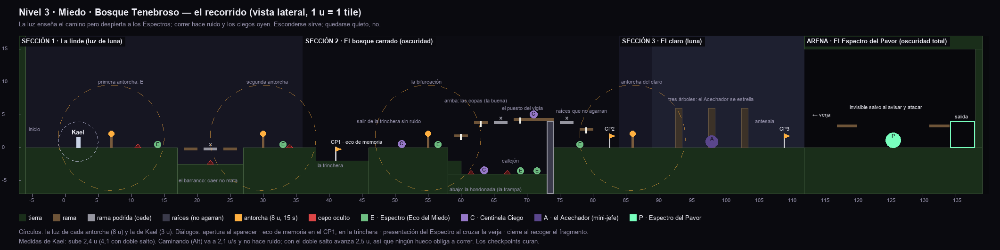
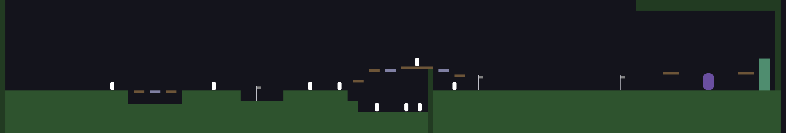
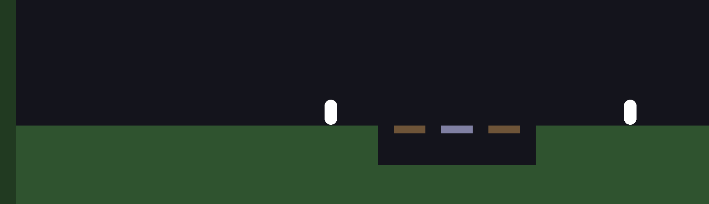
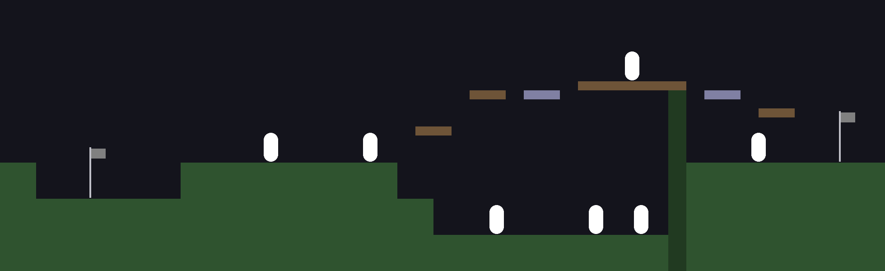
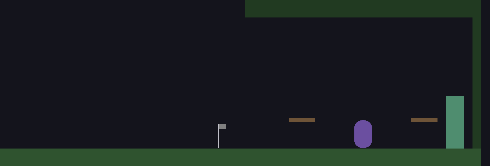

# Nivel 3 · Miedo · Bosque Tenebroso: el recorrido

> **Estado:** aprobado el 2026-10-14, con las nueve decisiones de la sección 9 («haz lo que
> recomiendas»). **Fases A y B montadas** en `Assets/Scenes/Nivel3.unity`:
>
> - **Fase A, el recorrido:** los bloques, las ramas, las raíces del callejón que no agarran, los
>   Espectros y los Centinelas Ciegos con su ruta, los tres checkpoints, la salida y la arena con el
>   Espectro del Pavor.
> - **Fase B, las mecánicas:** la oscuridad por tramos, la luz de Kael, las antorchas (se encienden
>   con E), los cepos, las ramas podridas que ceden, los anillos de ruido y las cintas de la ruta
>   buena.
>
> Los números de abajo son los de `Assets/Scripts/Editor/DisenoNivel3.cs`, que monta
> `PreparadorNivel` y comprueban las pruebas (`DisenoNivel3Tests`, `EscenaNivel3Tests`,
> `MecanicasMiedoTests`, `Nivel3PlayModeTests` y `MecanicasMiedoPlayModeTests`). Si cambias el
> recorrido, cámbialo allí y sube su `Version`: la escena se vuelve a montar entera.
>
> Los prompts de todas las imágenes están en `Prompts_Mundo3.md`: los enemigos y el jefe (primera
> tanda) y el escenario, las mecánicas, el fondo, las cinemáticas y las puertas (segunda tanda).

*El esquema se regenera con `python Herramientas/esquema_nivel3.py`. Es un dibujo de diseño, a
escala (1 u = 1 tile), no una captura del juego. Dibuja también lo que todavía no está en la escena
(el Acechador y sus árboles). Los círculos son la luz de cada antorcha (8 u) y la de Kael (3 u); las
rayas blancas de las copas, las cintas.*

---

## 1. La idea: el miedo paraliza; el nivel enseña a avanzar a oscuras

El Anexo A resume el mundo así: «El miedo paraliza cuando se enfrenta en la oscuridad». El guion
lo dice con un gesto, **ocultarse sin perderse**, y Kael lo cierra con «El Miedo no se fue: dejó
de decidir por mí. Puedo andar en la sombra sin perderme en ella». El eco de memoria («Una
trinchera. Un silencio demasiado largo. Él se quedó quieto para que no lo encontraran») y la
línea del jefe («Él aprendió a desaparecer para seguir vivo. Yo soy todo lo que dejó escondido»)
dan la otra mitad: el soldado sobrevivió escondiéndose. El nivel convierte eso en reglas de
juego, en tres tiempos:

1. **Huir: la linde.** El miedo pide correr, y correr sale caro. Hace ruido, y en la oscuridad
   las trampas solo se ven a 1 u: corriendo no da tiempo a pararse. La luz lo enseña todo, pero
   **despierta lo que dormía**: cada antorcha es una decisión.
2. **Esconderse: el bosque cerrado.** Oscuridad completa. Los Centinelas Ciegos oyen y caminar
   despacio (Alt) es silencioso: esconderse funciona. Pero no basta. Los Espectros cazan en la
   oscuridad, y el bosque es un laberinto: el camino que parece fácil acaba en un callejón. Quien
   solo se esconde se pierde; hay que elegir cuándo encender una luz.
3. **Enfrentar: el claro y la arena.** El Acechador, el mini-jefe, caza por el ruido: para
   vencerlo hay que **hacerse oír a propósito**, delante de un árbol. Y el Espectro del Pavor es
   invisible: se le vence acercándose cuando avisa, no huyendo del aviso. En su segunda fase hay
   tres figuras y la verdadera es la que lleva la luz.

Dos piezas más refuerzan el tema:

- **La trinchera.** El primer checkpoint está dentro de una trinchera, donde suena el eco de
  memoria. Es el único sitio seguro del bosque cerrado: dentro no te oyen, pero quedarse no lleva
  a ningún sitio. Salir de ella en silencio es la primera prueba.
- **La luz de Kael.** Kael lleva su propia luz, de 3 u (Anexo A), que no cuenta como «iluminado»
  para los Espectros: con ella ve dónde pisa, no está a salvo.

Esto responde a dos observaciones de los evaluadores, como el Mundo 2. La primera pedía
profundizar en el diseño conceptual: cada pieza sale de la emoción. La quinta preguntaba qué
estrategias de juego sirven al autoconocimiento: aquí la que funciona es avanzar despacio, decidir
cuándo encender y enfrentar a propósito; las que fallan son correr a ciegas (trampas y ruido) y
quedarse quieto (los Espectros llegan).

## 2. Las mecánicas del mundo

Medidas con los parámetros reales de Kael (`ParametrosJugador`). **Buena parte ya existe desde la
Fase 4**, sin nivel donde usarla; lo marco con ✔.

| Mecánica | Qué hace | En el código |
|---|---|---|
| **Oscuridad** | Cada sección tiene su luz: la linde, luz de luna; el bosque cerrado, oscuridad completa; el claro, luna otra vez; la arena, oscuridad total (Anexo A). La oscuridad no es negro puro: las siluetas del fondo se adivinan contra un cielo violeta muy oscuro, para no perder la orientación. | ✔ Fase B. `LuzDelNivel` lleva la luz global de la escena y la cambia según el tramo en que esté Kael, poco a poco (1,5 s). La activa el `LevelManager` si `LevelData.reglas.oscuridad`: en el Editor la escena sigue con luz. Los valores, en `DisenoNivel3.Luces`. |
| **La luz de Kael** | Un círculo de 3 u de radio alrededor de Kael (Anexo A: intensidad 1,5). | ✔ Fase B. `LuzJugador`: una luz 2D hija de Kael, apagada en el prefab; el `LevelManager` la enciende con `reglas.radioLuzJugador`. Pálida y un poco fría. No se registra en `Iluminacion`. |
| **Antorcha** | Se enciende con **E** (Interactuar) a 1,5 u de ella. Ilumina **8 u durante 15 s** (Anexo A) y parpadea los 3 últimos. Mientras arde se ven las trampas, las ramas podridas y los Espectros, y **los Espectros no se acercan a Kael si está dentro de su luz**. Pero al encenderse **despierta a todos los Espectros dormidos en su radio** (Anexo A): esperan en el borde de la luz y, cuando se apaga, van a por él. **Se enciende una vez por vida**: al reaparecer en un checkpoint vuelve a estar lista. | ✔ Fase B. `Antorcha` (prefab en `Assets/Prefabs/Mecanicas`): se registra en `Iluminacion` mientras arde, su círculo sale de la llama (1,5 u sobre el pie) y anuncia que se encendió (`Antorcha.AlEncenderse`). Despertar a los Espectros con ese aviso es la fase C. E la lee Kael (`InteraccionJugador`), y el HUD pone «E · Encender» sobre la antorcha que tiene al alcance. |
| **Sigilo** | Correr por encima del 60 % de la velocidad (3,6 u/s) hace ruido cada 0,4 s, que se oye a 6 u. **Caminar con Alt (2,1 u/s) o agachado (2 u/s) es silencioso.** El dash también hace ruido. Al correr salen de los pies de Kael unos anillos pálidos: el jugador **ve** que hace ruido (son las «partículas de ruido» del Anexo A). | ✔ `PlayerModoMovimiento` (STEALTH, NORMAL y RUN, como pide el Anexo A), que `GameManager` enciende si `LevelData.reglas.sigilo`; caminar con Alt ✔ (v0.31). ✔ Fase B: los anillos (`AnillosDeRuido`, líneas sin imagen que se ven a oscuras), que crecen hasta donde se oye cada ruido. |
| **Cepo** (trampa oculta) | Un cepo de caza oculto entre las hojas. **Solo se ve a 1 u de Kael** (Anexo A) **o bajo la luz de una antorcha.** Si Kael lo pisa: 1 de daño, **lo sujeta 1 s** (puede atacar, pero no andar ni saltar) y **suena**: el chasquido se oye a 8 u. Después se queda cerrado, inofensivo, hasta reaparecer. Caminando, se ve 0,5 s antes de pisarlo; corriendo, 0,17 s: a oscuras, quien corre cae. | ✔ Fase B. `Cepo` (prefab): no tiene collider, nota a Kael con una caja en el suelo. Su chasquido sale por el mismo canal que la carrera (`PlayerModoMovimiento.HacerRuido`), así que ya lo oyen los Centinelas Ciegos de la Fase 4. Se rearma cuando Kael reaparece tras morir. |
| **Rama podrida** | Las «plataformas que ceden» del Anexo A (`FalsePlatform`). A oscuras es igual que las demás ramas; bajo una antorcha se ve gris y agrietada. Al pisarla cruje 0,3 s y se parte; vuelve a los 4 s. | ✔ Fase B. El prefab `RamaPodrida`: una `PlataformaInestable` con estos tiempos y `RamaPodrida`, que la pinta como las sanas a oscuras, gris bajo una antorcha, y la hace temblar mientras cruje. |
| **La bifurcación** | El laberinto de dos rutas del Anexo A: **arriba, las copas (la buena)**; **abajo, la hondonada (la trampa)**, que acaba en un callejón cubierto de raíces. La buena está marcada con **cintas blancas** atadas a las ramas, que solo se ven con luz (o a 3 u, con la de Kael). Caer de las copas es caer a la hondonada: la trampa es también el castigo de un mal salto. | ✔ La hondonada (fase A). ✔ Las cintas (fase B): cuatro rectángulos blancos que cuelgan de las ramas sanas de las copas, con el material que reacciona a la luz. |
| **Eco de memoria** | En el primer checkpoint, en la trinchera. | ✔ `Checkpoint.ecoDeMemoria` (v0.37). |
| **Checkpoints que curan** | Tres: la trinchera, tras las copas y la antesala. | ✔ `Checkpoint.cura` (v0.44). |

**La Invisibilidad Parcial se gana aquí, no se usa aquí**, como el Dash Acuático en el Mundo 2.
Ya está programada (Q, 3 s, 8 s de espera) ✔ y los enemigos que ven ya la respetan ✔. Se estrena
en el Jardín (mundo 5), en su zona de oscuridad parcial, como dice el Anexo A.

## 3. El recorrido, tramo a tramo

Medidas en unidades de Unity (1 u = 1 tile). El suelo está a y 0. Son una **propuesta**: al
montarlo, las pruebas de alcance ajustarán los números, como pasó con el Nivel 2 («Lo que cambió
al montarlo»).

| Tramo | x | Suelo | Qué hay | Qué aprende o siente el jugador |
|---|---|---|---|---|
| **Inicio** | −6 a 6 | tierra, y 0 | Kael aparece en x 2. Luz de luna. | **Apertura:** «No veo mis propios pasos. Algo respira entre los árboles… o soy yo». |
| **La primera antorcha** | 6 a 17 | tierra | Antorcha en x 7. A su alrededor, un cepo (x 11) y un Espectro dormido (x 14). Sobre la antorcha, «E». | **El tutorial de la antorcha** (Anexo A). Al encenderla aparecen el cepo y el Espectro, que despierta y espera en el borde de la luz. Lo que enseña la luz lo despierta ella misma. |
| **El barranco** | 17 a 27 | hondonada a y −2,5 | Tres ramas cruzan a ras del suelo (huecos de 1 u); **la del medio está podrida**. En el fondo, un cepo (x 22). Se sale con el doble salto, por cualquiera de los dos lados. | Caer no mata, pero duele y retrasa. La rama podrida se delata con luz: en la linde todavía hay luna para adivinarla. |
| **La segunda antorcha** | 27 a 36 | tierra | Antorcha en x 30; un Espectro dormido en x 33 y el tercer cepo (x 34). | Ya se sabe lo que pasa al encender: ahora es una decisión. Se puede pasar a oscuras, con cuidado. |
| **La trinchera** | 38 a 46 | trinchera a y −2 | **CP1** (x 41) y **eco de memoria**. Empieza la oscuridad completa. | Respirar. Dentro de la trinchera no te oyen. |
| **Salir sin ruido** | 46 a 56 | tierra | El primer **Centinela Ciego** patrulla de x 47 a x 55; un Espectro dormido en x 52. | Salir caminando. Si corres, te oye; si te pegas, te nota. O acercarse por la espalda y golpear primero. |
| **La bifurcación** | 55 a 58 | tierra | Antorcha en x 55. El suelo se acaba en x 58. | Encenderla enseña las cintas de las copas, pero despierta al Espectro de x 52 si no lo ha hecho ya. |
| **Arriba: las copas** (la buena) | 59 a 80 | ramas, y 2 a 4,5 | Se sube por dos ramas (y 2 e y 4), cada una a 1 u de la anterior: todo se cruza caminando. **Una rama podrida** sobre la hondonada (x 65 a 67). **El puesto del vigía**, una plataforma de 6 u a y 4,5 (x 68 a 74) con el segundo **Centinela Ciego**, apoyada en las raíces. Pasado el puesto, otra rama podrida que solo asusta: debajo hay suelo. Se baja por una rama a y 3; debajo, un Espectro. | Pasar junto al vigía sin que te oiga, o cazarlo. Las ramas crujen. |
| **Abajo: la hondonada** (la trampa) | 58 a 73 | hondonada a y −4 | Parece el camino: llana y ancha. El tercer **Centinela Ciego**, dos cepos y dos Espectros dormidos. En x 73 **se cierra**: un muro de raíces de 8 u que sostiene el puesto del vigía. Sus raíces **no agarran** (como el hielo liso del Mundo 2: sin eso, el salto de pared sacaba de ahí). Se vuelve por un escalón en x 58 a 60. | El camino fácil era el falso. Cuesta tiempo (y puntos), no la vida. |
| **Tras las copas** | 74 a 84 | tierra | **CP2** en x 82,5. | Respirar otra vez. |
| **La antorcha del claro** | 84 a 89 | tierra | Antorcha en x 86. | Ver al Acechador antes de entrar, a costa de despertarlo. |
| **El claro** | 89 a 106 | tierra | El único sitio sin copas: entra la luna. **El Acechador**, el mini-jefe, merodea entre tres árboles gruesos (x 93, 98 y 103). Kael pasa por delante de los árboles; el Acechador, que embiste a ciegas, se estrella contra ellos. | Se puede cruzar caminando, sin que se entere. O vencerlo: correr delante de un árbol para que embista y se estrelle. |
| **La antesala** | 106 a 112 | tierra | **CP3** en x 109. | El respiro antes del jefe. |
| **La arena** | 112 a 139 | tierra | Sala de 25 × 15 u (interior de x 113 a 138), como las otras dos. **Oscuridad total: solo la luz de Kael** (Anexo A). Dos ramas a y 3,5 (x 117 a 120 y 131 a 134), a 7 u del jefe por cada lado, que se alcanzan con el doble salto. Entrada en x 115; salida en x 136. | La **presentación** al cruzar la verja. |

**Recuento frente al Anexo A:**

| | Anexo A | Propuesta |
|---|---|---|
| Sección 1 | 0–20 u: luz moderada, tutorial de antorchas, 2 Espectros, 3 trampas ocultas | −6 a 36 u: lo mismo |
| Sección 2 | 20–50 u: oscuridad completa, laberinto con 2 rutas, 3 Centinelas Ciegos, 4 Espectros, plataformas que ceden | 36 a 84 u: lo mismo, más la trinchera |
| Sección 3 | no existe | 84 a 112 u: el claro con el Acechador, el mini-jefe (no está en el Anexo) |
| Arena | 50–70 u: oscuridad total, solo la luz del jugador | 112 a 139 u: lo mismo, en 25 × 15 u como las otras arenas |
| Longitud | ~70 u | ~145 u, como los otros dos ya alargados (125 y 139 u) |
| Checkpoints | no dice | tres: la trinchera, tras las copas y la antesala |
| Trampas | «invisibles hasta 1 u» | cinco cepos: tres en la linde (Anexo A) y dos en la hondonada |

**El tiempo con bono** sería de 15 min (en el Nivel 1 son 10 y en el Nivel 2, 13): aquí se camina
mucho. Se ajusta cuando lo juegues.

### Lo que cambió al montarlo (fase A, 2026-10-14)

- **El barranco mide 2,5 u de hondo, no 3, y no tiene escalón.** Con 3 u y un escalón para
  salir, el escalón quedaba bajo una rama: Kael daba con la cabeza al saltar y no salía. A 2,5 u,
  bajo las ramas quedan 2 u libres (Kael mide 1,8) y se sale con el doble salto pegado a
  cualquiera de las dos paredes, donde no hay rama encima. Caer cuesta un doble salto y el cepo.
- **Las ramas de las copas van a 1 u unas de otras**, y la primera está a 1 u del borde de la
  bifurcación, no encima: una rama encima del borde le cortaba el paso a Kael (su cabeza llega a
  1,8 u) y escondía la bajada a la hondonada.
- **El callejón no tiene techo de raíces.** Lo cierran las raíces, que suben hasta el puesto del
  vigía (8 u sobre el fondo, más que el doble salto) y no agarran. Un techo no añadía nada.
- **El puesto del vigía mide 6 u** (de x 68 a 74) y se apoya en las raíces. Las ramas de la
  bajada están a y 4 y a y 3, para que bajo ellas se ande sin tocarlas.
- **Ninguna rama por la que se pase por debajo deja menos de 2 u**, y lo comprueban las pruebas.
- **Las ramas de la arena se corrieron 1 u hacia el centro** (versión 2 del diseño): la de la
  derecha se montaba sobre la puerta de salida. Ahora quedan a 7 u del jefe por cada lado.

### Lo que cambió al montarlo (fase B, 2026-10-14)

- **La luna del claro empieza en x 89**, donde se abre el claro, y no al empezar la sección 3
  (x 84). La antorcha del claro (x 86) queda a oscuras: por eso sirve para ver al Acechador antes
  de entrar. La antesala comparte la luna del claro: es el respiro antes del jefe.
- **Cuánta luz hay en cada tramo lo he decidido yo**, porque el Anexo A solo dice «moderada»,
  «completa» y «total». La linde tiene 0,55; el bosque cerrado, 0,08; el claro y la antesala,
  0,45; y la arena, 0,03. Están en `DisenoNivel3.Luces`: si al jugarlo no se ve lo que debe, se
  cambian ahí.
- **El cepo no empuja: sujeta.** Quita la vida sin retroceso ni invulnerabilidad, como el ahogo
  del Mundo 2: si lo empujara, el golpe lo sacaría del cepo. Mientras lo sujeta, Kael tampoco sale
  con el dash.
- **Una rama podrida se pisa y se salta en seguida.** Caminando se tarda casi 1 s en cruzarla y
  cruje 0,3 s: hay que apoyarse en ella y saltar ya, sin pararse. Las pruebas de los pasos ya
  comprobaban que la siguiente rama se alcanza caminando.
- **«Una vez por vida» es literal.** La antorcha y el cepo vuelven a estar listos cuando Kael
  reaparece **tras morir**; tocar otro checkpoint no los repone.
- **No hay fotos de la oscuridad.** Al renderizarla en segundo plano, Unity dibuja la luz global,
  pero no las luces de Kael ni las de las antorchas. Hay que verla en el Editor, jugando.

### Cómo se ve hoy

Fotos de la escena montada en la fase A: bloques de color y cápsulas, con luz y sin Kael. Así
se ve en el Editor; jugando, la oscuridad de la fase B la cubre. Los bloques están más claros
que la paleta del Anexo A, que es casi negra, para que se lean con la luz de la luna y la de Kael.

## 4. Medidas de Kael, para que todo se pueda cruzar

| | Caminando (Alt) | Corriendo |
|---|---|---|
| Velocidad | 2,1 u/s, en silencio | 6 u/s, con ruido |
| Salto | 2,4 u de alto; avanza ~1,5 u | 2,4 u; avanza 4,4 u |
| Doble salto | 4,1 u de alto; avanza ~2,5 u | 4,1 u; avanza más de 6 u |
| Un cepo aparece a 1 u | 0,5 s para frenar | 0,17 s: no da tiempo |

- **Ningún hueco obliga a correr.** Los de las copas miden 1 u y se cruzan caminando.
  Quien corre llega antes (y, con el doble salto, se puede saltar la rama podrida), pero se oye.
  `DisenoNivel3Tests` comprueba cada salto con la velocidad de caminar.
- **Lo más alto** son las ramas de la arena (3,5 u): solo con el doble salto, como la capa de hielo
  de la Doncella. Las pruebas usarán el mismo margen que en el Nivel 2 (el 90 % de lo que salta
  Kael).
- **La luz de Kael (3 u)** llega a las ramas de y 4 desde el suelo: se ve dónde está la siguiente
  rama, aunque no si está podrida.

## 5. Los enemigos

| Enemigo | Cuántos | Cómo se comporta | Qué enseña | En el código |
|---|---|---|---|---|
| **Espectro** (el Eco del Miedo) | 6 (2 en la linde y 4 en el bosque cerrado, como el Anexo A) | **Es el Eco de este mundo:** el mismo cuerpo que el Eco de la Ira y el Lamento, el verde que se deshace en polvo negro de `Referencias/Arte/EnemigosNiveles.jpeg`. **Duerme** hasta que una antorcha lo despierta, hasta que Kael pasa a 1,5 u o hasta que le pegan. Despierto, **solo se acerca si Kael está a oscuras**: dentro de la luz de una antorcha no se acerca. **Casi invisible:** a oscuras no se ve; dentro de la luz de Kael se adivina una silueta (una cuarta parte de opaco) con su polvo negro; **cuando ataca, sus ojos se encienden y se ve entero**, y también bajo una antorcha. Rápido (persigue a 3,8 u/s) y frágil (2 de vida, quita 1). A la escala de los Ecos (1,8 × 1,5) y con su ritmo de ataque. | El miedo crece en la incertidumbre y se acerca cuando no miras. | ✔ Sus datos (`Espectro.asset`) y su detección (`DeteccionEnOscuridad`) existen desde la Fase 4. Faltan el sueño, la casi invisibilidad y un aviso de ataque más largo: hoy el golpe llega a los 0,2 s, y si solo se ve al atacar, hace falta medio segundo para verlo venir. Usará el controlador de animación del Eco, como el Lamento. |
| **Centinela Ciego** | 3, en el bosque cerrado (Anexo A) | Un **centinela de trinchera con una máscara de gas de cristales ciegos**, abrigo largo y fusil con bayoneta. *El Anexo A solo lo nombra; el aspecto es propuesta mía, por la trinchera del eco de memoria.* Patrulla despacio (1 u/s). **No ve: oye** el ruido de Kael en un cono, hasta 8 u delante y 3 u detrás (el «cono de detección sonora» del Anexo), y el chasquido de un cepo. Al oír se detiene, ladea la cabeza (0,6 s: el aviso), va hacia donde oyó (4 u/s) y lanza una estocada (2 de daño, 1,4 u de alcance). Si en 2 s no encuentra a nadie, vuelve a su ronda. Si Kael lo roza (1,2 u), lo nota aunque no haga ruido. 5 de vida. **La Invisibilidad no sirve contra él**, porque no ve. | El silencio protege. Y acercarse en silencio deja golpear primero. | ✔ Sus datos (`CentinelaCiego.asset`) y su detección por ruido (`DeteccionPorRuido`: recuerda el ruido 2 s y nota el roce a 1,2 u) existen desde la Fase 4. Faltan el cono, el aviso y el ruido del cepo. |
| **El Acechador** (mini-jefe) | 1, en el claro | **No está en el Anexo A**: es el mini-jefe del mundo, como el Golem y la Plañidera. Una **bestia de sombra, como un lobo enorme sin ojos**, que se deshace en polvo negro como los Ecos del Miedo: es lo que «respira entre los árboles» en la línea de apertura. 10 de vida e hiperarmadura, como el Golem. Merodea despacio, olfateando. **Oye como el Centinela, pero más lejos (12 u).** Al oír se agazapa y gruñe (0,7 s: el aviso) y **embiste en línea recta** hacia donde oyó el ruido, a 10 u/s, hasta chocar: **contra un árbol, se queda aturdido 2,5 s y los golpes valen el doble** (como la espada clavada de la Centinela); contra Kael, quita 2; si no choca con nada, frena y vuelve a escuchar. Si Kael se le pega (1,5 u), echa la cabeza atrás (0,5 s) y muerde (quita 1). | **Hacerse oír a propósito.** Es el único sitio del juego donde correr es la estrategia: el miedo se enfrenta, no solo se esquiva. | Por hacer: `EnemyController` y `EnemyData` con hiperarmadura, como el Golem, para merodear y morder; un componente propio (`Acechador`) apaga el controlador mientras embiste o está aturdido, como la Plañidera con sus esquirlas. Los árboles chocan con los enemigos y no con Kael. |

Los puntos que darían (`TablaPuntaje`): el Espectro y el Centinela Ciego, 150 ✔ (ya están); el
Acechador, 700 (entre la Plañidera, 600, y el jefe); el Espectro del Pavor, 2500 ✔.

## 6. El jefe: el Espectro del Pavor

**Concepto:** `Referencias/Arte/Jefes/jefe3.jpeg`. Una figura alta con una armadura de escamas
negras como hojas o plumas, vetas de un verde pálido que brilla, una máscara rajada que brilla
por dentro, una gema blanca en el pecho, hojas negras que flotan a su alrededor y una espada
curva. Funciona tal cual: a oscuras solo se verían sus vetas y su máscara, que es justo lo que
pide el combate. El prompt de AI Studio está en `Prompts_Mundo3.md`, apartado B (con un paso
opcional para pedir tres variantes, como con la Doncella).

**Sus datos** (`Assets/Data/Jefes/EspectroDelPavor.asset`, el esqueleto de la Fase 7) ✔: 22 de
vida y dos fases, la segunda al 50 %. Ya es casi invisible al empezar el combate.

**Cómo pelea.** Casi todo el tiempo es **invisible e intangible**: ningún golpe le alcanza (Anexo
A: «invisible el resto del tiempo»). Se ve, y se le puede golpear, desde que avisa hasta que se
recupera de su ataque. **Cada ataque avisa con 1 s de destello** (Anexo A): se encienden su máscara,
sus vetas y el filo de la espada. En la arena no hay más luz que la de Kael: el destello se ve
desde cualquier sitio.

| Fase | Patrón | Qué pasa | Cómo se responde |
|---|---|---|---|
| 1 · El acecho: tajo, embestida, tajo y hojas | **Tajo** | Aparece a 2,5 u de Kael, a su espalda (o delante, si Kael está contra una pared), avisa 1 s y lanza un tajo de 3 u de alcance (quita 2). Después **se queda 1,5 s jadeando, visible**. | Alejarse del filo durante el aviso y volver a por él: es **la ventana**. |
| | **Embestida** | Aparece junto a una pared, avisa 1 s y cruza la arena a ras de suelo (1,6 u de alto, a 11 u/s). Quita 1. Al otro lado se queda visible 1 s. | Saltarla o esperarla en una rama. |
| | **Hojas** | Alza el brazo y avisa 1 s; en cuatro o cinco franjas el suelo brilla en verde, y en ellas caen hojas negras afiladas. Quitan 1. | Salir de lo que brilla. Como las erupciones de la Centinela. |
| 2 · Las tres sombras (50 %): sombras, hojas, sombras y embestida | **Grito** | Al empezar la fase la oscuridad late y la luz de Kael parpadea 0,9 s. | La señal de que el combate cambia, como el rugido de la Centinela. |
| | **Sombras** | Aparecen **tres figuras** (a la izquierda, en el centro y a la derecha) y lanzan su tajo una tras otra, cada una con su aviso. Después se quedan las tres 1,5 s jadeando. **Solo la verdadera lleva una luciérnaga dorada** que le da vueltas; las sombras, verdes (la «partícula de luz distinta» del Anexo A). Golpear a la verdadera cuenta y deshace a las sombras. **Golpear a una sombra la deshace en hojas y encoge la luz de Kael a la mitad (1,5 u) durante 3 s.** | Seguir la luz. En el miedo, la figura verdadera es la que tiene luz. |
| Muerte | — | **La oscuridad retrocede** (Anexo A): la luz sube en 3 s y el bosque se ve entero por primera vez. Después, la cinemática de la derrota y el fragmento. | **Cierre:** «El bosque no era un laberinto: era un lugar donde nadie había encendido una luz». |

**En el código:** `EspectroDelPavor` llevará lo suyo (aparecer, desvanecerse, ser intangible) y
los ataques serán datos, como los de la Centinela y la Doncella: `PatronTajo`,
`PatronEmbestidaSombra`, `PatronHojas` y `PatronSombras`. Las sombras son figuras sin vida que se
deshacen al golpearlas. Un verificador comprobará, al regenerar, que cada fase tiene su ventana:
sin ella no se le podría vencer.

**Por qué así:** su línea dice «Él aprendió a desaparecer para seguir vivo». Por eso es invisible,
y por eso se le vence **acercándose cuando avisa**: el destello que asusta es el momento de ir a
por él. En la segunda fase el miedo se multiplica en sombras, y la verdadera es la que tiene luz.
Es el «dejó de decidir por mí» del cierre, hecho combate.

## 7. Qué hay que implementar, por fases

Como en el Mundo 2: una rama por fase, pruebas en verde, el CHANGELOG y PENDIENTES al día, y
parar si algo no cuadra. **Las fases A a D no necesitan arte:** se hacen con bloques de color y
cápsulas, sin sprites inventados.

| Fase | Qué | Piezas |
|---|---|---|
| **A · Recorrido** ✔ | La escena `Nivel3`, montada desde una tabla de medidas, todavía con luz | `DisenoNivel3` y `PreparadorNivel` para el Miedo; el `LevelData` con su escena, sus secciones y sus checkpoints; pruebas de alcance (caminando y corriendo) |
| **B · Mecánicas** ✔ | La oscuridad, la luz de Kael, las antorchas, el ruido, los cepos, las ramas podridas y las cintas | Luces 2D por sección y en Kael (`ReglasNivel.oscuridad`); `Antorcha` sobre `ZonaIluminada`; los anillos de ruido; `Cepo`; `RamaPodrida`; las cintas; el eco de memoria en la trinchera |
| **C · Enemigos** | El Espectro, el Centinela Ciego y el Acechador | El sueño y la casi invisibilidad del Espectro; el cono y la estocada del Centinela; `Acechador`, con su embestida y los árboles |
| **D · Jefe** | El Espectro del Pavor completo, sin arte | Aparecer e intangibilidad en `EspectroDelPavor`; `PatronTajo`, `PatronEmbestidaSombra`, `PatronHojas` y `PatronSombras`; la arena a oscuras; un verificador |
| **E · Arte** | Vestir lo anterior a medida que llegue | Una sub-fase por paquete, como en el Mundo 2 |
| **F · Narrativa y sonido** | Presentación, derrota y cierre con planos; las puertas | El sistema de cinemáticas, sin cambios; la puerta, la verja y el checkpoint de este mundo |

## 8. Las imágenes que necesitamos

### Reglas para todas

Las del Mundo 2 (`Prompts_Mundo2.md`, apartado 0), con lo que aprendimos allí:

- **Un PNG por fotograma**, sobre **magenta plano (#FF00FF)**. Nunca el damero gris.
- **Cada pieza tiene una maestra**, y los demás fotogramas se piden **editándola**, adjuntando
  siempre la maestra y nunca el fotograma anterior.
- **Cada maestra tiene todo lo que no puede faltar** (los ojos, el hueco del pecho…), y cada
  prompt lo enumera. Lo que la maestra no tiene, sus ediciones tampoco lo tendrán.
- **Que no cambie el tamaño del píxel ni del lienzo.** Con el ataque del Lamento, Gemini devolvió
  lienzos de 2390 × 1760 y cada fotograma con su píxel. Los prompts ya lo piden expresamente;
  aun así, mira cada imagen antes de pedir la siguiente.
- **Margen alrededor de la figura.** A la Doncella el lienzo le cortaba la cola.
- **Yo no reescalo ni recorto** (tu regla): ajusto el tamaño en el juego con los píxeles por
  unidad.
- **La paleta del Anexo A:** negro profundo `#0A0A0F`, violeta oscuro `#2D1B4E`, verde pantanoso
  `#1A2E1A` y gris espectral `#3A3A4A`, más un verde pálido (`#7FE6B0`) para lo que brilla: las
  vetas del jefe, los ojos de los Espectros al atacar y el aliento del Acechador. **El único color
  cálido del mundo es la luz de las antorchas**: lo cálido es lo que se enciende.

### P1 · Los enemigos (prompts listos: `Prompts_Mundo3.md`, apartado A)

| # | Imagen | Fotogramas | Alto en el juego | Notas |
|---|---|---|---|---|
| 1 | **Espectro** | los 12 del Eco: Idle 2, Correr 4, Ataque 4, Muerte 2 | como el Eco | **Editando cada fotograma del Eco**, como el Lamento. Las bases ya están en `Tesis/Imagenes/Mundo3/Espectro/Bases/`. Al atacar, sus ojos brillan en verde pálido; al morir se deshace en polvo negro. |
| 2 | **Centinela Ciego** | Andar 4, Escuchar 2, Estocada 3 (aviso, estocada, recuperarse), Daño 1, Muerte 3 (13) | ~2,3 u | La máscara de gas con los cristales ciegos tiene que leerse en todos. |
| 3 | **El Acechador** (mini-jefe) | Merodear 4, Escuchar 1, Aviso 2, Embestida 2, Aturdido 2, Mordisco 2, Muerte 4 (17) | ~2,2 u de alto y ~3,6 de largo | Sin ojos, con el aliento verde pálido y la grupa deshaciéndose en polvo. |

### P1 · El jefe (prompts listos: `Prompts_Mundo3.md`, apartados B y C)

| # | Imagen | Fotogramas | Tamaño en el juego | Notas |
|---|---|---|---|---|
| 4 | **Espectro del Pavor** | Reposo 4, Aparecer 4 (desvanecerse es el mismo al revés), Tajo 4, Embestida 3, Hojas 3, Grito 3, Muerte 5 (26) | ~3,4 u, como la Centinela | Por Google AI Studio, desde `jefe3.jpeg`. |
| 5 | **Hoja que cae** | 3: cae, gira, se rompe contra el suelo | ~0,5 u | Editando la maestra del jefe, para que tenga su píxel. |
| 6 | **Aviso de las hojas** | 2 | franja de ~2 u | El suelo que brilla en verde. |
| 7 | **Luciérnaga** | 2 | ~0,25 u | Una sola: el juego la tiñe de dorado (la verdadera) o de verde (las sombras). |
| 8 | **Fragmento del Miedo** | 1 | ~0,6 u | Editando el de la Tristeza, para que los fragmentos casen. |

### Segunda tanda, cuando apruebes el diseño

| # | Imagen | Notas |
|---|---|---|
| 9 | **Tileset del bosque** | Tierra con raíces, ramas (con sus extremos), trinchera con tablones, raíces del callejón. Editando la hoja del Mundo 2 con la misma distribución, como se hizo desde la del Mundo 1. |
| 10 | **Antorcha** | Apagada, encendida (3 en bucle) y consumida. |
| 11 | **Cepo** | Abierto entre hojas, cerrado. |
| 12 | **Rama y rama podrida** | Sana, podrida (se ve con luz) y partiéndose. |
| 13 | **Cinta blanca** | 1–2, atadas a una rama. |
| 14 | **El fondo** | Cielo violeta con luna, árboles lejanos, árboles cercanos, un árbol enorme como hito (como la fortaleza y la torre), niebla y ramas en primer plano. |
| 15 | **Cinemáticas** | Presentación (2 planos) y derrota (2), a 480 × 268 como las del Mundo 2. |
| 16 | **Las puertas** | Puerta de salida, verja de la arena, checkpoint y la cinemática de salida, como las de los otros dos mundos. |
| 17 | **Kael caminando a escondidas** | Opcional, en Pixelorama: hoy, al caminar, usa el clip de correr más despacio. |

### Lo que no necesita imagen

- **La oscuridad y las luces:** son luces 2D.
- **La invisibilidad del Espectro y del jefe:** el juego baja la opacidad.
- **Los anillos de ruido:** se dibujan en el juego, como los corazones del HUD.

### El sonido (no es imagen, pero hace falta)

Casi silencio, roto por ruidos del bosque (Anexo A). Un golpe de cuerdas al encender una antorcha.
El chasquido del cepo. El jefe: percusión irregular y frecuencias bajas.

### Orden recomendado

1. **El Espectro (1):** es el enemigo que más se ve y sale de las bases del Eco.
2. **El Espectro del Pavor y lo suyo (4 a 8):** sin él, el combate son cápsulas.
3. **El Centinela Ciego y el Acechador (2 y 3).**
4. **La segunda tanda.**

Nada de esto bloquea las fases A a D: el nivel se puede montar y jugar mientras dibujas.

## 9. Decisiones (respondidas el 2026-10-14: «haz lo que recomiendas»)

Todas aprobadas tal como las recomendé:

1. **Las antorchas se encienden una vez por vida** y vuelven a estar listas al reaparecer.
   *Recomendado:* si se pudieran volver a encender, quedarse junto a una sería estar a salvo para
   siempre, y encenderla dejaría de ser una decisión.
2. **Los Espectros duermen** hasta que una antorcha los despierta, Kael pasa a 1,5 u o les pega;
   despiertos, solo se acercan a oscuras y solo se ven del todo al atacar. *Recomendado:* si solo
   los despertara la antorcha, no encenderla sería siempre lo mejor.
3. **El cepo** sujeta 1 s, quita 1 y se oye a 8 u, y solo se ve a 1 u (Anexo A) o con luz.
   *Recomendado.*
4. **La ruta falsa del laberinto acaba en un callejón** (la hondonada) y hay que volver. Es lo que
   dice el Anexo A («una correcta, una trampa»). *Recomendado.* La otra opción es un rodeo más
   largo y peligroso que también llega.
5. **El mini-jefe, el Acechador**, en el claro (no está en el Anexo A, como la Plañidera). Se
   puede cruzar el claro sin pelear, caminando. *Recomendado:* los otros dos mundos tienen
   mini-jefe y el puntaje lo premia.
6. **El Centinela Ciego es un centinela con una máscara de gas de cristales ciegos.** El Anexo A
   solo lo nombra. *Recomendado:* une el bosque con la trinchera del eco de memoria y se distingue
   bien del Espectro y del Acechador.
7. **El Espectro del Pavor es el de `jefe3.jpeg`**, sin rediseñar. *Recomendado:* ya tiene la
   máscara y las vetas que se ven a oscuras. Si prefieres otro aspecto, el paso B1 pide tres
   variantes.
8. **Golpear a una sombra encoge la luz de Kael 3 s.** El Anexo A no dice qué pasa. *Recomendado:*
   sin castigo, se golpearía a las tres sin mirar.
9. **El nivel mide unos 145 u, con tres secciones, la arena y tres checkpoints**, como los otros
   dos alargados, y 15 min de tiempo con bono. *Recomendado.*

Lo que difiere del Anexo A va a N19, para corregirlo en la tesis, como con los otros dos mundos:
el nivel mide unos 145 u y no 70, con tres secciones y la arena (el Anexo dice dos y la arena);
tiene tres checkpoints (el Anexo no dice ninguno) y el primero en una trinchera; la arena mide
25 × 15 u como las otras; el Acechador, el mini-jefe, no está en el Anexo; los Espectros
despiertan también con el roce o un golpe, no solo con la luz; las trampas son cepos que
sujetan y hacen ruido; y golpear a una sombra del jefe encoge la luz de Kael.
