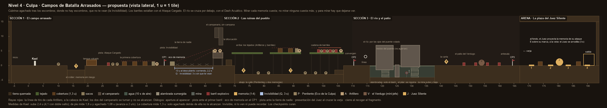

# Nivel 4 · Culpa · Campos de Batalla Arrasados: el recorrido

> **Estado: aprobado el 2026-10-20 (N48: «me gusta el diseño que se le dio al mundo») y montado sin
> arte, fases A a D**, en la rama `nivel4-recorrido`: el recorrido, las mecánicas, los enemigos y el
> Juez Silente, con bloques de color y cápsulas. Lo que cambió al montarlo, en la sección 10. **La
> fase E va por la mitad** (2026-10-22): la primera tanda de imágenes (el Penitente, el Artillero, el
> Verdugo, el Juez y lo que lanzan) ya está en el juego; la segunda (el escenario, el barril, la mina,
> el río, el campanario, las memorias y el fondo) tiene sus prompts. La F (las cinemáticas, las
> memorias con su imagen y las puertas), también.
>
> La propuesta era del 2026-10-17, ampliada dos veces el 2026-10-19. Las dieciséis decisiones están
> en la sección 9. Las seis últimas son del 2026-10-19:
>
> - **11 a 13, la Invisibilidad** que Kael gana en el Mundo 3 («mira cómo aplicar esa
>   invisibilidad… qué mecánicas u objetivos se podrían añadir»): la tierra de nadie, la regla de que
>   para recordar hay que dejarse ver, y lo que hacen el Verdugo y el Juez cuando no ven a Kael.
> - **14 a 16, el río** («agranda también el nivel 4 añadiendo también alguna parte acuática»): el
>   Dash Acuático del Mundo 2, por debajo del puente volado, entre alambradas y minas.
>
> Los números de las secciones 3 a 6 son los de la propuesta: los que cambiaron al montarlo están en
> la sección 10, y los que valen son los de `DisenoNivel4`. Los prompts de la primera tanda (los
> enemigos y el jefe) están en `Prompts_Mundo4.md`.

*El esquema se regenera con `python Herramientas/esquema_nivel4.py`. Es un dibujo de diseño, a
escala (1 u = 1 tile), no una captura del juego. Las rayas rojas son la línea de tiro de cada
Artillero; los rombos, las cuatro memorias.*

---

## 1. La idea: la culpa pesa, pero no define

El Anexo A resume el mundo así: «La culpa pesa, pero no define la identidad completa». El guion lo
dice con un gesto, **mirar lo que pasó y resistirlo sin negarlo**, y Kael lo cierra con «Mirarlo
no me destruyó. La Culpa es un peso, no un nombre. Puedo cargarlo y seguir de pie». El eco de
memoria («Una orden. Un sí. Un pueblo que ya no está. Él lo recuerda cada día con los ojos
abiertos») y la línea del jefe («No dicto sentencia. Solo te muestro lo que él se negó a mirar»)
dan la otra mitad: el soldado cumplió una orden y no quiere mirar lo que pasó. El nivel convierte
eso en reglas de juego, en tres tiempos:

1. **Cubrirse: el campo arrasado.** La culpa se esconde detrás de algo. Los Artilleros disparan a
   la cabeza: **solo agachado detrás de los escombros no te alcanzan**, y avanzar es elegir cuándo
   salir. Y los actos tienen consecuencias: un barril estalla con el Ataque Cargado (lo que Kael
   aprendió en la Ira) y se lleva todo lo que tiene alrededor, también a Kael si se queda cerca.
   Y donde no queda nada detrás de lo que esconderse, en la tierra de nadie, queda esconderse de
   las miradas: **la Invisibilidad que Kael aprendió en el Miedo.**
2. **Mirar o no mirar: las ruinas del pueblo.** Dos caminos que llegan al mismo sitio. Por los
   tejados, rápido y explosivo, sin memorias. Por la calle, con dos memorias. **Mirar una memoria
   cuesta:** los enemigos de su zona se vuelven un 20 % más agresivos (Anexo A). **No mirar
   ninguna cuesta más, y después:** el Juez tendrá un 30 % más de vida. Enfrentar la culpa es más
   barato que evitarla: el Anexo A dice que es la traducción más directa de la tesis a una regla
   de juego y que se implemente tal cual. Así se hace.
3. **Sostener: el río, el patio y la plaza.** Para llegar al patio hay que cruzar el río por los
   ojos del puente que se voló, entre alambre y minas: lo que dejó la guerra sigue ahí, y se cruza
   con el Dash Acuático que Kael aprendió en la Tristeza. El Verdugo, el mini-jefe, solo se
   arrodilla con una
   explosión: con las consecuencias que uno mismo provoca. Y al Juez Silente no se le puede
   golpear: **solo se expone cuando Kael activa la memoria que le muestra su ataque.** Vencerle es
   mirar.

Tres piezas más refuerzan el tema:

- **Para recordar hay que dejarse ver.** Invisible, Kael no puede activar una memoria ni una marca
  del Juez. Esconderse sirve para pasar, no para mirar: es lo que dice el mundo («mirar lo que pasó
  y resistirlo sin negarlo»), hecho regla.
- **Las cuatro memorias** (Anexo A) son objetos del campo de batalla: una radio, una campana, un
  casco sobre un fusil y una carta. Cada una se activa con **E** y abre una cinemática de unos 5 s,
  con su imagen y una línea de Kael. El guion dejó su texto para cuando llegáramos aquí; está en la
  sección 6 (decisión 10).
- **El Juez las proyecta en la plaza.** Las mismas cuatro, en el suelo y al fondo: quien las miró
  en el camino ya sabe qué son.

Esto responde a dos observaciones de los evaluadores, como los otros mundos. La primera pedía
profundizar en el diseño conceptual: cada pieza sale de la emoción. La quinta preguntaba qué
estrategias de juego sirven al autoconocimiento: aquí la que funciona es mirar, aunque cueste; la
que falla es esconderse siempre (los Artilleros se toman su tiempo, y escondido no se recuerda) o
pasar de largo (el Juez lo sabe).

## 2. Las mecánicas del mundo

Medidas con los parámetros reales de Kael (`ParametrosJugador`). Buena parte ya existe desde las
Fases 3 a 8, sin nivel donde usarla; lo marco con ✔.

| Mecánica | Qué hace | En el código |
|---|---|---|
| **Agacharse** | S (desde la v0.68; antes, Ctrl o C). Kael pasa de 1,8 u de alto a 1,08 u y avanza a 2 u/s. Solo en este mundo (`ReglasNivel.agacharse`). | ✔ Desde la Fase 3: `PlayerCrouchState`, con su dibujo. |
| **Cobertura** | Escombros, sacos terreros, chimeneas y el tanque volcado: bloques bajos de **1,3 u** que paran los disparos. De pie, Kael asoma la cabeza por encima; agachado, queda debajo del borde. | ✗ Fase B: bloques de suelo bajos, con su arte en la fase E. |
| **Disparo a la cabeza** | Los Artilleros apuntan a la cabeza de Kael. **Ni agacharse solo ni la cobertura sola sirven: hacen falta las dos.** De pie tras la cobertura, el disparo pasa por encima del borde y le da; agachado al descubierto, le da igual. | ✔ `Proyectil` (la bola de la torreta) ya se para contra el suelo y las paredes. ✗ Fase C: el Artillero. |
| **Barril explosivo** | El `Explodable` del Anexo A. **Solo lo enciende el Ataque Cargado**, otra explosión o un disparo de Artillero (un barril no es cobertura). La mecha dura 0,6 s (parpadea en rojo) y estalla en 2,5 u: quita 3 a los enemigos y 1 a Kael. **Enciende los barriles que tiene a menos de 3 u**, uno tras otro: las cadenas explosivas del Anexo A. Queda quemado hasta que Kael reaparece en un checkpoint, como las antorchas del Mundo 3. Golpeado sin cargar, solo suena. | ✔ El golpe ya dice si venía cargado (`Golpe.Cargado`; el hielo del Mundo 2 lo usa). ✗ Fase B: `BarrilExplosivo`. |
| **Invisibilidad Parcial** | **Q**: 3 s en los que no la ven los que ven, y 8 s de espera (se gana en el Mundo 3). Los Artilleros bajan el arma: se apaga su línea roja y no disparan (la ráfaga que ya salió sigue su camino). Los Penitentes se paran donde lo perdieron. El Verdugo y el Juez van a donde lo vieron por última vez. **Invisible no se recuerda:** ni las memorias ni las marcas del Juez se activan, y el aviso dice «Para recordar, déjate ver». Un indicador del HUD enseña cuándo vuelve a estar lista. | ✔ `PlayerAbilities` (Q, 3 s, 8 s) y la detección de los que ven (`ContextoDeteccion.ObjetivoOculto`), desde la Fase 4. ✗ Fase B: que las memorias la comprueben y el indicador del HUD (sin imagen: la Q, que se rellena). ✗ Fases C y D: que el Artillero, el Verdugo y el Juez la respeten. |
| **El agua y el Dash Acuático** | El agua del río es la del Mundo 2 y la de la ciénaga del Mundo 3: velocidad ×0,6, salto ×0,6 y gravedad ×0,3 (desde el fondo se sube 2,9 u, y 5 con el doble salto); 10 s de aire, y después un corazón cada 2 s. Bajo el agua el dash funciona (se gana en el Mundo 2): recorre 2,9 u sin que el agua lo frene. | ✔ `ZonaModificadorMovimiento` (agua), `OxigenoJugador` y el dash, desde el Mundo 2. |
| **Alambrada sumergida** | La maraña de la ciénaga del Mundo 3, hecha alambre de espino: llena el ojo del puente del fondo al techo; dentro, Kael va al 5 % de su velocidad y no salta. Solo el dash la cruza. | ✔ La maraña del Mundo 3, con otro dibujo. |
| **Mina** | Una mina de contacto sujeta al fondo por su cadena, que **sube y baja 2 u cada 3 s**: se pasa por debajo cuando sube o por encima cuando baja. Si Kael la toca, o le da un golpe de espada, estalla: 1,5 u, quita 1 a Kael y 3 a los enemigos. Desde el alcance máximo de la espada, su explosión no le llega. No vuelve hasta que Kael reaparece, como los barriles: se puede pagar un corazón para quitarla de en medio. | ✗ Fase B: `Mina`, con la explosión de los barriles. |
| **Memoria** | Un objeto que brilla en ámbar. A 1,5 u aparece «E · Recordar». Al activarla, una cinemática de ~5 s (su imagen y una línea de Kael) y el brillo se apaga. Se recuerda aunque Kael muera. | ✔ El estado de memoria (`GameStateMachine.IniciarCinematica`, de PLAYING a CUTSCENE y vuelta), la interacción con E (Mundo 3) y la lista de memorias en la partida guardada (`DatosGuardado.memoriasActivadas`). ✗ Fase B: `MemoriaInteractuable`. |
| **Sistema de consecuencias** | **Al activar una memoria, los enemigos de su zona se vuelven un 20 % más agresivos:** se mueven y atacan un 20 % más deprisa, y los Artilleros recargan un 20 % antes. Se ve: al terminar la cinemática, esos enemigos destellan en rojo apagado. **Si al llegar al Juez no se ha activado ninguna, el Juez tiene un 30 % más de vida** (28 → 36), y su barra lo enseña con ese tramo en otro color. Las memorias cuentan en cada partida del nivel: al empezarlo otra vez desde el selector, se olvidan. | ✗ Fase B: `SistemaConsecuencias`, que escucha a las memorias (está en el plan, `OnMemoriaActivada`). Para subir la agresividad sin tocar `EnemyController`, cada enemigo tomará una copia de sus datos con los valores subidos; si hiciera falta tocarlo, te aviso antes. |
| **Las pistas** | Dos: ante el primer barril, Kael nombra el Ataque Cargado; ante la tierra de nadie, la Invisibilidad. (La del Mundo 2 era el Ataque Cargado ante el hielo; la del Mundo 3, si apruebas la ciénaga, el Dash Acuático.) | ✔ `MOMENTOS_DIALOGO.PISTA`. |
| **Eco de memoria** | En el primer checkpoint, el refugio. | ✔ `Checkpoint.ecoDeMemoria`. |
| **Checkpoints que curan** | Tres: el refugio, la convergencia y la antesala. | ✔ `Checkpoint.cura`. |

**El nivel necesita las tres habilidades de antes:** el Ataque Cargado (los barriles), el Dash
Acuático (el río) y la Invisibilidad Parcial (la tierra de nadie). El Anexo A dice que «el nivel
requiere progresión previa», y ya las tiene quien llega: se ganan en los mundos 1, 2 y 3. El Anexo
estrena la Invisibilidad en el Jardín (mundo 5); aquí se adelanta (decisión 11).

**La Defensa Reforzada se gana aquí, no se usa aquí**, como el Dash y la Invisibilidad en sus
mundos. Ya está programada (un escudo que para un golpe cada 15 s) ✔; se estrena en el Jardín.
Le falta su dibujo: va en la segunda tanda.

**Los charcos son decorado:** el Anexo A los pone en el suelo, pero no dice que hagan nada, y otra
mecánica más taparía las que importan.

## 3. El recorrido, tramo a tramo

Medidas en unidades de Unity (1 u = 1 tile). El suelo está a y 0. Con luz de día, gris y parda,
bajo un cielo de humo: aquí no se esconde nada a oscuras, se esconde detrás de algo o de las
miradas.

| Tramo | x | Suelo | Qué hay | Qué aprende o siente el jugador |
|---|---|---|---|---|
| **Inicio** | −6 a 6 | tierra quemada, y 0 | Kael aparece en x 2. | **Apertura:** «Aquí nada se movió desde el último disparo. Es la Culpa de otro… y la siento mía». |
| **El primer Penitente** | 6 a 13 | tierra | Un Penitente, solo, en x 10. | El enemigo común: lento, arrastra sus cadenas. |
| **El cráter** | 13 a 19 | cráter a y −1,5 | **Memoria 1, la radio** (x 16), sin enemigos alrededor. | **La memoria sin riesgo** del Anexo A: enseña a mirar sin que cueste nada. |
| **El tanque volcado** | 19,5 a 23 | un bloque de 2 u | Se sube de un salto. Es la primera cobertura, todavía sin nadie que dispare. | |
| **El barril** | 23 a 31 | tierra | Un barril en x 27 y dos Penitentes juntos (x 28,5 y 30). En x 24, **la pista**. | **El tutorial del barril:** un Ataque Cargado y se van los dos. Quien lo hace de cerca, se lleva su golpe. |
| **La primera cobertura** | 31 a 44 | tierra | Un **Artillero** tras sus sacos terreros en x 43,5. Delante, tres escombros de 1,3 u (x 32,5, 36 y 39,5). | **El tutorial de la cobertura:** agacharse detrás de cada escombro cuando apunta y avanzar cuando recarga. |
| **El refugio** | 44 a 48 | tierra | **CP1** (x 46) y el **eco de memoria**. | Respirar. |
| **La tierra de nadie** | 48 a 62,5 | tierra | Los sacos del refugio (x 48 a 49,5) son la última cobertura. Después, **13 u al descubierto** (49,5 a 62,5): barro, alambradas caídas y cráteres pequeños, todo decorado. **La segunda pista** en x 47,5. | **Lo que la cobertura no resuelve.** Corriendo se cruza en 2,2 s, y la Invisibilidad dura 3. Sin ella, al menos una ráfaga llega. |
| **El campanario** | 62,5 a 66 | tierra | La torre de la iglesia del pueblo, sin campana: la campana es la memoria 2. Abajo, un arco por el que se pasa (2,5 u de alto). En su balcón (y 4,5), **dos Artilleros** que miran a la tierra de nadie y **se turnan**: cuando uno recarga, el otro apunta. No se les alcanza, y bajo el arco no ven a Kael. | **Esconderse de las miradas.** Son la mirada del campo: no se les vence, se les evita. |
| **La bifurcación** | 66 a 70 | tierra | Unos escombros (y 2) suben a los tejados; en x 70 el suelo se hunde en la calle. | Elegir: subir o bajar. |
| **Arriba: los tejados** | 69 a 107 | tejados a y 4,5, con huecos de 2,5 y 3 u | Se sube con el doble salto. **Dos Artilleros** (x 92 y 106,2), dos chimeneas de cobertura (x 85,5 y 89) y, en el último tejado, **cuatro barriles en cadena** (x 98,5 a 104,5) con tres Penitentes entre ellos y el segundo Artillero al final. **Sin memorias.** | Rápido y explosivo: un Ataque Cargado limpia el último tejado entero. Caer de un tejado es caer a la calle. |
| **Abajo: la calle** | 70 a 107 | calle a y −3 | **Memoria 2, la campana** (x 73) y dos Penitentes (x 78 y 81,5); **memoria 3, el casco sobre el fusil** (x 89) y tres Penitentes (x 94, 97,5 y 101). Sin barriles ni Artilleros. Se sale por un escalón (x 104 a 107). | Más lento y con memorias. Cada una hace más agresivos a los Penitentes que vienen detrás: mirar cuesta. |
| **La convergencia** | 107 a 114 | tierra | **CP2** en x 110,5. Las dos rutas llegan aquí. | |
| **El río** | 114 a 140 | agua de 4 u (fondo a y −4) | El puente se voló, y sus restos cierran el río hasta 7 u de alto: se pasa por debajo, por sus dos ojos. **La orilla** (114 a 116), con la línea de Kael (x 114,5). **El primer ojo** (118 a 124; techo a y −1,5, 2,5 u de alto), con **una alambrada** (120 a 122,5). **El pilar** del puente (124,5 a 126) asoma 0,25 u del agua: se respira. **El segundo ojo** (126,5 a 133; techo a y −0,5, 3,5 u de alto), con **una mina** que sube y baja (x 128,5) y **otra alambrada** (130 a 132,5). Se sale a **la otra orilla** (138 a 140) con el doble salto. | El Dash Acuático, otra vez, con lo de este mundo: la mina es una consecuencia que espera. |
| **La carta** | 140 a 145 | tierra | **Memoria 4, la carta** (x 142), a la puerta del patio. | Mirarla hace más agresivo al Verdugo, que espera dentro. |
| **El patio del Verdugo** | 145 a 162 | tierra | Un patio de fusilamiento, con la pared llena de agujeros. **El Verdugo**, el mini-jefe, y **cuatro barriles** separados (x 148, 152, 156 y 160, a 4 u: no se encadenan). | Llevarlo junto a un barril y encenderlo: arrodillado, los golpes valen el doble. Invisible, Kael puede esperarlo junto a un barril: el Verdugo va a donde lo vio por última vez. O vencerlo a golpes, despacio. |
| **La antesala** | 162 a 167 | tierra | **CP3** en x 164,5. | El respiro antes del jefe. |
| **La arena: la plaza** | 167 a 194 | tierra | Sala de 25 × 15 u (interior de x 168 a 193), como las otras. **Cuatro marcas en el suelo**, una por memoria (x 171, 177,5, 183,5 y 190), y dos escombros de cobertura (x 174 y 187). El Juez, al fondo, en el centro. Entrada en x 168; salida en x 190,5. | La **presentación** al cruzar la verja. |

**Recuento frente al Anexo A:**

| | Anexo A | Propuesta |
|---|---|---|
| Sección 1 | 0–25 u: campo abierto, primer contacto con Penitentes, introduce la cobertura, 1 memoria sin riesgo | −6 a 66 u: lo mismo, más el tutorial del barril y la tierra de nadie |
| Sección 2 | 25–60 u: ruinas con 2 rutas, alta (Artilleros y barriles) o baja (Penitentes y 2 memorias), que convergen | 66 a 114 u: lo mismo |
| Sección 3 | no existe | 114 a 167 u: el río, la cuarta memoria y el Verdugo, el mini-jefe (no está en el Anexo) |
| Arena | 60–85 u: plaza con marcas de memorias en el suelo | 167 a 194 u: lo mismo, en 25 × 15 u como las otras arenas |
| Longitud | ~85 u | ~200 u: el más largo, como le toca al cuarto (los otros miden 125, 139 y 173 u con la ciénaga) |
| Memorias | 4 | 4: una en el campo, dos en la calle y una a la puerta del patio |
| Checkpoints | no dice | tres: el refugio, la convergencia y la antesala |

**El tiempo con bono** sería de 16 min (en el Nivel 1 son 10; en el 2, 13; en el 3, 16 con la
ciénaga): aquí se espera tras la cobertura, se bucea y las memorias se miran. Se ajusta cuando lo juegues.

## 4. Medidas de Kael, para que la cobertura funcione

| | De pie | Agachado |
|---|---|---|
| Alto | 1,8 u | 1,08 u |
| Velocidad | 6 u/s | 2 u/s |
| Tras una cobertura de 1,3 u | asoma la cabeza: el disparo pasa por encima del borde y le da | queda por debajo del borde: el disparo da en la cobertura |
| Al descubierto | le da | le da (apunta a la cabeza) |

- **El cañón del Artillero está a 1,5 u del suelo** y apunta a 0,25 u por debajo de lo alto de
  Kael. Agachado tras una cobertura, la línea de tiro corta la cobertura siempre que Kael esté más
  cerca de ella que el 70 % de la distancia al Artillero. En los tres tramos con Artilleros que se
  cubren (el campo y los dos tejados), la cobertura está a menos de 1 u de donde se agacha Kael.
  `DisenoNivel4Tests` lo comprobará con la geometría de cada uno.
- **La tierra de nadie no tiene cobertura, a propósito.** Mide 13 u: corriendo (6 u/s) se cruza en
  2,2 s, y la Invisibilidad dura 3 (sobran 0,8). Los dos Artilleros del campanario se turnan: cada
  uno apunta 0,8 s, dispara y recarga 2 s, y el segundo empieza 1,6 s después que el primero. Al
  descubierto siempre apunta alguno. Ven a 14 u: hasta los sacos del refugio no ven a Kael. Las
  pruebas lo comprobarán.
- **El balcón del campanario está a 4,5 u**, y el doble salto sube 4,1: no se alcanza. Sus paredes
  no agarran, como las raíces del callejón del Mundo 3.
- **Los saltos:** el tanque (2 u) se sube con un salto (2,4 u); los tejados (4,5 u), con el doble
  salto (4,1 u desde los escombros de 2 u). Los huecos entre tejados (2,5 y 3 u) se saltan
  corriendo (4,4 u). Los escalones de la calle miden 1,5 u.
- **Lo más alto** son los tejados: aquí no hay ramas que obliguen al doble salto en la arena. La
  plaza es llana; lo que se esquiva salta por el suelo.
- **El río, como la ciénaga del Mundo 3.** Bajo el agua Kael va a 3,6 u/s y sube 2,9 u desde el
  fondo (5 con el doble salto): sale al pilar (4,25 u) y a las orillas (4 u). Cada ojo del puente
  cuesta unos 3 a 4 s de los 10 de aire; sin el dash, una alambrada cuesta 14 s. **La mina**, al
  subir, deja libres los 2 u de abajo (Kael mide 1,8); al bajar, se salta por encima (el techo del
  segundo ojo está 3,5 u sobre el fondo). Las pruebas lo comprobarán, como en la ciénaga.

## 5. Los enemigos

| Enemigo | Cuántos | Cómo se comporta | Qué enseña | En el código |
|---|---|---|---|---|
| **Penitente** (el Eco de la Culpa) | 11: 3 en el campo, 5 en la calle y 3 en los tejados | **Es el Eco de este mundo:** el mismo cuerpo que el Eco de la Ira, el Lamento y el Espectro, el pardo de abajo a la izquierda de `Referencias/Arte/EnemigosNiveles.jpeg`: encorvado, con el pecho cubierto de **placas de identificación** y grilletes en las muñecas cuyas **cadenas arrastra**. Lento (patrulla a 1 u/s y persigue a 2,2), 3 de vida, quita 1. Va en grupos de dos y tres: para eso están los barriles. Si Kael se vuelve invisible, lo pierde: se para donde lo vio y vuelve a su ronda. **A la escala de los Ecos (1,8 × 1,5) y con su ritmo de ataque (1,6×, descansa 0,45 s) desde el principio** (tu regla para el enemigo común de cada mundo). | Lo que uno arrastra. | ✗ Fase C: sus datos y su prefab con el controlador de animación del Eco, como el Lamento y el Espectro. |
| **Artillero** | 5: uno en el campo, dos en el campanario y dos en los tejados | Un soldado **arrodillado tras sus sacos terreros**, con casco, un fusil largo y la cara lisa de los Ecos; de la espalda le cuelgan placas, como a los Penitentes. *El Anexo A solo lo nombra; el aspecto es propuesta mía.* **No se mueve.** Ve a Kael hasta 14 u por delante. **Ráfaga:** apunta 0,8 s (el aviso: un destello en el cañón y una línea roja fina hasta donde va a disparar), dispara tres balas seguidas a la cabeza de Kael y recarga 2 s. Si Kael llega a 1,5 u, le da un culatazo (avisa 0,4 s, quita 1). 3 de vida. **Invisible, Kael no existe para él:** si estaba apuntando, baja el arma y se apaga la línea roja; la ráfaga que ya salió sigue su camino. Los dos del campanario no se alcanzan ni dan puntos. | Cubrirse y elegir cuándo salir. Y, donde no hay dónde cubrirse, que no te vean. | ✔ `Proyectil`. ✗ Fase C: `Artillero`. |
| **El Verdugo** (mini-jefe) | 1, en el patio | **No está en el Anexo A**: es el mini-jefe del mundo, como el Golem, la Plañidera y el Acechador. Un **Penitente enorme con capucha de verdugo**, un hacha de dos manos y, colgando, la cadena de un garfio. Es la mano que cumplió la sentencia: lo que el soldado hizo cuando dijo «sí». 16 de vida e hiperarmadura, como el Golem. Camina despacio hacia Kael. **Hachazo:** alza el hacha (0,8 s, el aviso) y la deja caer, 2,5 u por delante; quita 2. **Barrido:** si Kael está a su espalda o muy cerca, gira el hacha a su alrededor (aviso 0,6 s, 2 u, quita 1). **Cadena:** si Kael se aleja más de 6 u, voltea el garfio (0,7 s) y lo lanza recto a la altura del pecho; si le da, lo arrastra hasta él y le quita 1. **Agachado, la cadena le pasa por encima.** **Una explosión a menos de 2,5 u lo deja de rodillas 2,5 s, y los golpes valen el doble** (como la espada clavada de la Centinela y el árbol del Acechador). **Si Kael se vuelve invisible, lo pierde:** termina lo que hacía, camina hasta donde lo vio por última vez y da allí un barrido a ciegas, sin lanzar la cadena. Así se le lleva junto a un barril. | Las consecuencias que uno provoca son también la salida. Agacharse no solo es esconderse, y esconderse sirve para preparar el golpe, no para evitarlo. | ✗ Fase C: `Verdugo`. |

Los puntos (`TablaPuntaje`): el Penitente, 100 (el común); el Artillero, 150; el Verdugo, 800
(entre el Acechador, 700, y el jefe); el Juez Silente, 3000 ✔ (ya está).

## 6. El jefe: el Juez Silente

**Concepto:** `Referencias/Arte/Jefes/Jefe4.jpeg`. Una figura alta con armadura oscura y un yelmo
liso, sin rostro; una capa gris cubierta de **placas de identificación** (las mismas de los
Penitentes); en el pecho, **una luz ámbar**; una balanza colgando de una mano y una espada larga y
recta en la otra. Funciona tal cual: las placas lo unen con los Penitentes, la balanza dice lo que
es y la luz del pecho es lo único cálido del mundo, como las memorias. El prompt de AI Studio está
en `Prompts_Mundo4.md`, apartado B.

**Sus datos** (`Assets/Data/Jefes/JuezSilente.asset`) ✔: 28 de vida (36 si no se miró ninguna
memoria), dos fases (la segunda al 50 %), inmune salvo en su ventana, que dura 3 s. Tocarlo no hace
daño: lo hacen sus ataques. Lo que falta son sus patrones.

**La plaza.** En el suelo hay **cuatro marcas**, una por memoria: la radio, la campana, la placa y
la carta. Al fondo, la pared de la plaza sirve de pantalla: **en cada ataque, el Juez proyecta en
ella la memoria que le corresponde** (su misma imagen, grande y desvaída).

**Cómo pelea.** Ningún golpe le hace nada (Anexo A: «inmune a ataques directos»). **Cada ataque es
una memoria:** mientras dura, su marca brilla en el suelo. Si Kael se pone encima y pulsa **E**,
el ataque se corta, **el Juez baja la espada y se arrodilla, la balanza toca el suelo, y durante
3 s se le puede golpear.** Cada ataque avisa 1 s antes de hacer daño y dura unos 5 s: da tiempo a
llegar a la marca, esquivando.

| Fase | Patrón (y su memoria) | Qué pasa | Cómo se responde |
|---|---|---|---|
| 1 · Lo que no miró (100 % a 50 %): la orden, el pueblo, el compañero y la carta | **La orden** (la radio) | Señala al frente con la espada: seis explosiones de artillería caen una tras otra, avanzando por la plaza desde su lado. Cada una marca el suelo 0,8 s antes. Quitan 1. | Quedarse entre dos marcas o saltar; y llegar a la radio. |
| | **El pueblo** (la campana) | Golpea la balanza con la empuñadura: suena como una campana y una ola de fuego de 1,2 u de alto barre la plaza a ras de suelo, primero desde un lado y después desde el otro. Quita 1. | Saltarla. |
| | **El compañero** (la placa) | Abre la capa: las placas salen volando en tres ráfagas, rectas y a la altura de la cabeza, como los disparos de los Artilleros. Quitan 1. | **Agacharse tras uno de los dos escombros.** La cobertura, en el combate. |
| | **La carta** (la carta) | Camina hasta Kael, alza la espada con las dos manos (1 s) y la clava: una onda sale por el suelo hacia los dos lados. Dos veces. Quita 2. | Saltar la onda. Es el ataque que más quita y el que deja más cerca de su marca. |
| 2 · Lo que se negó a mirar (50 %) | **La condena** | Al empezar la fase clava la espada en el suelo: las cuatro memorias se proyectan a la vez, un instante, y la luz de su pecho se enciende entera. | La señal de que el combate cambia, como el grito de los otros jefes. |
| | **Una real y una trampa** | Los mismos cuatro ataques, en otro orden, pero ahora **brillan dos marcas**: la de la memoria que proyecta y otra cualquiera. **La trampa** suelta cadenas que sujetan a Kael 1 s y le quitan 1, y la marca buena se apaga: ese ataque ya no se corta. | Mirar la pared antes de correr: la memoria que proyecta es la verdadera. |
| Muerte | — | **Todas las memorias se iluminan** (Anexo A): las cuatro marcas y las cuatro imágenes a la vez. Después, la cinemática de la derrota y el fragmento. | **Cierre:** «Mirarlo no me destruyó. La Culpa es un peso, no un nombre. Puedo cargarlo y seguir de pie». |

**La Invisibilidad, ante el Juez, funciona pero cuesta.** Invisible no se activa ninguna marca
(para recordar hay que dejarse ver), y dura 3 s de los unos 5 que dura cada ataque. A cambio, el
Juez pierde a Kael: en «La carta» camina hasta donde lo vio por última vez y clava allí la espada
(la onda sale igual y hay que saltarla), y las placas de «El compañero» vuelan a la altura de la
cabeza donde lo vio. Esconderse protege del golpe que más quita; solo mirar lo vence (decisión 13).

**Por qué así:** su línea dice «Solo te muestro lo que él se negó a mirar». Por eso no se le puede
golpear hasta que Kael mira, y lo que hay que mirar es justo lo que el ataque enseña. En la segunda
fase la culpa engaña: no todo lo que brilla es lo que pasó. Y quien no miró ninguna memoria en el
camino llega con el Juez más fuerte, porque «el jefe sabe que Kael evita la verdad» (Anexo A).

**Las cuatro memorias** (su texto, para la decisión 10). Las dice Kael, como el resto del guion,
y duran unos 5 s; cada una lleva una imagen (segunda tanda), que es también la que el Juez
proyecta en la plaza:

| # | Memoria | Dónde | Texto |
|---|---|---|---|
| 1 | **La orden** (una radio de campaña en el barro) | el cráter | «Una radio entre el barro. "Adelante". Él dice que sí antes de preguntar adónde.» |
| 2 | **El pueblo** (una campana caída entre cenizas) | la calle | «Una campana caída entre cenizas. Nadie la tocó para avisar. Él tampoco.» |
| 3 | **El compañero** (un casco sobre un fusil clavado, con una placa) | la calle | «Una placa con un nombre que no es el suyo. Se la guardó. Nunca supo a quién devolverla.» |
| 4 | **La carta** (una carta sobre una caja de munición) | la puerta del patio | «Una carta que solo dice "Lo siento". La escribió muchas veces. Nunca la envió.» |

Y **las dos pistas**. Ante el primer barril: «Ese barril… Un Ataque Cargado y no quedaría nada a su
alrededor. Ni yo, si me quedo cerca.» Ante la tierra de nadie: «Ni un escombro hasta la torre: si
me ven, no llego. Con la Invisibilidad no me verán… pero dura poco: hay que correr.»

Y **la línea del río**, en la orilla: «Volamos el puente para que nadie nos siguiera. Ahora el que
tiene que cruzar soy yo.»

## 7. Qué hay que implementar, por fases

Como en los otros mundos: una rama, una fase cada vez, pruebas en verde, el CHANGELOG y PENDIENTES
al día, y parar si algo no cuadra. **Las fases A a D no necesitan arte:** se hacen con bloques de
color y cápsulas, sin sprites inventados.

| Fase | Qué | Piezas |
|---|---|---|
| **A · Recorrido** ✔ | La escena `Nivel4`, montada desde una tabla de medidas | `DisenoNivel4` y `PreparadorNivel` para la Culpa; el `LevelData` con su escena, sus secciones y sus checkpoints; pruebas de alcance, de la línea de tiro tras cada cobertura y de la tierra de nadie (que se cruza en menos de 3 s y que el balcón no se alcanza), y del río (que del fondo se sale a las orillas y al pilar, que bajo cada techo cabe Kael y que cada alambrada se cruza con un dash) |
| **B · Mecánicas** ✔ | La cobertura, los barriles, las memorias y sus consecuencias, y el río | Coberturas de 1,3 u; `BarrilExplosivo` (mecha, radio, cadena); `MemoriaInteractuable` con su cinemática (de momento, solo texto), que no se activa invisible; `SistemaConsecuencias` (+20 % en su zona y +30 % al Juez); el indicador de la Invisibilidad en el HUD; el agua del río, las alambradas sumergidas (las marañas del Mundo 3, con otro dibujo) y `Mina`; las dos pistas, la línea del río y el eco de memoria |
| **C · Enemigos** ✔ | El Penitente, el Artillero y el Verdugo | El Penitente con los datos y el controlador del Eco; `Artillero` (ráfaga a la cabeza, culatazo, y los dos del campanario que se turnan); `Verdugo` (hachazo, barrido, cadena, las rodillas al estallar un barril y el barrido a ciegas); que los tres pierdan a Kael invisible |
| **D · Jefe** ✔ | El Juez Silente completo, sin arte | Las marcas y la pantalla de la plaza (que no se activan invisible); `PatronOrden`, `PatronPueblo`, `PatronCompanero` y `PatronSentencia`, que apuntan a donde vio a Kael por última vez; la trampa de la segunda fase; un verificador |
| **E · Arte** ✔ | Vestir lo anterior a medida que llegue | Una sub-fase por paquete. **La primera tanda ✔** (2026-10-22): el Penitente, el Artillero, el Verdugo y el Juez Silente con su arte, la explosión del barril, de la mina y de la artillería, la ola de fuego, la placa, la bala, el garfio con su cadena y el fragmento (`ArteMundo4`, `VerificadorNivel4`). **La segunda ✔** (2026-10-22): el escenario, las coberturas, el barril, la mina, el río, el campanario, las memorias con su losa y el fondo. Y lo último (2026-10-23): el aviso del culatazo y el abrigo vacío del Artillero, la onda de la sentencia y el escudo de Kael |
| **F · Narrativa** ✔ | Presentación, derrota, las cuatro memorias con su imagen y las puertas | El sistema de cinemáticas, sin cambios. La presentación y la derrota del Juez y las cuatro memorias con su imagen (`ConstructorCinematicasNivel4`), la pared del Juez con sus imágenes, y la puerta, la verja, el checkpoint y la salida de la Culpa (`ConstructorPuertas.Culpa`) |

## 8. Las imágenes que necesitamos

### Reglas para todas

Las de los otros dos mundos (`Prompts_Mundo3.md`, apartado 0): **un PNG por fotograma sobre magenta
plano (#FF00FF)**, nunca el damero; **cada pieza con su maestra** y los demás fotogramas editándola,
adjuntando siempre la maestra; cada prompt enumera **lo que no puede faltar**; **que no cambie el
tamaño del píxel ni del lienzo**; margen alrededor de la figura; y yo no reescalo ni recorto.

**La paleta del Anexo A:** gris parduzco `#3C2E1E`, marrón quemado `#5C3D1E`, verde oliva muerto
`#4A5C2E` y rojo desaturado `#8B3333`, más un **ámbar** (`#E0B060`) solo para lo que se recuerda:
la luz del pecho del Juez y el brillo de las memorias. **El rojo apagado es lo que hace daño** (la
mecha del barril, la línea de tiro del Artillero) y **el ámbar, lo que hay que mirar**.

### P1 · Los enemigos (✔ montados el 2026-10-22; prompts: `Prompts_Mundo4.md`, apartado A)

| # | Imagen | Fotogramas | Alto en el juego | Notas |
|---|---|---|---|---|
| 1 | **Penitente** | los 12 del Eco: Idle 2, Correr 4, Ataque 4, Muerte 2 | como el Eco | **Editando cada fotograma del Eco**, como el Lamento y el Espectro. Las bases ya están en `Tesis/Imagenes/Mundo4/Penitente/Bases/`. |
| 2 | **Artillero** | Reposo 2, Apuntar 1, Disparo 2, Recarga 2, Culatazo 2, Daño 1, Muerte 3 (13) | ~1,5 u, arrodillado | Los sacos terreros van aparte (segunda tanda), porque también son cobertura. |
| 3 | **El Verdugo** (mini-jefe) | Andar 4, Hachazo 3, Barrido 2, Cadena 3, De rodillas 2, Muerte 4 (18) | ~3 u | Sin fotograma de daño: tiene hiperarmadura. |

### P1 · El jefe (✔ montado el 2026-10-22; prompts: `Prompts_Mundo4.md`, apartados B y C)

| # | Imagen | Fotogramas | Tamaño en el juego | Notas |
|---|---|---|---|---|
| 4 | **Juez Silente** | Reposo 4, Andar 4, La orden 3, El pueblo 3, El compañero 3, La sentencia 4, Arrodillado 2, La condena 3, Muerte 5 (31) | ~3,4 u, como la Centinela y el Pavor | Por Google AI Studio, desde `Jefe4.jpeg`. |
| 5 | **La placa que vuela** | 2 | ~0,4 u | Editando la maestra del jefe, para que tenga su píxel. |
| 6 | **La explosión** | 4, y la marca que avisa, 2 | ~2,5 u | La misma para los barriles y la artillería de «La orden». |
| 7 | **La ola de fuego** | 2 | ~1,2 u de alto | «El pueblo». |
| 8 | **La cadena** | 2: el garfio y un tramo de cadena que se repite | — | La del Verdugo y la de la trampa del Juez. |
| 9 | **La bala del Artillero** | 1 | ~0,3 u | Un trazador corto. |
| 10 | **Fragmento de la Culpa** | 1 | ~0,6 u | Editando el de la Tristeza, para que los fragmentos casen. |

### Segunda tanda (prompts listos el 2026-10-22: `Prompts_Mundo4.md`, apartados E a L; ✔ = montada el 2026-10-22)

| # | Imagen | Notas |
|---|---|---|
| 11 | **Tileset del campo** ✔ | Tierra quemada con charcos, tejados rotos, muros de las ruinas y la calle. Editando la hoja de un mundo anterior, con la misma distribución. |
| 12 | **Coberturas** ✔ | Escombros, sacos terreros, chimenea y el tanque volcado. |
| 13 | **Barril** ✔ | Entero, con la mecha encendida (2) y quemado. |
| 14 | **Las cuatro memorias** ✔ | Cada objeto apagado y brillando (la radio, la campana, el casco sobre el fusil y la carta), sus cuatro marcas del suelo de la plaza, y **sus cuatro imágenes** (480 × 268), que sirven para la cinemática y para la proyección del Juez. |
| 15 | **El fondo** ✔ | Cielo de humo, el pueblo en ruinas a lo lejos, un campanario roto como hito (como la fortaleza, la torre y el árbol), alambradas y cráteres en primer plano. |
| 16 | **Cinemáticas** ✔ | Presentación (2 planos) y derrota (2), a 480 × 268. Montadas; dos se repiten (sección 10). |
| 17 | **Las puertas** ✔ | Puerta de salida, verja de la arena, checkpoint y la cinemática de salida, como las de los otros mundos. |
| 18 | **El escudo de Kael** ✔ | La Defensa Reforzada: 3 fotogramas (aparece, para el golpe, se rompe). Se estrena en el Jardín. |
| 19 | **El campanario** ✔ | La torre de la iglesia en primer plano, sin campana: la base con su arco, el balcón con su parapeto (donde se arrodillan los dos Artilleros) y lo alto roto. Es el hito del fondo, de cerca. |
| 20 | **La tierra de nadie** ✔ | Su decorado: alambradas caídas, estacas y cráteres pequeños. No hacen nada. |
| 21 | **El agua del río** ✔ | 3 en bucle, como la de la ciénaga: la tira de la superficie, parda y turbia, con ceniza flotando. Editando la del Mundo 2. |
| 22 | **La alambrada sumergida** ✔ | 4, como la maraña: quieta (2, se mece) y cerrándose (2). **2 u de ancho** (sección 10): 2 de alto en el primer ojo y 3 en el segundo. |
| 23 | **La mina** ✔ | 2 (quieta y a punto de estallar) y un tramo de su cadena que se repite. Estalla con la explosión de los barriles (6). |
| 24 | **El puente volado** ✔ | Los restos que cierran el río, con sus dos ojos, y el pilar. Piezas del tileset del campo (11). |

### Lo que no necesita imagen

- **La línea roja del aviso del Artillero:** se dibuja en el juego, como los anillos de ruido.
- **El indicador de la Invisibilidad en el HUD:** la letra Q, que se rellena mientras espera, como
  la barra de aire.
- **Kael invisible:** el juego baja su opacidad, como en el Mundo 3.
- **El destello rojo de las consecuencias y la proyección desvaída del Juez:** el juego tiñe y
  baja la opacidad de lo que ya hay.

### El sonido (no es imagen, pero hace falta)

Marcha militar lenta y distorsionada; silencio en las memorias (Anexo A). La explosión del barril
y la campana. El jefe: órgano de iglesia y bajo profundo.

**La música ✔ (2026-10-23), con los sonidos de LMMS** (`Musica/LEEME.md`):

| Tema | Cómo es |
|---|---|
| **La marcha** (`Nivel4_Marcha`, el nivel) | Re menor, 64 BPM, 32 compases (120 s). Caja de marcha con sus redobles, bombo en la 1 y la 3, tuba, cuerdas y la campana del campanario cada dos compases. El tema, en una trompeta sin agudos y algo rota (*bitcrush*), como en un disco viejo; la segunda vez, con otra trompeta debajo. Al final, un eco lejano del tema que se apaga, y todo vuelve a crecer hasta el principio. |
| **El Juez Silente** (`Nivel4_Juez`, la plaza) | Re menor, 96 BPM, 32 compases (80 s), sobre un bajo que baja: Re, Do, Si bemol, La, Sol, Fa, Mi, La. El órgano a golpes (3 + 3 + 2), el pedal y un bajo en corcheas que salta de octava, timbales y gran casa. Luego el tema de la marcha en el órgano; después, arriba, con el coro y la caja de la marcha; y al final el pedal solo, que vuelve a crecer. |

- **El silencio de las memorias:** la música del nivel **calla en todas las cinemáticas** (se apaga en
  0,6 s) y al volver sigue donde iba. Las memorias son cinemáticas; las del Juez y la salida, también, y
  así no suena la marcha bajo su presentación ni bajo su derrota.
- **La plaza:** al empezar el combate, la marcha se apaga y entra el órgano desde el principio; al caer el
  Juez, vuelve la marcha.
- Faltan los efectos de sonido: la explosión del barril, la campana y los golpes.

### Orden recomendado

1. **El Penitente (1):** es el enemigo que más se ve y sale de las bases del Eco.
2. **El Juez y lo suyo (4 a 10):** sin él, el combate son cápsulas.
3. **El Artillero y el Verdugo (2 y 3).**
4. **La segunda tanda.**

Nada de esto bloquea las fases A a D: el nivel se puede montar y jugar mientras dibujas.

## 9. Decisiones (por aprobar: PENDIENTES N48)

1. **El nivel mide unos 200 u, con tres secciones, la arena y tres checkpoints**, como los otros
   tres alargados, y 16 min de tiempo con bono. *Recomendado.*
2. **Los Artilleros apuntan a la cabeza: solo agachado tras una cobertura no te alcanzan.**
   *Recomendado:* si dispararan a una altura fija, agacharse bastaría y la cobertura sobraría; si
   apuntaran al centro, la cobertura bastaría y agacharse sobraría. El Anexo A pide las dos cosas
   («agacharse tras escombros evita proyectiles»).
3. **Los barriles:** solo los encienden el Ataque Cargado, otra explosión o un disparo; mecha de
   0,6 s; quitan 3 a los enemigos y **1 a Kael**; se encadenan a menos de 3 u; uno por vida.
   *Recomendado:* que también hieran a Kael hace que encenderlos sea una decisión, no un botón.
4. **Las consecuencias:** +20 % de velocidad y de ritmo a los enemigos de la zona de cada memoria,
   con un destello rojo para que se vea qué lo causó; +30 % de vida al Juez si no se miró ninguna,
   con ese tramo de la barra en otro color; y las memorias cuentan en cada partida del nivel. *El
   Anexo A dice el 20 % y el 30 %, no cómo se ven ni cuándo se olvidan.* *Recomendado:* si no se
   ve, el jugador no aprende la regla.
5. **El mini-jefe, el Verdugo**, en el patio (no está en el Anexo A, como el Acechador). Se
   arrodilla con las explosiones. *Recomendado:* los otros tres mundos tienen mini-jefe, y este
   junta las tres mecánicas del mundo (los barriles, el Ataque Cargado y agacharse ante la cadena).
6. **El Penitente es el Eco de la Culpa** de `EnemigosNiveles.jpeg`, editando las bases del Eco,
   a su escala y con su ritmo de ataque. *Recomendado:* es la familia de los Ecos, y tu regla.
7. **El Artillero es un soldado arrodillado tras sus sacos, con la cara lisa de los Ecos y placas
   a la espalda.** El Anexo A solo lo nombra. *Recomendado:* que no se mueva hace que la cobertura
   sea un problema de ritmo, no de persecución.
8. **El Juez Silente es el de `Jefe4.jpeg`**, sin rediseñar. *Recomendado:* ya tiene la balanza,
   las placas y la luz del pecho. Si prefieres otro aspecto, el paso B1 pide tres variantes.
9. **Cada ataque del Juez es una memoria:** en la primera fase brilla solo su marca; en la segunda,
   la suya y una trampa, y **la trampa sujeta a Kael 1 s, le quita 1 y deja ese ataque sin
   cortar**. El Anexo A no dice qué hace la trampa. *Recomendado:* sin castigo se pisarían las dos
   marcas sin mirar la pared.
10. **El texto de las cuatro memorias, de las dos pistas y de la línea del río** (sección 6). Lo
    escribí yo, en la voz de Kael. *Si quieres cambiar alguna línea, dímelo y la cambio antes de
    montarlas.*
11. **La tierra de nadie y el campanario** (2026-10-19): 13 u al descubierto bajo dos Artilleros que
    se turnan y no se alcanzan. La Invisibilidad la cruza; sin ella, cuesta al menos una ráfaga.
    *Recomendado:* es el sitio donde la cobertura, recién aprendida, no sirve, y hace falta lo que
    Kael aprendió en el Miedo. Alarga el nivel 18 u. *La otra opción:* dejar la Invisibilidad para
    el Jardín, como dice el Anexo A.
12. **Para recordar hay que dejarse ver** (2026-10-19): invisible no se activa ninguna memoria ni
    ninguna marca del Juez. *Recomendado:* es la tesis del mundo hecha regla, y hace de la
    Invisibilidad una decisión en el combate: esconderse o mirar.
13. **Invisible, el Verdugo y el Juez van a donde vieron a Kael por última vez** (2026-10-19). El
    Verdugo da allí un barrido a ciegas; la sentencia del Juez cae allí y sus placas vuelan a esa
    altura. *Recomendado:* así la Invisibilidad sirve para llevar al Verdugo junto a un barril y para
    esquivar el golpe que más quita, pero no para vencer al Juez. *La otra opción:* que el Juez vea a
    través de ella («de la culpa no te escondes»). Es más tajante, pero deja la habilidad sin uso en
    el combate.
14. **El río y el puente volado** (2026-10-19), entre el CP2 y la carta: 26 u más, hasta unos 200
    u. *Recomendado:* va justo después de un checkpoint (quien se ahoga vuelve a 3,5 u del agua) y
    antes del patio, donde se juntan las tres habilidades. Con él, el nivel usa todo lo que Kael ha
    aprendido.
15. **Las alambradas sujetan como las marañas del Mundo 3, y las minas suben y bajan** (2026-10-19).
    La mina estalla al tocarla o al golpearla (1,5 u, quita 1) y no vuelve hasta que Kael reaparece.
    *Recomendado:* la alambrada repite una regla ya aprendida, y la mina añade lo de este mundo: una
    consecuencia que espera. Pagar un corazón para quitarla es también una decisión.
16. **La línea del río** (sección 6). *Recomendado:* une el río con «La orden», la memoria 1. Si
    prefieres que el río no diga nada, se quita.

Lo que difiere del Anexo A irá a N19, para corregirlo en la tesis, como con los otros mundos: el
nivel mide unos 200 u y no 85, con tres secciones y la arena (el Anexo dice dos y la arena); tiene
tres checkpoints; la arena mide 25 × 15 u; el Verdugo, el mini-jefe, no está en el Anexo; los
Artilleros apuntan a la cabeza; los barriles también hieren a Kael; las memorias se olvidan al
volver a empezar el nivel; la memoria trampa del Juez sujeta a Kael; la Invisibilidad se estrena
aquí (el Anexo la deja para el Jardín) y no deja recordar; y hay un río, con alambradas y minas,
que se cruza bajo el agua (el Anexo solo pone charcos).

## 10. Lo que cambió al montarlo (fases A a D, 2026-10-20)

Montado sin arte en la rama `nivel4-recorrido`: `DisenoNivel4` es la tabla de medidas y
`PreparadorNivelCulpa` monta la escena `Nivel4` desde ella (`DisenoNivel4.Version` 4: una por fase).
Las pruebas de alcance, de la línea de tiro y del río (`DisenoNivel4Tests`) obligaron a estos cambios
(el esquema del principio sigue siendo el de la propuesta: las medidas que valen son las de esta tabla):

| Qué | En la propuesta | Montado | Por qué |
|---|---|---|---|
| **El río** | 4 u de hondo; el pilar asoma 0,25 u | **3,5 u**; el pilar, **a ras del agua** | Con 4 u, al cruzar la superficie lo que sobra del doble salto sube a Kael 0,22 u sobre el borde, y la regla del agua pide 0,25 (lo mismo pasó con la ciénaga del Mundo 3). Con 3,5 sobran 0,37. Y el pilar, como el tocón de la ciénaga: más alto, no se sale a él. |
| **Los ojos del puente** | 118 a 124 y 126,5 a 133 | **118 a 123** (techo a −1,5: 2 u) y **127 a 134** (techo a −0,5: 3 u); el pilar, de 124 a 126 | A unidades enteras, y con 1 u de agua abierta entre cada ojo y lo que viene después: bajo el techo no se salta, y hace falta ese hueco para subir al pilar o a la orilla. La otra orilla empieza en 137. |
| **Las alambradas** | 2,5 u | **2 u** (120 a 122 y 131 a 133) | Para salir hay que sacar también el cuerpo de Kael (0,8 u): con 2,5 u harían falta dos dashes. Así, una con un dash, como dice la decisión 15. **Su dibujo (P2, nº 22) tendrá que medir 2 u de ancho**, no 2,5. |
| **La mina** | x 128,5 | **x 129** | En el segundo ojo, 2 u dentro, antes de la alambrada. Arriba deja 2,1 u libres por debajo; abajo, 2,1 por encima (Kael mide 1,8). |
| **Los sacos del refugio** | 48 a 49,5 | **47,5 a 49** | Los Artilleros del campanario ven a 14 u: con los sacos en 48, Kael tras ellos quedaba justo en el límite. Así, tras los sacos no lo ven. |
| **La tierra de nadie** | 13 u | **14 u** (49 a 63): 2,3 s corriendo | Sigue cabiendo en los 3 s de la Invisibilidad, y entre ráfaga y ráfaga de los dos que se turnan pasan 1,6 s: sin ella, al menos una llega. |
| **La pista de la tierra de nadie** | x 47,5 | **46,5 a 47,5** | Entre el CP1 y los sacos. |
| **El CP2** | x 110,5 | **x 112,5** | A 3,5 u del agua: quien se ahoga vuelve a unos pasos del río, como en la ciénaga. |
| **Los escombros de la bifurcación** | justo al salir del arco | **67 a 69**, a 1 u del arco | Bajo la torre no se salta (el arco mide 2,5 u): pegados al arco, no se podía subir a ellos. Desde lo alto se elige: los tejados o la calle. |
| **Los tejados** | huecos de 2,5 y 3 u | **69 a 80, 82 a 95 y 98 a 107**: huecos de 2 y 3 u | A unidades enteras. Los dos se saltan corriendo con un salto (4,4 u). |
| **El segundo tejado** | Artillero en x 92, chimeneas en 85,5 y 89 | **Artillero en 92,5; chimeneas de 85 a 86 y de 88 a 89** | Agachado tras la segunda chimenea, la línea de tiro pasaba 3 milésimas por debajo de su borde. Ahora, 0,1 u. |
| **El cañón del Artillero** | sobre sus sacos | **por delante de sus sacos** (1,3 u por delante de él) | Encima de ellos, sus propias balas chocaban con sus sacos al disparar a Kael agachado delante. |
| **Los dos Penitentes del barril** | x 28,5 y 30 | **x 28,3 y 29,5** | Los dos al alcance del barril (2,5 u): «un Ataque Cargado y se van los dos». |

Y lo que decidí al programarlo, donde el documento no decía cómo:

- **El barril y la mina son bloques en la capa de los enemigos.** La espada los golpea, y Kael y los
  enemigos los atraviesan (la matriz de colisión no junta esas capas). Por eso la mina nota a Kael con
  una consulta y no con un trigger. Las balas del Artillero encienden el barril que tocan.
- **Encender un barril con la espada cuesta un corazón si no se sale de un dash.** El Ataque Cargado
  deja a Kael atacando unos 0,4 s y la mecha dura 0,6: corriendo no da tiempo a salir de sus 2,5 u, y con
  un dash sí. Es lo que pedía la decisión 3 («quien lo hace de cerca, se lleva su golpe»), pero
  conviene jugarlo: si se siente injusto, se alarga la mecha.
- **El Artillero necesita ver la cabeza de Kael para apuntar.** Agachado tras una cobertura, no lo ve:
  no apunta (el resultado es el mismo que el de la sección 4: no le alcanza). Si Kael se esconde
  mientras apunta, dispara a donde lo vio y la bala da en la cobertura.
- **La cadena del Verdugo no arrastra a Kael hasta él**: le quita 1 y el golpe lo empuja hacia el
  Verdugo (su retroceso va hacia él). Arrastrarlo entero pediría tocar el movimiento de Kael.
- **Arrodillado, al Juez se le golpea con el daño de siempre** (no el doble): 28 de vida en ventanas de
  3 s son unas cuatro memorias mirándolas bien.
- **Mientras no llegue el arte de las memorias**, cada una tiene un color (la radio, verde oliva; la
  campana, bronce; la placa, gris azulado; la carta, hueso): el de su marca en la plaza y el de su
  proyección en la pared. Así, en la segunda fase, se distingue la verdadera de la trampa. La trampa es
  cualquiera de las otras tres, al azar.
- **Las cinemáticas de las memorias** son, de momento, la línea de Kael sobre el juego congelado; su
  imagen llega con la segunda tanda (fase F).
- **El Penitente no hace daño al tocarlo**, como el Eco de la Ira: solo su golpe.

### Lo que cambió al montar el arte (fase E, primera tanda, 2026-10-22)

| Qué | Antes | Ahora | Por qué |
|---|---|---|---|
| **El cañón del Artillero** | 1,3 u por delante y a 1,5 de alto | **1,55 u por delante y a 1,06 de alto** | Es la boca de su fusil en el dibujo (A1, apuntando): arrodillado mide 1,5 u (decidido el 2026-10-21). `VerificadorNivel4` comprueba que el diseño y el dibujo coinciden. |
| **Sus sacos** | 0,8 × 1,3 u, de su x − 1,2 a su x − 0,4 | **0,85 × 0,9 u**, de su x − 1,3 a su x − 0,45 | Más bajos, para que su fusil dispare por encima (decidido el 2026-10-21); el cañón asoma 0,25 u por delante de ellos. Las demás coberturas siguen midiendo 1,3. |
| **A dónde apunta** | 0,25 u bajo lo alto de Kael | **0,1 u bajo lo alto: a lo alto de la cabeza** | Con el cañón más bajo, la línea de tiro sube más despacio, y de pie tras la cobertura más cercana a cada Artillero (el tercer escombro y la segunda chimenea) la bala daba en la cobertura: Kael quedaba a salvo sin agacharse. Apuntando a lo alto de la cabeza, de pie le da tras todas y agachado tras ninguna (la decisión 2: hacen falta las dos cosas). El margen tras esas dos es pequeño (0,03 u): conviene jugarlo. |
| **El último fotograma de la muerte del Juez** | M5: el montón con la gema | **M5: solo el montón; la gema, aparte** | M5 se pidió dos veces y las dos salió con el Juez de pie encima. Se quedó el montón (que salió bien) y la gema que flota encima es el Fragmento de la Culpa suelto: se apaga al recogerlo (`FragmentoJefe.gema`). |
| **La cadena del Verdugo** | un rectángulo a 1,4 u | **el garfio dibujado vuela a 1,4 u y la cadena baja de su mano (a 2 u) hasta él** | En el dibujo lanza la cadena desde el hombro; el garfio sigue a la altura del pecho de Kael, para que agachado le pase por encima. |
| **La onda de la sentencia** | un rectángulo | igual | No tiene dibujo: es el único ataque del Juez sin él. Su prompt, opcional, está en `Prompts_Mundo4.md` (K2). El golpe de la espada ya no se pinta: se ve la espada clavada. |

Las piezas nuevas del arte tienen la escala de su juego: la explosión dibujada mide lo que alcanza un
barril (5 u) y se escala para la mina (×0,6) y para la artillería del Juez (×0,45); la ola, lo alto de
su zona (1,2 u); la placa, el píxel del Juez; la bala, un trazador de 0,55 u; el garfio y la cadena, el
píxel del Verdugo. El aviso del culatazo del Artillero se queda en su reposo (K2) y muere tendido, sin
el abrigo vacío: los dos fotogramas no salieron con su pose (sus prompts, opcionales, en `K1`).

Cómo se ve: `Nivel4_ConArte_Artillero.png`, `_Barril`, `_Verdugo`, `_JuezOrden`, `_JuezCompanero` y `_Gema`, en esta carpeta.

### Lo que cambió al montar el escenario (fase E, segunda tanda, 2026-10-22)

| Qué | Antes | Ahora | Por qué |
|---|---|---|---|
| **El balcón del campanario** | de x 61 a 63 | **de x 61,7 a 63** | En el dibujo sale 1,3 u de la torre (a 31,5 px/u, que es lo que deja su suelo a 4,5 u, el de los tejados). Es el único bloque que no empieza en una unidad entera: lo dibuja el campanario, no el tileset. |
| **El arco** | 2,5 u | **2,9 u** | Lo que mide el hueco del arco en el dibujo. Kael sigue pasando sin agacharse. |
| **La torre** | hasta 12 u | **hasta 10,5 u** | Lo alto de su dibujo. Sigue sin saltarse ni escalarse. |
| **Los Artilleros del balcón** | x 61,6 y 62,5 | **x 62 y 62,7** | Para que se arrodillen en el balcón dibujado. Siguen viendo la tierra de nadie y sin ver el refugio. |

**Las coberturas** se dibujan con lo alto de su bloque y su pie en el del bloque; a lo ancho sobresalen
un poco (hasta 0,25 u por lado los escombros y los sacos). La chimenea lleva debajo su base de tejas,
que cuelga sobre la viga del tejado, y el tanque volcado asoma su cañón por la derecha. El choque sigue
siendo el del bloque: si alguna engaña sobre dónde tapa, se ajusta su dibujo, no su bloque.

**El atrezo** no hace nada: la cruz del inicio, el árbol y el cráter del campo, la alambrada antes del
barril, la caja del refugio, las alambradas caídas, los cráteres y el casco de la tierra de nadie, las dos
casas del fondo de la calle, la farola, la cortina y los cables que cuelgan de los tejados, el montón de
ladrillos de la convergencia y la viga caída junto a la carta. La plaza no lleva nada.

Cómo se ve: `Nivel4_Vestido_Campanario.png`, `_Tanque`, `_Refugio`, `_Tejados` y `_Rio`, en esta carpeta.

### Lo que cambió al montar las memorias, el fondo y las cinemáticas (fase E y F, 2026-10-22)

**Las memorias** se pidieron a 32 píxeles por unidad y salieron con más (Gemini dibujó 100 a lo ancho en
lugar de 64). Cada una va a la escala que le da lo que se pidió que midiera: la radio y la carta, 1 u de
ancho; la campana, 1,06; el casco sobre el fusil, 1,5 de alto. En el camino, el objeto apagado lleva
encima el mismo brillando, que late; al recordarla, el brillo se va y queda el objeto.

**En la plaza, cada memoria espera sobre su losa** (como dice el prompt): la losa, del ancho de una marca
(1,4 u), va metida en el suelo, a ras; encima, la encendida, que solo se ve mientras la marca brilla; y
sobre ella, de pie, el objeto apagado. **Las marcas ya no tienen color**: con arte, las cuatro losas son
iguales y se sabe de quién es cada una por el objeto que lleva encima. En la segunda fase, cuando brillan
la verdadera y la trampa, la buena es la del objeto que el Juez proyecta en la pared.

**La pared del Juez proyecta la imagen de la memoria** (la de su cinemática), desvaída, a lo ancho de la
pared (10 × 5,6 u). En la condena y al caer, las cuatro pasan una tras otra (0,375 s cada una). **Y la
pared baja**: estaba de 6 a 12 u sobre el suelo de la plaza y, con Kael en el suelo, la cámara solo enseña
hasta unas 6,3 u (las capturas lo dejaron ver): no se veía qué memoria proyectaba. Ahora va de 0,3 a 5,9 u,
detrás del Juez.

**La cinemática de cada memoria** ya no va sobre el juego: es su imagen, 5 s (negro 0,2 · la imagen
0,5 + 3,8 + 0,5), con la línea de Kael abajo en dos líneas. **La del Juez** tiene la estructura y la
duración de la del Pavor (9,8 s): la plaza con «No dicto sentencia.», y de cerca la segunda frase arriba y
su rótulo abajo. Su derrota, los dos planos, sin texto.

**El fondo** es el del Mundo 3 con cada capa cambiada: el cielo de humo, el pueblo en ruinas, el campo
cercano, el humo bajo, los cables de arriba (en espejo: sus bordes no casan) y la alambrada de abajo,
anclada al suelo como los helechos. **Aquí es de día**: no se oscurece con la luz del nivel. **El campanario
del fondo se ve centrado sobre la plaza** (como el árbol hueco sobre la arena del Pavor), el de la iglesia
del pueblo, como en la presentación del Juez; el de la tierra de nadie es el de cerca. Si lo prefieres
visible desde el inicio, es una constante (`ConstructorFondoMundo4.CentroDelCampanario`).

**Se repitieron** (2026-10-23) `PresentacionJuez2` y `DerrotaJuez1`, que habían salido con el bosque del Mundo 3: ya son
el Juez en el pueblo, con una sola balanza, y de rodillas en la plaza. De cerca, el cielo de humo es claro: lo que dice y
su rótulo van abajo, sobre la capa, uno detrás de otro (la plaza dura 0,3 s menos y el plano de cerca 0,3 más: sigue en
9,8 s).

### Lo que cambió al montar lo último (fase E y F, 2026-10-23)

| Qué | Cómo quedó | Por qué |
|---|---|---|
| **La puerta de salida** | La de la iglesia, 4 × 3 u (42,5 px/u), como las de los otros mundos | Al abrirse, sus cadenas caen a su pie: asoman 0,26 u bajo el suelo, sobre la tierra. |
| **La verja de la plaza** | En tramos de 4 u, repetida hasta el techo (31,75 px/u) | Las verjas de los otros mundos miden 4 u por tramo. La tira no casa del todo por arriba y por abajo (arriba lleva la barra de la que cuelgan las cadenas): al repetirse, cada tramo cuelga de la reja del de debajo. |
| **El checkpoint** | 3,3 u (22 px/u), como los de los otros mundos | Se pidió de 2,8 u; los checkpoints miden entre 3 y 3,6, más que Kael y menos que la puerta. |
| **El aviso del culatazo y el abrigo vacío del Artillero** | El culatazo avisa con la culata en alto (G1) y la muerte acaba en el abrigo vacío (M3), que es el que se desvanece | Llegaron en otro lienzo: cada uno lleva el ancla de los demás, encajado sobre el reposo y sobre el soldado tendido. Se guardaron sobre las fuentes de la recarga y de la caída: esos dos PNG se quedan como estaban. |
| **La onda de la sentencia** | Dibujada: la tierra que se levanta y rueda, 0,8 u sobre el suelo, lo que su zona | Su franja de tierra va metida en el suelo, como la ola de fuego. |
| **El escudo de Kael** | Se ve al recargarse (aparece y se va) y al parar un golpe (del lado del golpe: lo para y se rompe) | El escudo de `PlayerHealth` no se activa: está o no está. |
| **El daño de Kael** | Su clip ocupa el retroceso entero (0,3 s), como el dash | `Daño.pxo` se exportó a 7,5×: se redujo a 1× sin perder un píxel (`reducir_hoja.py --escala 7.5`). |

Cómo se ve: `Nivel4_Memorias_*.png` y `Nivel4_Puertas_*.png` en esta carpeta, y las cinemáticas en
`Docs/Cinematicas/Juez_*`, `Culpa_Memoria_*` y `Culpa_Salida_*`.
