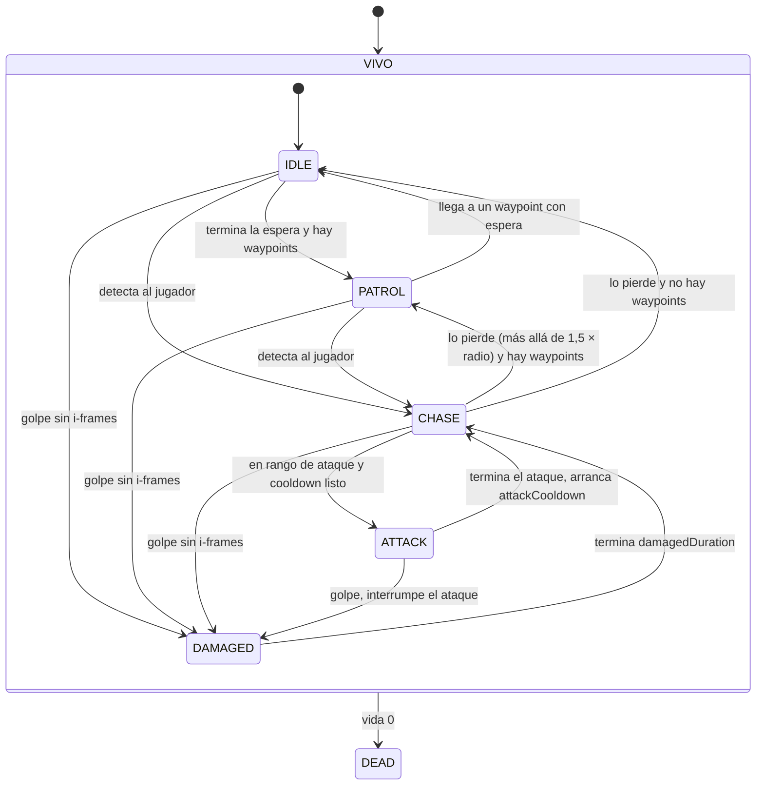

# FSM: Enemigo

> Generado automáticamente desde la tabla de transiciones del código
> (menú *Fragmentum → Exportar diagramas FSM*). No editar a mano.

| Desde | Hacia | Condición |
|---|---|---|
| IDLE | PATROL | termina la espera y hay waypoints |
| PATROL | IDLE | llega a un waypoint con espera |
| IDLE | CHASE | detecta al jugador |
| PATROL | CHASE | detecta al jugador |
| CHASE | ATTACK | en rango de ataque y cooldown listo |
| ATTACK | CHASE | termina el ataque, arranca attackCooldown |
| CHASE | PATROL | lo pierde (más allá de 1,5 × radio) y hay waypoints |
| CHASE | IDLE | lo pierde y no hay waypoints |
| IDLE | DAMAGED | golpe sin i-frames |
| PATROL | DAMAGED | golpe sin i-frames |
| CHASE | DAMAGED | golpe sin i-frames |
| ATTACK | DAMAGED | golpe, interrumpe el ataque |
| DAMAGED | CHASE | termina damagedDuration |
| IDLE | DEAD | vida 0 |
| PATROL | DEAD | vida 0 |
| CHASE | DEAD | vida 0 |
| ATTACK | DEAD | vida 0 |
| DAMAGED | DEAD | vida 0 |
