# FSM: Jefe

> Generado automáticamente desde la tabla de transiciones del código
> (menú *Fragmentum → Exportar diagramas FSM*). No editar a mano.

```mermaid
stateDiagram-v2
    [*] --> COMBATE
    state COMBATE {
        [*] --> PHASE_1
        PHASE_1
        PHASE_2
        PHASE_3
        VULNERABLE
        PHASE_1 --> PHASE_2 : vida <= umbral de la fase 2
        PHASE_2 --> PHASE_3 : vida <= umbral de la fase 3, si existe
        PHASE_1 --> VULNERABLE : AbrirVentanaVulnerable()
        PHASE_2 --> VULNERABLE : AbrirVentanaVulnerable()
        PHASE_3 --> VULNERABLE : AbrirVentanaVulnerable()
        VULNERABLE --> PHASE_1 : termina la ventana; vida por encima de la fase 2
        VULNERABLE --> PHASE_2 : termina la ventana; vida entre umbrales
        VULNERABLE --> PHASE_3 : termina la ventana; vida en la fase 3
    }
    COMBATE --> DEFEATED : CondicionDerrota()
```

| Desde | Hacia | Condición |
|---|---|---|
| PHASE_1 | PHASE_2 | vida <= umbral de la fase 2 |
| PHASE_2 | PHASE_3 | vida <= umbral de la fase 3, si existe |
| PHASE_1 | VULNERABLE | AbrirVentanaVulnerable() |
| PHASE_2 | VULNERABLE | AbrirVentanaVulnerable() |
| PHASE_3 | VULNERABLE | AbrirVentanaVulnerable() |
| VULNERABLE | PHASE_1 | termina la ventana; vida por encima de la fase 2 |
| VULNERABLE | PHASE_2 | termina la ventana; vida entre umbrales |
| VULNERABLE | PHASE_3 | termina la ventana; vida en la fase 3 |
| PHASE_1 | DEFEATED | CondicionDerrota() |
| PHASE_2 | DEFEATED | CondicionDerrota() |
| PHASE_3 | DEFEATED | CondicionDerrota() |
| VULNERABLE | DEFEATED | CondicionDerrota() |
