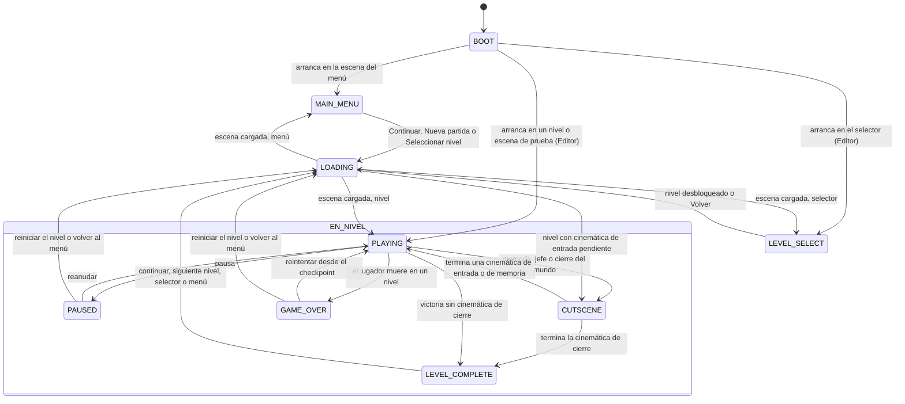

# FSM: Juego

> Generado automáticamente desde la tabla de transiciones del código
> (menú *Fragmentum → Exportar diagramas FSM*). No editar a mano.

| Desde | Hacia | Condición |
|---|---|---|
| BOOT | MAIN_MENU | arranca en la escena del menú |
| BOOT | LEVEL_SELECT | arranca en el selector (Editor) |
| BOOT | PLAYING | arranca en un nivel o escena de prueba (Editor) |
| MAIN_MENU | LOADING | Continuar, Nueva partida o Seleccionar nivel |
| LEVEL_SELECT | LOADING | nivel desbloqueado o Volver |
| LOADING | MAIN_MENU | escena cargada: menú |
| LOADING | LEVEL_SELECT | escena cargada: selector |
| LOADING | PLAYING | escena cargada: nivel |
| LOADING | CUTSCENE | nivel con cinemática de entrada pendiente |
| PLAYING | PAUSED | pausa |
| PAUSED | PLAYING | reanudar |
| PAUSED | LOADING | reiniciar el nivel o volver al menú |
| PLAYING | CUTSCENE | memoria, jefe o cierre del mundo |
| CUTSCENE | PLAYING | termina una cinemática de entrada o de memoria |
| CUTSCENE | LEVEL_COMPLETE | termina la cinemática de cierre |
| PLAYING | GAME_OVER | el jugador muere en un nivel |
| GAME_OVER | PLAYING | reintentar desde el checkpoint |
| GAME_OVER | LOADING | reiniciar el nivel o volver al menú |
| PLAYING | LEVEL_COMPLETE | victoria sin cinemática de cierre |
| LEVEL_COMPLETE | LOADING | continuar: siguiente nivel, selector o menú |
