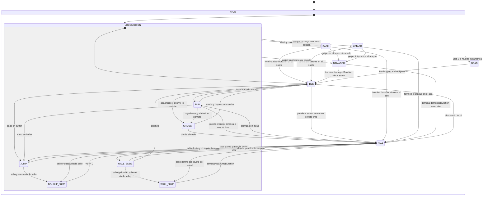

# FSM: Jugador

> Generado automáticamente desde la tabla de transiciones del código
> (menú *Fragmentum → Exportar diagramas FSM*). No editar a mano.

| Desde | Hacia | Condición |
|---|---|---|
| IDLE | RUN | input horizontal |
| RUN | IDLE | sin input |
| IDLE | CROUCH | agacharse y el nivel lo permite |
| RUN | CROUCH | agacharse y el nivel lo permite |
| CROUCH | IDLE | suelta y hay espacio arriba |
| CROUCH | FALL | pierde el suelo |
| IDLE | JUMP | salto en buffer |
| RUN | JUMP | salto en buffer |
| IDLE | FALL | pierde el suelo, arranca el coyote time |
| RUN | FALL | pierde el suelo, arranca el coyote time |
| FALL | JUMP | salto dentro del coyote time |
| JUMP | FALL | vy <= 0 |
| JUMP | DOUBLE_JUMP | salto y queda doble salto |
| FALL | DOUBLE_JUMP | salto y queda doble salto |
| DOUBLE_JUMP | FALL | vy <= 0 |
| FALL | IDLE | aterriza sin input |
| FALL | RUN | aterriza con input |
| FALL | WALL_SLIDE | toca pared y empuja hacia ella |
| WALL_SLIDE | WALL_JUMP | salto (prioridad sobre el doble salto) |
| WALL_SLIDE | FALL | deja la pared o de empujar |
| WALL_SLIDE | IDLE | aterriza |
| FALL | WALL_JUMP | salto dentro del coyote de pared |
| WALL_JUMP | FALL | termina wallJumpDuration |
| IDLE | DASH | dash y cooldown listo |
| RUN | DASH | dash y cooldown listo |
| CROUCH | DASH | dash y cooldown listo |
| JUMP | DASH | dash y cooldown listo |
| DOUBLE_JUMP | DASH | dash y cooldown listo |
| FALL | DASH | dash y cooldown listo |
| WALL_SLIDE | DASH | dash y cooldown listo |
| WALL_JUMP | DASH | dash y cooldown listo |
| IDLE | ATTACK | ataque, o carga completa soltada |
| RUN | ATTACK | ataque, o carga completa soltada |
| CROUCH | ATTACK | ataque, o carga completa soltada |
| JUMP | ATTACK | ataque, o carga completa soltada |
| DOUBLE_JUMP | ATTACK | ataque, o carga completa soltada |
| FALL | ATTACK | ataque, o carga completa soltada |
| WALL_SLIDE | ATTACK | ataque, o carga completa soltada |
| WALL_JUMP | ATTACK | ataque, o carga completa soltada |
| DASH | IDLE | termina dashDuration en el suelo |
| DASH | FALL | termina dashDuration en el aire |
| ATTACK | IDLE | termina el ataque en el suelo |
| ATTACK | FALL | termina el ataque en el aire |
| IDLE | DAMAGED | golpe sin i-frames ni escudo |
| RUN | DAMAGED | golpe sin i-frames ni escudo |
| CROUCH | DAMAGED | golpe sin i-frames ni escudo |
| JUMP | DAMAGED | golpe sin i-frames ni escudo |
| DOUBLE_JUMP | DAMAGED | golpe sin i-frames ni escudo |
| FALL | DAMAGED | golpe sin i-frames ni escudo |
| WALL_SLIDE | DAMAGED | golpe sin i-frames ni escudo |
| WALL_JUMP | DAMAGED | golpe sin i-frames ni escudo |
| DASH | DAMAGED | golpe sin i-frames ni escudo |
| ATTACK | DAMAGED | golpe, interrumpe el ataque |
| DAMAGED | IDLE | termina damagedDuration en el suelo |
| DAMAGED | FALL | termina damagedDuration en el aire |
| IDLE | DEAD | vida 0 o muerte instantánea |
| RUN | DEAD | vida 0 o muerte instantánea |
| CROUCH | DEAD | vida 0 o muerte instantánea |
| JUMP | DEAD | vida 0 o muerte instantánea |
| DOUBLE_JUMP | DEAD | vida 0 o muerte instantánea |
| FALL | DEAD | vida 0 o muerte instantánea |
| WALL_SLIDE | DEAD | vida 0 o muerte instantánea |
| WALL_JUMP | DEAD | vida 0 o muerte instantánea |
| DASH | DEAD | vida 0 o muerte instantánea |
| ATTACK | DEAD | vida 0 o muerte instantánea |
| DAMAGED | DEAD | vida 0 o muerte instantánea |
| DEAD | IDLE | Revivir() en el checkpoint |
