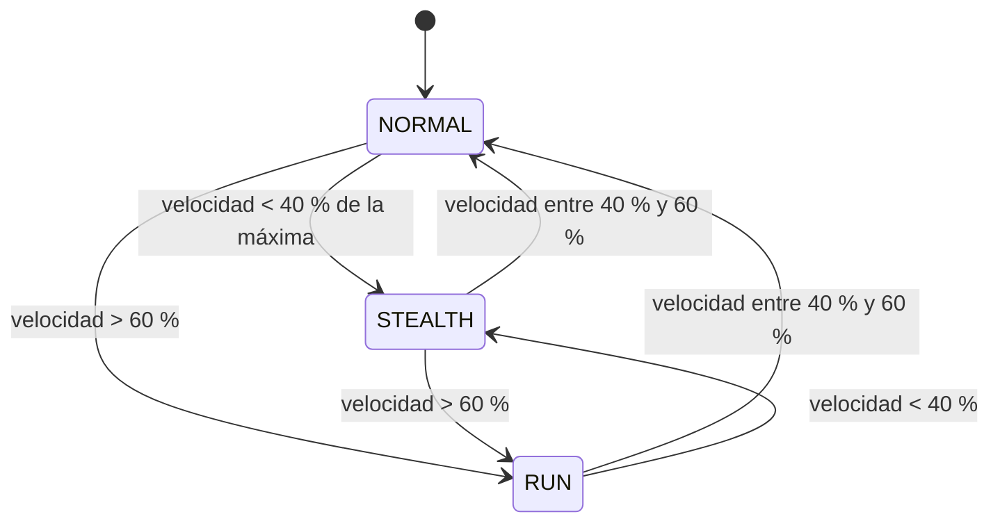

# FSM: JugadorModoMovimiento

> Generado automáticamente desde la tabla de transiciones del código
> (menú *Fragmentum → Exportar diagramas FSM*). No editar a mano.

| Desde | Hacia | Condición |
|---|---|---|
| NORMAL | STEALTH | velocidad < 40 % de la máxima |
| STEALTH | NORMAL | velocidad entre 40 % y 60 % |
| NORMAL | RUN | velocidad > 60 % |
| RUN | NORMAL | velocidad entre 40 % y 60 % |
| STEALTH | RUN | velocidad > 60 % |
| RUN | STEALTH | velocidad < 40 % |
