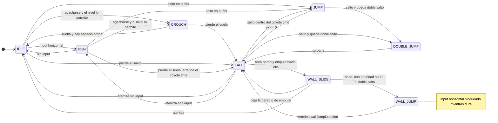
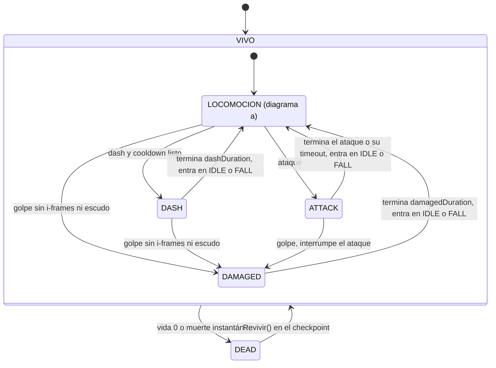
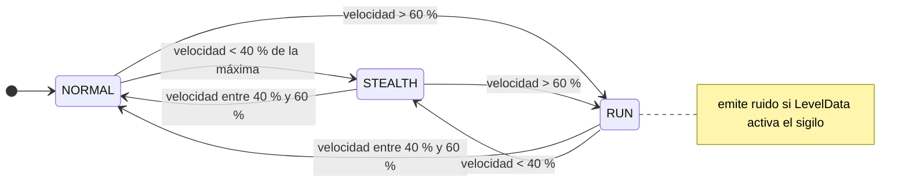
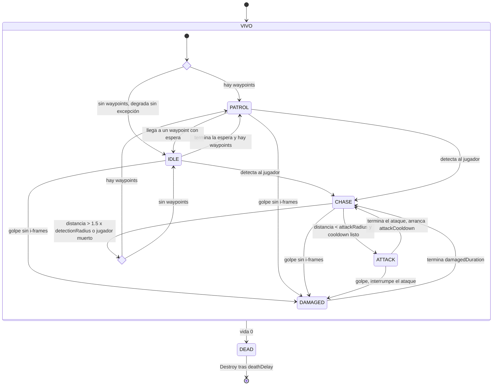
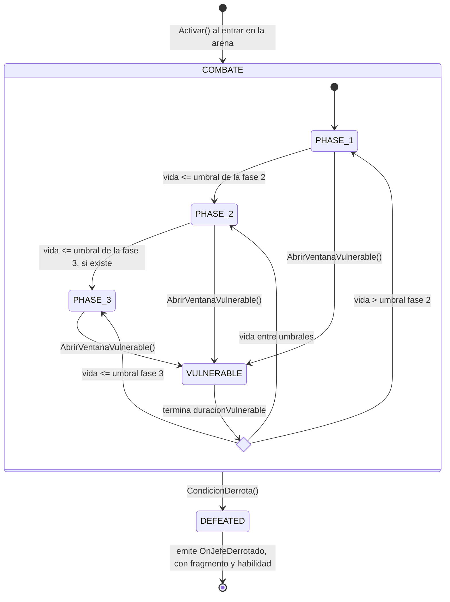
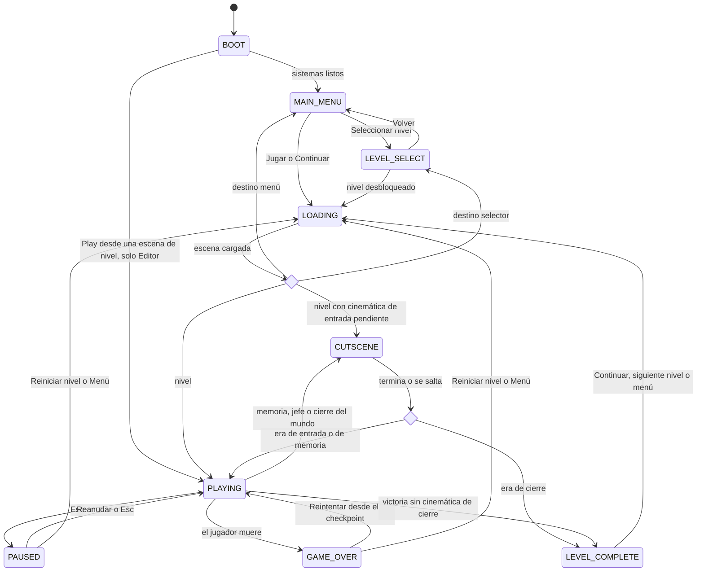
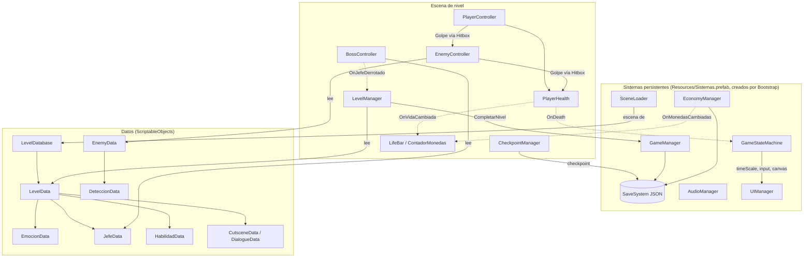

# Plan de arquitectura: Fase 1

> **Fragmentum: Ecos de la Identidad.** Versión 1.1 (2026-09-19). **Aprobado**.
> Base: auditoría de la Fase 0 sobre el proyecto v1 (`Tesis`) y `PENDIENTES.md`.
> Este documento **no contiene código**. Describe qué se construye, en qué orden y cómo se verifica.

## Revisión 1.1: el trabajo se traslada a Tesis2.0

La versión 1.0 de este plan se escribió sobre el proyecto original (`Tesis`, Unity 6000.2.14f1).
Tras revisar `Tesis2.0` se decidió construir ahí la **v2** del juego, con el arte nuevo generado
con Gemini, y dejar `Tesis` congelado como **v1** de referencia para la comparación
«antes / después» de la tesis.

| Qué cambia | Detalle |
|---|---|
| Proyecto destino | `Tesis2.0`. Línea base en git: commit `46f56ed`. |
| Motor | Unity **6000.6.0f1** (antes 6000.2.14f1). |
| Input | El Input System es el **único** sistema de entrada activo. El adaptador `IFuenteInput` se implementa sobre él desde el principio, no como migración futura. |
| Escala | El tileset nuevo son 32 px por tile a 32 PPU, así que **1 tile = 1 unidad** y las medidas del Anexo A se traducen directamente. |
| Orden de fases | El jugador pasa antes que los enemigos: en un proyecto vacío no se puede probar un enemigo sin jugador (ver §9). |
| Compatibilidad con escenas viejas | La sección §8 se simplifica: no hay que conservar GUID ni escribir migradores para las escenas del prototipo, porque las escenas se construyen de cero. El cuidado con los `.meta` se mantiene solo para los assets que se importen desde `Tesis`. |
| Decisiones | P1 (patrón State con clases), P2 (orden de fases), P3 (limpieza), P4 (modo batch) y P5 (pruebas automáticas) quedaron aprobadas. S6: el dash va en **Shift izquierdo**, que es la tecla que ya trae la acción *Sprint*. |

## Revisión 1.2: ajustes tras la Fase 3 (2026-09-28)

| Qué cambia | Detalle |
|---|---|
| Motor | Unity **6000.6.3f1**, la versión instalada en el PC nuevo. `Object.FindFirstObjectByType` está obsoleto en 6000.6: se usa `FindAnyObjectByType`. |
| FSM del jugador (§3.2) | DASH y ATTACK salen de los **8** subestados de LOCOMOCION, no de 5. El superestado implementa la salida una vez y cada subestado solo refina la condición. |
| FSM del jugador (§3.1) | Se añade **FALL → WALL_JUMP** (coyote de pared, 0,1 s tras soltar la pared). |
| FSM del jugador (§3.2) | DASH, ATTACK y DAMAGED vuelven a IDLE o FALL; IDLE → RUN se encadena en el mismo frame. |
| Diagramas | El exportador anida los superestados (LOCOMOCION dentro de VIVO). Los diagramas reales están en `Docs/FSM/`. |
| Verificación (§8.5) | Además de las pruebas EditMode, hay **pruebas PlayMode** que comprueban con física real los criterios de aceptación del jugador. Se amplían en cada fase jugable. |
| Input | Nueva acción `Ability` (Q o RB) para la invisibilidad; Ctrl izquierdo también agacha. |

### Ajustes tras la Fase 4 (2026-09-28)

| Qué cambia | Detalle |
|---|---|
| FSM del enemigo (§3.4) | La elección inicial «¿hay waypoints?» se resuelve arrancando en IDLE sin espera: con ruta, IDLE → PATROL ocurre en el primer frame. El diagrama real está en `Docs/FSM/Enemigo.md`. |
| Colisiones | El cuerpo del jugador no choca con el de los enemigos, ni los enemigos entre sí (Player × Enemy y Enemy × Enemy en la matriz). El daño por contacto va por una hitbox `Contacto`. |
| Enemigos | Se añade `evitarBordes`: no avanzan hacia un borde ni contra una pared. |
| Datos | `EnemyData` añade `danioContacto`, `alturaAtaque`, `factorHisteresis`, ventana de golpe y `tinte` provisional. |
| Verificación (§8.5) | El proyecto de verificación vive ahora en el repositorio: `Herramientas/verificar.ps1` compila sin abrir Unity y, con `-Unity`, regenera todo y ejecuta las pruebas EditMode y PlayMode. |

Estado de las fases: **2 hecha** · **3 hecha** · **4 hecha** (las dos últimas pendientes de tu prueba en el Editor, ver `PENDIENTES.md` N1 y N7) · 5 en adelante por hacer.

---

## 0. Supuestos de partida

Tomo como válidas las propuestas de la Fase 0 mientras no digas lo contrario. Todas salvo S1 y S6 afectan **solo a datos** y se pueden cambiar después sin tocar código.

| # | Supuesto | Origen |
|---|----------|--------|
| S1 | Plataforma: **Unity 6000.6.0f1** (proyecto `Tesis2.0`). Se usan las API de Unity 6; ojo: `Object.GetInstanceID()` está obsoleto en esta versión. | PENDIENTES D1 |
| S2 | Título canónico: **Fragmentum: Ecos de la Identidad**. | D4 |
| S3 | Jefes: **Centinela Ardiente**, Doncella del Lamento, Espectro del Pavor, **Juez Silente**, El Verdadero Soldado. | D5, D6 |
| S4 | Nivel 5: emoción **Esperanza**, con «aceptación» como descriptor. | D7 |
| S5 | Escenas: `Menu_Inicial`, `Niveles`, `Level1`…`Level5`, `LevelFinal`. Los nombres viven solo en `LevelDatabase`. | D8 |
| S6 | Dash en **Shift izquierdo** (acción *Sprint*); **E** es «interactuar» (acción *Interact*: antorchas y memorias). | D10 |
| S7 | UI en español; los textos visibles viven en datos. | D11 |
| S8 | Jefe2 = Doncella del Lamento y Jefe3 = Espectro del Pavor (solo afecta a qué sprite de referencia se asigna). | D9 |
| S9 | Se mantienen las capas actuales `suelo` (3) y `Wall` (6) **además** de las del Anexo A, porque la detección de suelo y pared por capa las necesita. | Auditoría 3.3 |

---

## 1. Recomendación: `switch` frente a patrón State

**Recomiendo la Opción 2: patrón State con clases**, apoyada en tres decisiones que reducen su coste:

1. **Un único núcleo genérico** (`MaquinaEstados<TEstado, TDueño>`) compartido por las cuatro FSM. En él vive el único `TransitionTo`, junto con la llamada a `OnExit`/`OnEnter`, el evento `OnStateChanged` y el registro de depuración.
2. **Una tabla de transiciones declarada** por cada FSM: la función de transición δ, escrita en un solo método estático. `TransitionTo` rechaza, con un `Debug.LogError`, cualquier transición que no esté en la tabla. Un menú del Editor **genera los diagramas Mermaid a partir de esa tabla**, así que el criterio «cada diagrama corresponde exactamente al código» se puede comprobar, no solo afirmar.
3. **Estados jerárquicos por herencia donde ahorran transiciones.** `PlayerLocomotionState` es el superestado de IDLE, RUN, JUMP, etc., e implementa una sola vez las salidas comunes hacia DASH y ATTACK. Las fases del jefe son **una sola clase** parametrizada con datos, no tres.

### Comparación

| Criterio | Opción 1: `switch` + `HandleX()` | Opción 2: State con clases (recomendada) |
|---|---|---|
| Coste de implementación | Bajo: ~4 archivos grandes. `TransitionTo` + `OnEnter`/`OnExit` se repiten en cada controlador. | Medio: núcleo de ~150 líneas + ~30 clases pequeñas (20-80 líneas). Unos **30-40 % más de código**. |
| Punto único de transición | Hay que respetarlo por disciplina en 4 archivos. | Garantizado por construcción: solo el núcleo cambia de estado, y además valida contra la tabla. |
| Variantes por mundo emocional | Crece el `switch` o se añaden condicionales por tipo de enemigo. | Se cambia una estrategia (`DeteccionData`) o un estado, no el controlador. |
| Jefes por fases | Un `switch` por jefe, o condicionales por fase. | `BossPhaseState` reutilizado; cada jefe solo aporta datos y patrones. |
| Depuración | Muy directa. | Igual de directa: el `enum` `currentState` sigue visible en el Inspector, con `OnStateChanged` y una etiqueta en los Gizmos. |
| Valor para la tesis | «FSM explícita». Válido, pero no es un patrón GoF nombrable. | **Patrón State (GoF)** + HSM + Strategy + Template Method. El diagrama de clases UML sale directo del código y los diagramas de estados se generan de la tabla. |
| Riesgo | Volver al `Update()` monolítico con el tiempo. | Fragmentación excesiva. Mitigación: solo se crea una clase si el estado tiene comportamiento propio. |

**Coste frente a valor:** la Opción 2 cuesta aproximadamente un día más de implementación repartido entre las fases 3, 5 y 7. A cambio da tres argumentos de tesis (patrones nombrados, UML fiel, diagramas verificables) y hace baratas las variantes por emoción, que son el núcleo del diseño.

**Si prefieres la Opción 1**, mantendría igualmente el núcleo genérico y la tabla de transiciones, con manejadores por `switch`. Costaría un 30 % menos y perdería el argumento GoF.

> En ambos casos **no** se usa el Animator como FSM (`StateMachineBehaviour`). La lógica vive en el código; el Animator solo presenta. Cada estado fija los parámetros en su `OnEnter`/`OnExit`.

---

## 2. Núcleo común de las FSM (`Scripts/Core/FSM`)

| Elemento | Responsabilidad |
|---|---|
| `IEstado<TEstado>` | Contrato: `OnEnter()`, `OnExit()`, `Actualizar()` (Update), `ActualizarFisica()` (FixedUpdate) y `EvaluarTransiciones()`, que devuelve el siguiente estado o ninguno. |
| `MaquinaEstados<TEstado, TDueño>` | Registra los estados, guarda `EstadoActual` y `EstadoAnterior`, y expone el **único** `TransitionTo(TEstado nuevo)`: valida contra la tabla, llama a `OnExit` del actual y `OnEnter` del nuevo, y emite `OnStateChanged(anterior, nuevo)`. |
| `TablaTransiciones<TEstado>` | Lista de `(desde, hacia, condición en texto)` y grupos (superestados, «VIVO»). Se declara en un método estático `DeclararTransiciones` de cada controlador, que también lee el exportador. |
| `ExportadorDiagramasFSM` (Editor) | Menú *Fragmentum → Exportar diagramas FSM*: escribe `Docs/FSM/*.md` con `stateDiagram-v2` generado desde las tablas. |

**Regla de flujo:** los estados **no** llaman a `TransitionTo`. Devuelven su deseo en `EvaluarTransiciones()` y la máquina lo ejecuta. Los eventos externos (daño, muerte, pausa) llegan al controlador, que llama a `maquina.TransitionTo(...)`. Esa llamada sigue pasando por el mismo método y por la tabla.

---

## 3. Diagramas de las FSM propuestas

> Son el diseño objetivo. Tras cada fase se regeneran desde el código con el exportador y se comparan.

### 3.1 Jugador: (a) locomoción



- El doble salto se recarga al aterrizar y al entrar en `WALL_SLIDE`.
- El coyote time solo se activa si `FALL` viene de IDLE, RUN o CROUCH, no del vértice de un salto.
- La dirección del wall jump es el **signo** de la normal de la pared, no `localScale.x`. Esto corrige N3.

### 3.2 Jugador: (b) acciones, daño y muerte



- `DASH` sale de IDLE, RUN, JUMP, DOUBLE_JUMP y FALL.
- `ATTACK` sale de esos mismos estados; lo implementa una vez el superestado `PlayerLocomotionState`.
- `ATTACK` tiene un **timeout** por código, de modo que un evento de animación perdido nunca deja al jugador bloqueado.
- **Habilidades como modificadores, no como estados nuevos:**
  - *Ataque cargado:* `ATTACK` con tiempo de pulsación y daño aumentado; puede detonar `Explodable`.
  - *Dash acuático:* `DASH` permitido dentro de `UnderwaterZone`.
  - *Invisibilidad parcial:* temporizador en `PlayerAbilities`, 3 s de duración y 8 s de cooldown.
  - *Defensa reforzada:* escudo en `PlayerHealth` que absorbe 1 golpe cada 15 s, antes de entrar en `DAMAGED`.
- **Mecánicas de nivel:**
  - *Bajo el agua:* modificador de `PlayerMotor` (gravedad ×0,3, velocidad ×0,6) más oxígeno.
  - *Agacharse:* estado `CROUCH`.
  - *Sigilo:* región ortogonal (c).

### 3.3 Jugador: (c) región ortogonal de modo de movimiento (sigilo, Nivel 3)



Es otra instancia del mismo núcleo, con su propio `enum MODOS_MOVIMIENTO`. Corre en paralelo a la FSM principal y solo publica `OnRuido(posición, radio)`, que consume la estrategia `DeteccionPorRuido` de los Centinelas Ciegos.

### 3.4 Enemigo



- **«Detecta al jugador»** lo decide la estrategia `DeteccionData` de cada `EnemyData`:
  - `PorDistancia`: genérico.
  - `ConVision`: no ve a través de muros; corrige N11.
  - `EnOscuridad`: solo se acerca si el jugador no está iluminado (Miedo).
  - `PorRuido`: Centinelas Ciegos.
- **`OnEnter` de cada estado** fija el Animator con los parámetros actuales (sin renombrar ninguno):
  - `MovEn` en PATROL y CHASE.
  - `Attack` en ATTACK.
  - `Damage` en DAMAGED.
  - `Death` en DEAD.
- **`DEAD`** desactiva los colliders, deja el Rigidbody en `Kinematic`, dispara `Death` y destruye el objeto tras `deathDelay`. Además, un cadáver no hace daño; corrige N6.
- **Receptores de eventos de animación:** se mantienen `CancelAttack()` y `DesactiveDamage()` como métodos públicos que *notifican* el fin del clip, para que los eventos de `EnemyAttack.anim` y `EnemyHurt.anim` sigan teniendo receptor.

### 3.5 Jefe (`BossController` abstracto)



- **Los jefes no tienen estado `DAMAGED`.** Recibir daño es un efecto (parpadeo) que no interrumpe el patrón en curso. Así ningún jefe puede quedar congelado por un golpe (el bug N1b).
- **Qué hace cada fase:** `BossPhaseState` es una sola clase instanciada tres veces con datos distintos (`FaseJefe`). Ejecuta en bucle los `PatronAtaque` (ScriptableObjects, patrón Strategy) de su fase.
- **Métodos que cada jefe redefine (Template Method):**
  - `CondicionDerrota()`: vida 0, o «integración completada» en el jefe final.
  - `AlCambiarDeFase()`.
  - `AlSerDerrotado()`.
- **Ventana `VULNERABLE`:**
  - La abre el patrón o el propio jefe; por ejemplo, el Juez Silente cuando se activa la memoria correcta.
  - Multiplica el daño recibido.
  - Con `JefeData.inmuneFueraDeVulnerable`, el jefe solo recibe daño en esa ventana.

| Jefe | Fases (umbral de vida) | Patrones | Estado de implementación |
|---|---|---|---|
| **Centinela Ardiente** | PHASE_1 (100 %) → PHASE_2 (50 %) | F1: `Martillazo` (abre ventana de 1,2 s con el martillo clavado) + `OndaDeSuelo`. F2: añade `PlataformasEnErupcion`. | **Completo** (referencia) |
| Doncella del Lamento | 100 % → 50 % | Olas (proyectil) e inundación; congelamiento | Esqueleto documentado |
| Espectro del Pavor | 100 % → 50 % | Ataque con destello de 1 s; 3 clones, uno real | Esqueleto |
| Juez Silente | 100 % → 50 % | Inmune salvo en `VULNERABLE` (memoria correcta); en F2 hay dos memorias, una trampa | Esqueleto |
| El Verdadero Soldado | 100 % → 60 % → 30 % | F1: espejo de ataques. F2: zonas de cada mundo. F3: sin ataques; `CondicionDerrota` = llegar al fragmento de luz | Esqueleto |

### 3.6 Juego global (`GameStateMachine`)



**Efectos de cada estado.** Es la única fuente de `Time.timeScale`: se eliminan las 5 escrituras dispersas actuales.

| Estado | `Time.timeScale` | Input de gameplay | Canvas activo |
|---|---|---|---|
| BOOT | 1 | bloqueado | — |
| MAIN_MENU | 1 | bloqueado | Menú principal |
| LEVEL_SELECT | 1 | bloqueado | Selector |
| LOADING | 1 | bloqueado | Carga (fade) |
| PLAYING | 1 | libre | HUD |
| PAUSED | 0 | bloqueado | Pausa sobre el HUD |
| CUTSCENE | 0 | bloqueado | Cinemática |
| GAME_OVER | 0 | bloqueado | Game Over |
| LEVEL_COMPLETE | 0 | bloqueado | Fin de nivel: registro emocional (omitible) y fragmento |

La UI usa tiempo sin escala, así que funciona con `timeScale = 0`. La cinemática inicial es la `cinematicaEntrada` del Nivel 1 marcada como «solo la primera vez».

---

## 4. Arquitectura objetivo (dependencias)



**Principios aplicados:**
- **Nada busca por nombre.** Las referencias llegan por Inspector o por tag (`GameTags`, un solo archivo) con un aviso claro si faltan.
- **Los datos no conocen a los controladores.**
- **La UI solo escucha eventos.**
- **Solo `GameManager` es singleton de progresión.** Los demás servicios persistentes cuelgan del mismo prefab.

---

## 5. Árbol de carpetas y archivos resultante

Leyenda:
- **[N]** nuevo.
- **[M]** reescrito conservando el GUID, así que las escenas no pierden la referencia.
- **[R]** renombrado o movido conservando el GUID (se mueve junto con su `.meta`).
- **[X]** eliminado.

```
Assets/
├── Scripts/
│   ├── Core/
│   │   ├── GameTags.cs                 [N] tags, capas y máscaras como constantes
│   │   ├── AnimatorParams.cs           [N] hashes: MovEn, Attack, Damage, Death, Movement, Walk
│   │   ├── ReferenciaEscena.cs         [N] escena como asset en el Editor + nombre validado
│   │   ├── Bootstrap.cs                [N] crea los sistemas persistentes antes de la 1.ª escena
│   │   ├── GameManager.cs              [M][R] progresión global persistente (sale de Scripts/)
│   │   ├── GameStateMachine.cs         [N] FSM global
│   │   ├── EconomyManager.cs           [N] monedas (se guardan)
│   │   ├── SceneLoader.cs              [N] carga asíncrona + fade
│   │   ├── EventosJuego.cs             [N] eventos globales (Observer)
│   │   ├── FSM/        IEstado.cs, EstadoBase.cs, MaquinaEstados.cs, TablaTransiciones.cs   [N]
│   │   ├── Combate/    IGolpeable.cs, Golpe.cs, Health.cs, Hitbox.cs, Proyectil.cs          [N]
│   │   ├── Input/      IFuenteInput.cs, InputClasico.cs                                     [N]
│   │   ├── Audio/      AudioManager.cs                                                      [N]
│   │   └── Save/       SaveSystem.cs, DatosGuardado.cs, MigracionPlayerPrefs.cs             [N]
│   ├── Player/
│   │   ├── PlayerController.cs         [M][R] ← PlayerMovement.cs (mismo GUID: el Player no pierde el componente)
│   │   ├── PlayerMotor.cs              [N] física en FixedUpdate + modificadores
│   │   ├── PlayerSensors.cs            [N] pared y techo; usa CheckGround
│   │   ├── CheckGround.cs              [M][R] OverlapBox + LayerMask sobre su propio collider
│   │   ├── PlayerHealth.cs             [N] : Health + defensa reforzada
│   │   ├── PlayerAbilities.cs          [N] habilidades según el progreso guardado
│   │   └── States/  PlayerLocomotionState (superestado), PlayerIdleState, PlayerRunState,
│   │                PlayerCrouchState, PlayerJumpState, PlayerDoubleJumpState, PlayerFallState,
│   │                PlayerWallSlideState, PlayerWallJumpState, PlayerDashState,
│   │                PlayerAttackState, PlayerDamagedState, PlayerDeadState      [N] ×13
│   ├── Enemies/
│   │   ├── EnemyController.cs          [M][R] contexto de la FSM
│   │   ├── Deteccion/  DeteccionData (abstracta), DeteccionPorDistancia, DeteccionConVision,
│   │   │               DeteccionEnOscuridad, DeteccionPorRuido                  [N]
│   │   └── States/     EnemyIdleState, EnemyPatrolState, EnemyChaseState, EnemyAttackState,
│   │                   EnemyDamagedState, EnemyDeadState                        [N] ×6
│   ├── Bosses/
│   │   ├── BossController.cs           [N] abstracta (GUID nuevo)
│   │   ├── CentinelaArdiente.cs        [M][R] ← BossController.cs actual (mismo GUID: Jefe1 pasa a ser Centinela sin reasignar)
│   │   ├── DoncellaLamento.cs, EspectroDelPavor.cs, JuezSilente.cs, VerdaderoSoldado.cs  [N] esqueletos compilables
│   │   ├── Patrones/   PatronAtaque (abstracta), PatronMartillazo, PatronOndaSuelo,
│   │   │               PatronPlataformasErupcion                                [N]
│   │   └── States/     BossPhaseState, BossVulnerableState, BossDefeatedState   [N]
│   ├── Levels/
│   │   ├── LevelManager.cs, CheckpointManager.cs, Checkpoint.cs, ArenaJefe.cs, SalidaNivel.cs  [N]
│   │   ├── DeadZone.cs                 [M][R]
│   │   ├── Escenario/  CameraMovement.cs [M][R], ParallaxMovement.cs [M][R]
│   │   ├── Objetos/    Moneda.cs [M][R], Pocion.cs [M][R] ← pocion.cs, Caja.cs [M][R]
│   │   └── Mecanicas/  PlatformCrumble, HotPlatform, Lava, IceSurface, UnderwaterZone,
│   │                   EchoRecorder, Torch, FalsePlatform, Explodable, MemoryObject,
│   │                   GardenGuardian, PlataformaMovil, TrampaOculta, ZonaCobertura,
│   │                   SistemaConsecuencias                                     [N]
│   ├── UI/
│   │   ├── UIManager.cs, ContadorMonedas.cs, BotonNivel.cs, PantallaGameOver.cs,
│   │   │   PantallaCarga.cs, PantallaFinNivel.cs, BurbujaOxigeno.cs             [N]
│   │   ├── LifeBar.cs [M][R], MainMenu.cs [M][R], SelectorNivel.cs [M][R]
│   │   └── MenuPausa.cs                [M][R] ← Pause.cs (mismo GUID)
│   ├── Data/
│   │   └── EmocionData, LevelData, LevelDatabase, EnemyData, JefeData (con FaseJefe[]),
│   │       HabilidadData, FragmentoData                                         [N]
│   ├── Narrative/
│   │   └── CutsceneData, CutscenePlayer, DialogueData, DialogueManager, RegistroEmocional,
│   │       PantallaRegistroEmocional, PantallaYoReconstruido                    [N]
│   └── Editor/
│       ├── ConfiguradorProyecto.cs     [N] tags, capas, matriz de colisión y Build Settings desde LevelDatabase
│       ├── LevelDatabaseEditor.cs      [N] validación: avisa si una escena no está en Build Settings
│       ├── ExportadorDiagramasFSM.cs   [N] Mermaid generado desde las tablas de transición
│       ├── GeneradorDatosIniciales.cs  [N] crea los assets de datos con los valores del Anexo A
│       └── MigradorEscenas.cs          [N] migración idempotente por fase (componentes, referencias, OnClick)
├── Data/                                [N] instancias de ScriptableObject
│   ├── Emociones/   Ira, Tristeza, Miedo, Culpa, Esperanza, Integracion
│   ├── Niveles/     LevelDatabase, L1_Ira … L5_Esperanza, L6_Final
│   ├── Enemigos/    Generico, SoldadoLava, GolemCeniza, (variantes de Tristeza y Miedo)
│   ├── Jefes/       CentinelaArdiente (+ patrones), esqueletos del resto
│   ├── Habilidades/ AtaqueCargado, DashAcuatico, InvisibilidadParcial, DefensaReforzada
│   ├── Fragmentos/  Ira, Tristeza, Miedo, Culpa, Esperanza
│   └── Narrativa/   Cinematica_Inicial, cierres, Dialogos_L1 … (con placeholders marcados)
├── Resources/Sistemas.prefab            [N] servicios persistentes
├── Prefabs/     Player.prefab [N], Enemy.prefab [M], Checkpoint.prefab [N], prefabs de mecánicas [N]
├── Scenes/      Level2 … Level5, LevelFinal [N] (esqueletos generados); Level1 [M] (migrado)
└── (limpieza)   _Recovery/ [X], *.zip [X], clips .anim de un solo frame [X],
                 Character.physicMaterial [X], materiales sin uso [X],
                 escena Demo de Pixel Adventure [X], TMP Examples & Extras [X, opcional]
Docs/FSM/*.md                            [N] diagramas exportados
CHANGELOG.md                             [N] problema → causa → solución, actualizado en cada fase
```

**Sobre `Level1/Enemys`:** propongo convertir `Golem` en el mini-jefe Golem de Ceniza (con `EnemyController` y `EnemyData`), convertir `Enemy2` (FireWorm) en Soldado de lava, y mover el resto de sprites decorativos (Demon, Wizard y el `Player` de Kael) a una escena `Galeria` de pruebas. Así desaparece el segundo objeto llamado `Player`.

---

## 6. Modelo de datos

### 6.1 ScriptableObjects

| Asset | Campos principales |
|---|---|
| `EmocionData` | `id` (enum `EMOCIONES`), `nombreCanonico`, `descriptor` (p. ej. «impulsividad, rabia reprimida»), `color`, `icono` |
| `LevelData` | `id`, `escena` (`ReferenciaEscena`), `nombreMundo`, `emocion`, `paleta` (4 colores del Anexo A), `icono`, `jefe` (`JefeData`), `habilidadOtorgada`, `fragmento`, `sinopsis`, `musica`, `musicaJefe`, `cinematicaEntrada`, `cinematicaCierre`, `dialogos`, `dificultad` (1-5), `reglas` (agacharse, sigilo, oscuridad, radio de luz del jugador), `secciones` (rangos en u, que se dibujan como Gizmos para guiar el pintado del layout) |
| `LevelDatabase` | lista ordenada de `LevelData`, escenas de menú y selector. La regla de desbloqueo es secuencial. |
| `EnemyData` | `vidaMaxima` (int), `danio` (int), `velocidadPatrulla`, `velocidadPersecucion`, `detectionRadius`, `attackRadius`, `attackCooldown`, `duracionAtaque`, `damagedDuration`, `invulnerabilidad`, `resistenciaRetroceso`, `deathDelay`, `deteccion` (`DeteccionData`), `spriteMiraDerecha`, `toleranciaWaypoint`, `esperaEnWaypoint` |
| `JefeData` | `nombreCanonico`, `vidaMaxima`, `fases[]` (`FaseJefe`: fase, umbral de vida, patrones, pausa entre patrones), `duracionVulnerable`, `multiplicadorVulnerable`, `inmuneFueraDeVulnerable`, `fragmento` |
| `HabilidadData` / `FragmentoData` | id estable, nombre, descripción, duración, cooldown e ícono. Cada fragmento apunta a su habilidad. |
| `CutsceneData` | `diapositivas[]` (imagen, texto, duración, audio opcional), `saltable`, `soloPrimeraVez` |
| `DialogueData` | `lineas[]` (hablante, texto y momento: APERTURA / ECO_MEMORIA / PRE_JEFE / CIERRE) |

Todos los campos de arte y audio aceptan `null`: el sistema usa su placeholder, avisa con `Debug.LogWarning` y el hueco queda en `PENDIENTES.md`.

### 6.2 Guardado (`SaveSystem`)

- **Archivo:** `Application.persistentDataPath/fragmentum_guardado.json`.
- **Escritura atómica:** se escribe primero en un archivo temporal y luego se reemplaza, guardando copia `.bak`.
- **Versionado:** el campo `version` permite migrar el formato en el futuro.

```json
{
  "version": 1,
  "nivelMaximoAlcanzado": 2,
  "nivelesCompletados": [1],
  "fragmentos": ["IRA"],
  "habilidades": ["ATAQUE_CARGADO"],
  "monedas": 12,
  "checkpoint": { "nivelId": 2, "checkpointId": "L2_CP1" },
  "cinematicasVistas": ["INICIAL"],
  "memoriasActivadas": []
}
```

- **Migración desde PlayerPrefs:** si no existe el JSON y sí la clave `Monedas`, se importa ese valor y se marca como migrado. La clave antigua **no se borra**.
- **Cuándo se guarda:** al activar un checkpoint, al completar un nivel, al volver al menú y al cerrar la aplicación. Esto corrige que las monedas nunca se guardaran.
- **Registro emocional:** archivo aparte, `registro_emocional.json` + `registro_emocional.csv`, con fecha, nivel, emoción, valor de 1 a 5 y texto opcional. Admite un código de participante opcional para el pilotaje de la tesis. No guarda datos personales y todo queda en local.

---

## 7. Eventos (quién publica y quién escucha)

| Evento | Publica | Escuchan |
|---|---|---|
| `OnVidaCambiada(actual, max)`, `OnDamaged`, `OnHealed`, `OnDeath` | `PlayerHealth` | `LifeBar`, `PlayerController` (DAMAGED/DEAD), `AudioManager`, `GameStateMachine` (vía `EventosJuego.JugadorMurio`) |
| `OnStateChanged(anterior, nuevo)` | cada FSM | audio, VFX, depuración |
| `OnFaseCambiada`, `OnJefeDerrotado(JefeData)` | `BossController` | `LevelManager` (victoria), `GameManager` (fragmento y habilidad), UI |
| `FragmentoObtenido(FragmentoData)` | `GameManager` | `PantallaYoReconstruido`, `SaveSystem` |
| `OnMonedasCambiadas(int)` | `EconomyManager` | `ContadorMonedas` |
| `OnCheckpointActivado` | `CheckpointManager` | `SaveSystem`, UI |
| `OnLuzEncendida(posición, radio)` | `Torch` | enemigos con `DeteccionEnOscuridad` (despiertan) |
| `OnRuido(posición, radio)` | `ModoMovimiento` del jugador | `DeteccionPorRuido` |
| `OnMemoriaActivada` | `MemoryObject` | `SistemaConsecuencias` (Nivel 4), `GameStateMachine` (CUTSCENE) |

Uso eventos C# (`event Action<…>`) más un hub estático `EventosJuego` para los pocos eventos globales, en lugar de canales de eventos como ScriptableObject. Motivo: los canales exigen crear y asignar un asset por evento en el Inspector. Serían más pasos manuales y más referencias que pueden quedar vacías, justo lo que la regla de «construir para ausencia» quiere evitar.

---

## 8. Estrategia para no romper las escenas

1. **Mover y renombrar conservando el GUID.** Cada script se mueve junto con su `.meta` (`git mv` de ambos). Unity referencia los scripts por GUID, así que `Player`, `Jefe1`, `Enemy.prefab`, etc. conservan su componente. Los campos renombrados llevan `[FormerlySerializedAs]` para no perder los valores del Inspector.
2. **Este proyecto no debe estar abierto en Unity** mientras aplico una fase. Si Unity lo reimporta a medias, puede regenerar `.meta` y romper referencias. Hoy tienes abierto `Tesis2.0`, no este.
3. **Un migrador por fase** (*Fragmentum → Migrar escenas (Fase N)*), idempotente. Añade componentes, asigna referencias, reengancha los `OnClick` y avisa de lo que no pudo hacer. Así los «pasos manuales» se reducen a: abrir Unity, ejecutar el menú, revisar la consola y guardar.
4. **Los parámetros del Animator no se renombran.** Los estados nuevos del jugador (JUMP, FALL, WALL_SLIDE, DASH) no tienen clip todavía. Solo añadiré parámetros nuevos (`EnSuelo`, `VelocidadY`) cuando haya clips, y los documentaré uno por uno.
5. **Compilación y pruebas verificadas antes de entregar.** Un proyecto de verificación fuera de `Assets/` compila los tres ensamblados contra las DLL de Unity 6000.6.0f1 con `dotnet build`. Además se ejecuta Unity en modo batch para compilar de verdad y lanzar las pruebas EditMode. Cada fase se entrega con 0 errores y las pruebas en verde.
6. **Una rama por fase** (`fase-2-cimientos`, …). Se fusiona a `main` cuando la pruebas en Unity.

---

## 9. Orden de implementación

Cada fase deja el juego **jugable** de principio a fin con lo que exista. Al final de cada una entrego archivos completos, «Pasos manuales en el Editor», qué probar y la entrada de `CHANGELOG.md`.

| Fase | Contenido | Tareas del encargo | Criterios de aceptación que cierra |
|---|---|---|---|
| **2. Cimientos y parches** | Proyecto bajo git; carpetas y namespaces `Fragmentum.*`; `GameTags` y `AnimatorParams`; núcleo FSM + tabla + exportador; infraestructura de combate (`Golpe`, `Health`, `Hitbox`); `ConfiguradorProyecto` (tags, capas, matriz). Adaptador de input sobre el Input System; ensamblados propios (`.asmdef`) y pruebas EditMode del núcleo. Los bugs del prototipo no se parchean: no se hereda ese código. | F, parte de H (tags y capas) | — (estabilidad) |
| **3. Jugador** | `PlayerController` como FSM (a, b, c); `PlayerMotor` en `FixedUpdate` con `linearVelocity`; `CheckGround` con OverlapBox; coyote time y jump buffer; wall jump y dash corregidos; `PlayerHealth` con eventos; `LifeBar` por eventos; ganchos de `PlayerAbilities`; `CROUCH`; modificadores de movimiento. | **B** | Sin salto flotante; movimiento por física; plataformas solapadas; sin `GameObject.Find`. |
| **4. Enemigos** | `EnemyController` como FSM de 6 estados; `EnemyData` + estrategias de detección; patrulla con waypoints y degradación a IDLE; histéresis; cooldown; DAMAGED con i-frames; DEAD real; Gizmos; `OnStateChanged`; arma por `Hitbox` (sin fuego amigo). Assets: Genérico, Soldado de lava, Golem de Ceniza y variantes de Tristeza y Miedo. | **A** | Ataca por ambos lados; patrulla; variantes perceptiblemente distintas; un punto de transición. |
| **5. Niveles I: progresión** | `EmocionData`, `LevelData`, `LevelDatabase` + validador; datos generados desde el Anexo A; `SaveSystem` + migración; `GameManager` persistente (`Bootstrap`); `EconomyManager`; `SceneLoader` con fade; **`GameStateMachine`**; `MainMenu` con «Continuar»; `SelectorNivel` con mundo, emoción, candados, fragmentos y botón «Volver»; Build Settings generados desde `LevelDatabase`. Los niveles sin escena aparecen como «en construcción», nunca como error. | **D1-D4, D6, D7, E** | El progreso persiste; el selector solo muestra niveles válidos; ningún error de escena inexistente; sin nombres de escena en el código. |
| **6. Niveles II: flujo de nivel** | `LevelManager` (spawn, música y paleta desde `LevelData`, victoria, siguiente nivel); `CheckpointManager` y `Checkpoint`; respawn; `UIManager` con `PantallaGameOver` (sale del `GameManager`), `MenuPausa` (← `Pause`) y `PantallaFinNivel`; `Player.prefab`. | **D5, D8** | Jugable de principio a fin con checkpoints. |
| **7. Jefes** | `BossController` abstracto; **Centinela Ardiente completo** (martillazo, onda de suelo, erupción, ventana vulnerable, derrota → fragmento + Ataque Cargado); `ArenaJefe`; esqueletos de los otros 4; `JefeData`. | **C** | Evento de fragmento y habilidad al derrotar al jefe. |
| **8. Narrativa** | `CutscenePlayer` + `CutsceneData` (cinemática inicial como sistema, con placeholders evidentes); `DialogueManager` + `DialogueData` (apertura, eco, pre-jefe y cierre); registro emocional omitible con exportación JSON y CSV; pantalla «yo reconstruido». | **G**, §3.8.5 | La cinemática inicial funciona sin imágenes; ningún asset ausente bloquea el juego. |
| **9. Nivel 1 de referencia** | `PlatformCrumble`, `HotPlatform`, `Lava`, `Proyectil` (torreta), checkpoint a 40 u, Golem de Ceniza y Soldados de lava colocados, arena cerrada; secciones del Anexo A dibujadas como Gizmos. **El pintado de tiles hasta 80 u es trabajo tuyo en el Editor** (queda en `PENDIENTES.md`); yo dejo prefabs y guías. | **H** (Nivel 1) | — |
| **10. Niveles 2 al final** | Resto de mecánicas (`IceSurface`, `UnderwaterZone` con oxígeno, `EchoRecorder`, `PlataformaMovil`, `Torch`, `FalsePlatform`, `TrampaOculta`, `Explodable`, `MemoryObject`, `SistemaConsecuencias`, `ZonaCobertura`, `GardenGuardian`); escenas esqueleto generadas con `LevelManager`, jugador, cámara y `LevelData`. | **H** (resto) | — |
| **11. Documentación** | `CHANGELOG.md` consolidado; tabla `clase \| patrón \| responsabilidad` fiel al código; diagramas exportados; `PENDIENTES.md` final. | Entregable final | Cada diagrama corresponde al código (se regeneran desde las tablas). |

**Por qué este orden.**
- `Tesis2.0` arranca vacío, así que la primera fase jugable tiene que ser la del jugador: sin jugador no hay forma de probar un enemigo.
- La 2 va antes porque todas las demás necesitan el núcleo FSM, `GameTags` y el combate por `Hitbox`.
- Las fases 4 (enemigos) y 5 (progresión) son tus dos prioridades máximas, y llegan en cuanto hay algo que jugar.
- Los assets que hagan falta (sprites de Kael, enemigos, música) se importan desde `Tesis` en la fase que los use, no antes.

---

## 10. Opción separada: nuevo Input System

**Estado actual:**
- El paquete ya está instalado (1.16.0).
- `InputSystem_Actions.inputactions` ya existe, con las acciones por defecto.
- Los `EventSystem` ya lo usan.
- `activeInputHandler = Both`.

**Recomendación:** no migrar ahora. `IFuenteInput` (patrón Adapter) aísla el gameplay del sistema de input. Migrar después consiste en escribir una segunda implementación, `InputSistemaNuevo`, sin tocar la FSM.

| | Coste | Beneficio |
|---|---|---|
| Migrar ya | ~0,5-1 día: mapa de acciones, implementación del adaptador y pruebas de mando | Mando y teclado, reasignación de teclas, sin el Input Manager obsoleto |
| Migrar más tarde (recomendado) | ~0,5 día gracias al adaptador | Igual, sin retrasar las prioridades A y D |

---

## 11. Patrones de diseño para la tesis (vista previa)

| Patrón | Dónde | Justificación |
|---|---|---|
| **State** (GoF) | Núcleo FSM + estados de jugador, enemigo, jefe y juego | El comportamiento depende del estado; las transiciones son explícitas y verificables. |
| **Estado jerárquico (HSM)** | `PlayerLocomotionState`; grupo VIVO | Evita duplicar las transiciones comunes. |
| **Template Method** (GoF) | `BossController` abstracto | Cada jefe redefine sus pasos, no el flujo de fases. |
| **Strategy** (GoF) | `DeteccionData`, `PatronAtaque` | Variantes por mundo emocional mediante datos. |
| **Observer** (GoF) | Eventos C# y `EventosJuego` | UI, audio y VFX desacoplados de la lógica. |
| **Adapter** (GoF) | `IFuenteInput` | Aísla el sistema de input. |
| **Facade** (GoF) | `SaveSystem` | Oculta serialización, rutas, copias de seguridad y migración. |
| **Singleton** | `GameManager` | Estado de progresión único entre escenas; uso acotado a una clase. |
| **Type Object** (Nystrom) | `LevelData`, `EnemyData`, `JefeData`… | La emoción, la mecánica y la estética son **datos del nivel**, no valores fijos en la escena. |

---

## 12. Riesgos y mitigaciones

| Riesgo | Mitigación |
|---|---|
| Los `OnClick` persistentes podrían no resolverse tras añadir namespaces. | El migrador los reengancha. Si alguno falla, queda listado en «Pasos manuales». |
| Referencias rotas si Unity reimporta a mitad de una fase. | Aplicar las fases con este proyecto cerrado; rama por fase; línea base `dd5c85b`. |
| Estados del jugador sin clip de animación. | Reutilizan clips existentes (PENDIENTES B3) y se registra el hueco. |
| No puedo pintar tilemaps ni crear arte. | Prefabs, Gizmos de secciones y `PENDIENTES.md`. El layout lo pintas tú. |
| No puedo darle al Play. | Compilación verificada + lista de pruebas por fase. Opcional: ejecutar Unity en modo batch para compilar de verdad, correr los migradores y lanzar pruebas EditMode (ver decisión P4). |

---

## 13. Decisiones que necesito para empezar la Fase 2

| # | Pregunta | Mi recomendación |
|---|---|---|
| P1 | ¿Opción 1 (`switch`) u Opción 2 (State con clases)? | **Opción 2**, con núcleo genérico y tabla de transiciones. |
| P2 | ¿Apruebas el orden de fases de §9? | Sí, tal cual. |
| P3 | ¿Apruebas la limpieza de §5, incluidos los ejemplos de TMP (~11 MB, 34 scripts)? | Sí. Todo queda recuperable desde `dd5c85b`. |
| P4 | ¿Me autorizas a ejecutar Unity 6000.2.14f1 en **modo batch** sobre este proyecto (con el proyecto cerrado) para compilar, correr migradores y pruebas? | Sí: convierte los «pasos manuales» en pasos verificados. |
| P5 | ¿Añadimos pruebas automáticas EditMode (tablas FSM, guardado, migración, validación de `LevelDatabase`)? Requiere pasar el código a un `.asmdef` propio. | Sí, en la Fase 2. Cuesta ~0,5 día y aporta evidencia para la tesis. |
| P6 | ¿Alguno de los supuestos S1-S9 no te vale? | — |
